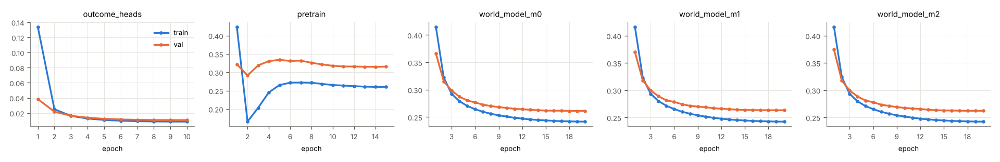
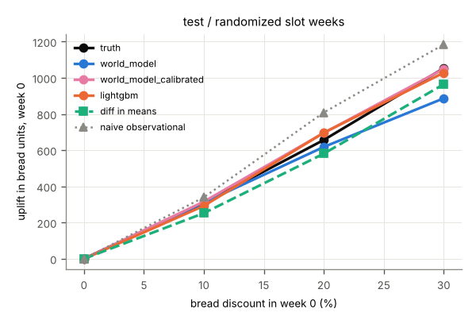
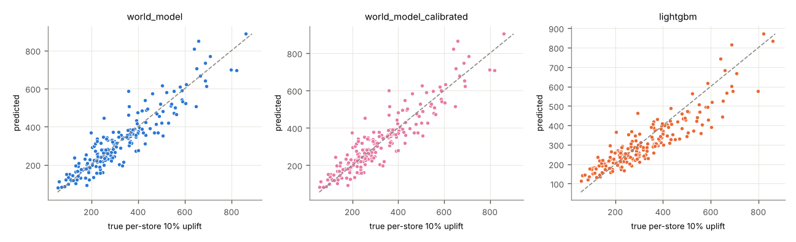
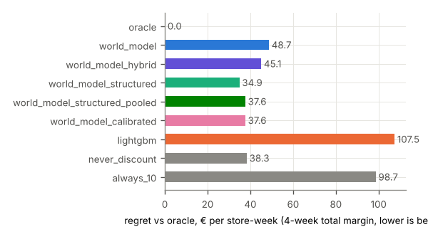
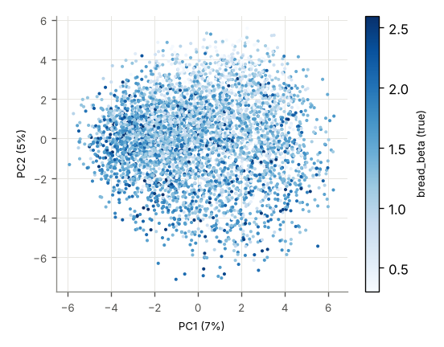

# Run report: poc_tiny

encoder `jepa` · world model `transformer` × 3 · target_drops_price True · censoring `tobit` · seed 0 · stores 200 · runtime 3,870 s

## Headline (test, all stores)

Lowest planning regret: **structured (hybrid + experimental pull-forward)** (34.9 € per store-week). world model 48.7, hybrid (WM bread + experimental cross effects) 45.1, structured (hybrid + experimental pull-forward) 34.9, structured, pooled cross-category slope 37.6, calibrated (structured, pooled slope, bread effects calibrated) 37.6, LightGBM 107, never discount 38.3, always 10% 98.7.

| model | WAPE bread h1 | WAPE margin 4w | ATE bias 20% (randomized) | CATE Spearman | action sensitivity | planning regret € | oracle match |
|---|---|---|---|---|---|---|---|
| world_model | 0.103 | 0.078 | -38.548 | 0.910 | 0.874 | 48.696 | 0.644 |
| world_model_hybrid | 0.103 | 0.078 | -38.548 | 0.910 | 0.874 | 45.081 | 0.577 |
| world_model_structured | 0.103 | 0.078 | -38.548 | 0.910 | 0.874 | 34.881 | 0.653 |
| world_model_structured_pooled | 0.103 | 0.078 | -38.548 | 0.910 | 0.874 | 37.634 | 0.680 |
| world_model_calibrated | 0.103 | 0.078 | 38.886 | 0.910 | 1.034 | 37.634 | 0.680 |
| lightgbm | 0.081 | 0.079 | 39.672 | 0.899 | 0.953 | 107 | 0.492 |

## val

### val / all (4600 windows)

**Forecast** (WAPE of bread units per horizon step; 4-week total margin)

| model | h1 | h2 | h3 | h4 | margin WAPE | margin MAE € |
|---|---|---|---|---|---|---|
| world_model | 0.110 | 0.109 | 0.111 | 0.113 | 0.079 | 2,751 |
| world_model_hybrid | 0.110 | 0.109 | 0.111 | 0.113 | 0.079 | 2,751 |
| world_model_structured | 0.110 | 0.109 | 0.111 | 0.113 | 0.079 | 2,751 |
| world_model_structured_pooled | 0.110 | 0.109 | 0.111 | 0.113 | 0.079 | 2,751 |
| world_model_calibrated | 0.110 | 0.109 | 0.111 | 0.113 | 0.079 | 2,751 |
| lightgbm | 0.087 | 0.089 | 0.090 | 0.092 | 0.080 | 2,781 |
| world_model_heads_on_real_embeddings | 0.055 | 0.054 | 0.054 | 0.055 | – | – |

**Effect recovery** (bread units in week 0, action [d,0,0,0], vs ground-truth counterfactuals)

| level | true | world_model pred | world_model_hybrid pred | world_model_structured pred | world_model_structured_pooled pred | world_model_calibrated pred | lightgbm pred | world_model bias | world_model_hybrid bias | world_model_structured bias | world_model_structured_pooled bias | world_model_calibrated bias | lightgbm bias | world_model RMSE | world_model_hybrid RMSE | world_model_structured RMSE | world_model_structured_pooled RMSE | world_model_calibrated RMSE | lightgbm RMSE | diff in means | naive obs. | true Δ margin 4w | world_model Δ margin 4w | world_model_hybrid Δ margin 4w | world_model_structured Δ margin 4w | world_model_structured_pooled Δ margin 4w | world_model_calibrated Δ margin 4w | lightgbm Δ margin 4w |
|---|---|---|---|---|---|---|---|---|---|---|---|---|---|---|---|---|---|---|---|---|---|---|---|---|---|---|---|---|
| 10% | 316 | 282 | 282 | 282 | 282 | 287 | 306 | -33.660 | -33.660 | -33.660 | -33.660 | -28.647 | -9.134 | 108 | 108 | 108 | 108 | 108 | 116 | 135 | – | -57.903 | -335 | -21.806 | -57.174 | -178 | -178 | -87.143 |
| 20% | 676 | 615 | 615 | 615 | 615 | 692 | 717 | -61.379 | -61.379 | -61.379 | -61.379 | 15.653 | 40.100 | 216 | 216 | 216 | 216 | 223 | 238 | 645 | – | -215 | -587 | -285 | -243 | -428 | -451 | -91.172 |
| 30% | 1,085 | 948 | 948 | 948 | 948 | 1,122 | 1,009 | -136 | -136 | -136 | -136 | 37.607 | -75.646 | 362 | 362 | 362 | 362 | 369 | 347 | 926 | – | -498 | -947 | -939 | -816 | -792 | -829 | -184 |

**Margin effect split** (Δ 4-week margin vs 0 %, € per store-week: bread vs all other categories)

| level | model | bread pred | bread true | other pred | other true | total pred | total true |
|---|---|---|---|---|---|---|---|
| 10% | world_model | -217 | -223 | -118 | 165 | -335 | -57.903 |
| 10% | world_model_hybrid | -217 | -223 | 195 | 165 | -21.806 | -57.903 |
| 10% | world_model_structured | -252 | -223 | 195 | 165 | -57.174 | -57.903 |
| 10% | world_model_structured_pooled | -252 | -223 | 74.352 | 165 | -178 | -57.903 |
| 10% | world_model_calibrated | -253 | -223 | 74.352 | 165 | -178 | -57.903 |
| 20% | world_model | -619 | -553 | 31.916 | 338 | -587 | -215 |
| 20% | world_model_hybrid | -619 | -553 | 334 | 338 | -285 | -215 |
| 20% | world_model_structured | -577 | -553 | 334 | 338 | -243 | -215 |
| 20% | world_model_structured_pooled | -577 | -553 | 149 | 338 | -428 | -215 |
| 20% | world_model_calibrated | -600 | -553 | 149 | 338 | -451 | -215 |
| 30% | world_model | -1,139 | -1,017 | 191 | 519 | -947 | -498 |
| 30% | world_model_hybrid | -1,139 | -1,017 | 200 | 519 | -939 | -498 |
| 30% | world_model_structured | -1,015 | -1,017 | 200 | 519 | -816 | -498 |
| 30% | world_model_structured_pooled | -1,015 | -1,017 | 224 | 519 | -792 | -498 |
| 30% | world_model_calibrated | -1,053 | -1,017 | 224 | 519 | -829 | -498 |

**Heterogeneity and action sensitivity**

| model | Spearman vs true per-store uplift | Spearman vs bread_beta | sensitivity ratio | ignores action |
|---|---|---|---|---|
| world_model | 0.921 | 0.589 | 0.874 | no |
| world_model_hybrid | 0.921 | 0.589 | 0.874 | no |
| world_model_structured | 0.921 | 0.589 | 0.874 | no |
| world_model_structured_pooled | 0.921 | 0.589 | 0.874 | no |
| world_model_calibrated | 0.921 | 0.589 | 1.035 | no |
| lightgbm | 0.896 | 0.453 | 0.930 | no |
(true per-store uplift vs bread_beta: Spearman 0.722)

**Planning** (true 4-week total margin of the chosen level, € per store-week)

| policy | value € | regret € | oracle match | levels chosen |
|---|---|---|---|---|
| oracle | 34,848 | 0.000 | 1.000 |  |
| never discount | 34,810 | 37.661 | 0.668 |  |
| always 10% | 34,752 | 95.564 | 0.217 |  |
| world_model | 34,801 | 46.900 | 0.651 | 0% 92%, 10% 3%, 20% 3%, 30% 2% |
| world_model_hybrid | 34,809 | 39.231 | 0.627 | 0% 78%, 10% 21%, 20% 2%, 30% 0% |
| world_model_structured | 34,816 | 31.660 | 0.674 | 0% 88%, 10% 12%, 20% 0%, 30% 0% |
| world_model_structured_pooled | 34,811 | 36.871 | 0.669 | 0% 100%, 10% 0%, 20% 0%, 30% 0% |
| world_model_calibrated | 34,811 | 36.858 | 0.669 | 0% 99%, 10% 1%, 20% 0%, 30% 0% |
| lightgbm | 34,782 | 66.126 | 0.560 | 0% 73%, 10% 18%, 20% 5%, 30% 4% |
true best level shares: 0% 67%, 10% 22%, 20% 11%, 30% 1%

**Censoring** (WAPE bread h1)

| model | censored weeks | uncensored weeks | share censored |
|---|---|---|---|
| world_model | 0.107 | 0.111 | 0.189 |
| world_model_hybrid | 0.107 | 0.111 | 0.189 |
| world_model_structured | 0.107 | 0.111 | 0.189 |
| world_model_structured_pooled | 0.107 | 0.111 | 0.189 |
| world_model_calibrated | 0.107 | 0.111 | 0.189 |
| lightgbm | 0.088 | 0.087 | 0.189 |

### val / randomized (578 windows)

**Forecast** (WAPE of bread units per horizon step; 4-week total margin)

| model | h1 | h2 | h3 | h4 | margin WAPE | margin MAE € |
|---|---|---|---|---|---|---|
| world_model | 0.108 | 0.104 | 0.099 | 0.111 | 0.073 | 2,536 |
| world_model_hybrid | 0.108 | 0.104 | 0.099 | 0.111 | 0.073 | 2,536 |
| world_model_structured | 0.108 | 0.104 | 0.099 | 0.111 | 0.073 | 2,536 |
| world_model_structured_pooled | 0.108 | 0.104 | 0.099 | 0.111 | 0.073 | 2,536 |
| world_model_calibrated | 0.108 | 0.104 | 0.099 | 0.111 | 0.073 | 2,536 |
| lightgbm | 0.090 | 0.095 | 0.087 | 0.097 | 0.081 | 2,811 |
| world_model_heads_on_real_embeddings | 0.055 | 0.053 | 0.052 | 0.055 | – | – |

**Effect recovery** (bread units in week 0, action [d,0,0,0], vs ground-truth counterfactuals)

| level | true | world_model pred | world_model_hybrid pred | world_model_structured pred | world_model_structured_pooled pred | world_model_calibrated pred | lightgbm pred | world_model bias | world_model_hybrid bias | world_model_structured bias | world_model_structured_pooled bias | world_model_calibrated bias | lightgbm bias | world_model RMSE | world_model_hybrid RMSE | world_model_structured RMSE | world_model_structured_pooled RMSE | world_model_calibrated RMSE | lightgbm RMSE | diff in means | naive obs. | true Δ margin 4w | world_model Δ margin 4w | world_model_hybrid Δ margin 4w | world_model_structured Δ margin 4w | world_model_structured_pooled Δ margin 4w | world_model_calibrated Δ margin 4w | lightgbm Δ margin 4w |
|---|---|---|---|---|---|---|---|---|---|---|---|---|---|---|---|---|---|---|---|---|---|---|---|---|---|---|---|---|
| 10% | 303 | 259 | 259 | 259 | 259 | 263 | 283 | -43.962 | -43.962 | -43.962 | -43.962 | -39.361 | -19.224 | 99.348 | 99.348 | 99.348 | 99.348 | 98.285 | 89.291 | 135 | – | -73.699 | -399 | -65.521 | -65.633 | -185 | -186 | -109 |
| 20% | 649 | 563 | 563 | 563 | 563 | 633 | 667 | -86.061 | -86.061 | -86.061 | -86.061 | -15.592 | 18.661 | 196 | 196 | 196 | 196 | 188 | 164 | 645 | – | -243 | -685 | -345 | -254 | -438 | -462 | -113 |
| 30% | 1,039 | 856 | 856 | 856 | 856 | 1,013 | 957 | -183 | -183 | -183 | -183 | -26.385 | -82.398 | 346 | 346 | 346 | 346 | 313 | 285 | 926 | – | -532 | -1,050 | -984 | -813 | -790 | -828 | -203 |

**Margin effect split** (Δ 4-week margin vs 0 %, € per store-week: bread vs all other categories)

| level | model | bread pred | bread true | other pred | other true | total pred | total true |
|---|---|---|---|---|---|---|---|
| 10% | world_model | -258 | -231 | -140 | 158 | -399 | -73.699 |
| 10% | world_model_hybrid | -258 | -231 | 193 | 158 | -65.521 | -73.699 |
| 10% | world_model_structured | -258 | -231 | 193 | 158 | -65.633 | -73.699 |
| 10% | world_model_structured_pooled | -258 | -231 | 73.536 | 158 | -185 | -73.699 |
| 10% | world_model_calibrated | -259 | -231 | 73.536 | 158 | -186 | -73.699 |
| 20% | world_model | -675 | -566 | -9.868 | 323 | -685 | -243 |
| 20% | world_model_hybrid | -675 | -566 | 331 | 323 | -345 | -243 |
| 20% | world_model_structured | -585 | -566 | 331 | 323 | -254 | -243 |
| 20% | world_model_structured_pooled | -585 | -566 | 147 | 323 | -438 | -243 |
| 20% | world_model_calibrated | -609 | -566 | 147 | 323 | -462 | -243 |
| 30% | world_model | -1,181 | -1,029 | 132 | 497 | -1,050 | -532 |
| 30% | world_model_hybrid | -1,181 | -1,029 | 198 | 497 | -984 | -532 |
| 30% | world_model_structured | -1,011 | -1,029 | 198 | 497 | -813 | -532 |
| 30% | world_model_structured_pooled | -1,011 | -1,029 | 221 | 497 | -790 | -532 |
| 30% | world_model_calibrated | -1,049 | -1,029 | 221 | 497 | -828 | -532 |

**Heterogeneity and action sensitivity**

| model | Spearman vs true per-store uplift | Spearman vs bread_beta | sensitivity ratio | ignores action |
|---|---|---|---|---|
| world_model | 0.941 | 0.669 | 0.824 | no |
| world_model_hybrid | 0.941 | 0.669 | 0.824 | no |
| world_model_structured | 0.941 | 0.669 | 0.824 | no |
| world_model_structured_pooled | 0.941 | 0.669 | 0.824 | no |
| world_model_calibrated | 0.941 | 0.669 | 0.975 | no |
| lightgbm | 0.891 | 0.505 | 0.921 | no |
(true per-store uplift vs bread_beta: Spearman 0.739)

**Planning** (true 4-week total margin of the chosen level, € per store-week)

| policy | value € | regret € | oracle match | levels chosen |
|---|---|---|---|---|
| oracle | 34,856 | 0.000 | 1.000 |  |
| never discount | 34,828 | 27.554 | 0.758 |  |
| always 10% | 34,754 | 101 | 0.149 |  |
| world_model | 34,818 | 37.871 | 0.744 | 0% 97%, 10% 1%, 20% 1%, 30% 1% |
| world_model_hybrid | 34,824 | 31.915 | 0.708 | 0% 86%, 10% 13%, 20% 0%, 30% 0% |
| world_model_structured | 34,832 | 23.582 | 0.761 | 0% 91%, 10% 9%, 20% 0%, 30% 0% |
| world_model_structured_pooled | 34,828 | 27.554 | 0.758 | 0% 100%, 10% 0%, 20% 0%, 30% 0% |
| world_model_calibrated | 34,828 | 27.554 | 0.758 | 0% 100%, 10% 0%, 20% 0%, 30% 0% |
| lightgbm | 34,800 | 56.094 | 0.644 | 0% 80%, 10% 10%, 20% 4%, 30% 6% |
true best level shares: 0% 76%, 10% 15%, 20% 9%, 30% 0%

**Censoring** (WAPE bread h1)

| model | censored weeks | uncensored weeks | share censored |
|---|---|---|---|
| world_model | 0.118 | 0.105 | 0.227 |
| world_model_hybrid | 0.118 | 0.105 | 0.227 |
| world_model_structured | 0.118 | 0.105 | 0.227 |
| world_model_structured_pooled | 0.118 | 0.105 | 0.227 |
| world_model_calibrated | 0.118 | 0.105 | 0.227 |
| lightgbm | 0.100 | 0.087 | 0.227 |

### val / cold_start_stores (690 windows)

**Forecast** (WAPE of bread units per horizon step; 4-week total margin)

| model | h1 | h2 | h3 | h4 | margin WAPE | margin MAE € |
|---|---|---|---|---|---|---|
| world_model | 0.117 | 0.116 | 0.118 | 0.121 | 0.086 | 2,925 |
| world_model_hybrid | 0.117 | 0.116 | 0.118 | 0.121 | 0.086 | 2,925 |
| world_model_structured | 0.117 | 0.116 | 0.118 | 0.121 | 0.086 | 2,925 |
| world_model_structured_pooled | 0.117 | 0.116 | 0.118 | 0.121 | 0.086 | 2,925 |
| world_model_calibrated | 0.117 | 0.116 | 0.118 | 0.121 | 0.086 | 2,925 |
| lightgbm | 0.091 | 0.094 | 0.098 | 0.100 | 0.086 | 2,937 |
| world_model_heads_on_real_embeddings | 0.056 | 0.060 | 0.060 | 0.060 | – | – |

**Effect recovery** (bread units in week 0, action [d,0,0,0], vs ground-truth counterfactuals)

| level | true | world_model pred | world_model_hybrid pred | world_model_structured pred | world_model_structured_pooled pred | world_model_calibrated pred | lightgbm pred | world_model bias | world_model_hybrid bias | world_model_structured bias | world_model_structured_pooled bias | world_model_calibrated bias | lightgbm bias | world_model RMSE | world_model_hybrid RMSE | world_model_structured RMSE | world_model_structured_pooled RMSE | world_model_calibrated RMSE | lightgbm RMSE | diff in means | naive obs. | true Δ margin 4w | world_model Δ margin 4w | world_model_hybrid Δ margin 4w | world_model_structured Δ margin 4w | world_model_structured_pooled Δ margin 4w | world_model_calibrated Δ margin 4w | lightgbm Δ margin 4w |
|---|---|---|---|---|---|---|---|---|---|---|---|---|---|---|---|---|---|---|---|---|---|---|---|---|---|---|---|---|
| 10% | 282 | 263 | 263 | 263 | 263 | 268 | 290 | -19.043 | -19.043 | -19.043 | -19.043 | -14.367 | 7.902 | 105 | 105 | 105 | 105 | 106 | 120 | 122 | – | -94.959 | -307 | -23.768 | -57.294 | -178 | -178 | -91.980 |
| 20% | 603 | 577 | 577 | 577 | 577 | 649 | 673 | -26.329 | -26.329 | -26.329 | -26.329 | 45.925 | 69.256 | 219 | 219 | 219 | 219 | 245 | 263 | 510 | – | -279 | -501 | -271 | -243 | -428 | -453 | -95.221 |
| 30% | 966 | 879 | 879 | 879 | 879 | 1,040 | 944 | -87.307 | -87.307 | -87.307 | -87.307 | 73.870 | -22.375 | 375 | 375 | 375 | 375 | 420 | 388 | 809 | – | -575 | -769 | -903 | -813 | -789 | -829 | -179 |

**Margin effect split** (Δ 4-week margin vs 0 %, € per store-week: bread vs all other categories)

| level | model | bread pred | bread true | other pred | other true | total pred | total true |
|---|---|---|---|---|---|---|---|
| 10% | world_model | -218 | -226 | -88.684 | 131 | -307 | -94.959 |
| 10% | world_model_hybrid | -218 | -226 | 195 | 131 | -23.768 | -94.959 |
| 10% | world_model_structured | -252 | -226 | 195 | 131 | -57.294 | -94.959 |
| 10% | world_model_structured_pooled | -252 | -226 | 74.227 | 131 | -178 | -94.959 |
| 10% | world_model_calibrated | -253 | -226 | 74.227 | 131 | -178 | -94.959 |
| 20% | world_model | -605 | -550 | 104 | 271 | -501 | -279 |
| 20% | world_model_hybrid | -605 | -550 | 334 | 271 | -271 | -279 |
| 20% | world_model_structured | -577 | -550 | 334 | 271 | -243 | -279 |
| 20% | world_model_structured_pooled | -577 | -550 | 149 | 271 | -428 | -279 |
| 20% | world_model_calibrated | -602 | -550 | 149 | 271 | -453 | -279 |
| 30% | world_model | -1,103 | -994 | 334 | 419 | -769 | -575 |
| 30% | world_model_hybrid | -1,103 | -994 | 200 | 419 | -903 | -575 |
| 30% | world_model_structured | -1,012 | -994 | 200 | 419 | -813 | -575 |
| 30% | world_model_structured_pooled | -1,012 | -994 | 223 | 419 | -789 | -575 |
| 30% | world_model_calibrated | -1,052 | -994 | 223 | 419 | -829 | -575 |

**Heterogeneity and action sensitivity**

| model | Spearman vs true per-store uplift | Spearman vs bread_beta | sensitivity ratio | ignores action |
|---|---|---|---|---|
| world_model | 0.833 | 0.615 | 0.910 | no |
| world_model_hybrid | 0.833 | 0.615 | 0.910 | no |
| world_model_structured | 0.833 | 0.615 | 0.910 | no |
| world_model_structured_pooled | 0.833 | 0.615 | 0.910 | no |
| world_model_calibrated | 0.833 | 0.615 | 1.076 | no |
| lightgbm | 0.771 | 0.499 | 0.977 | no |
(true per-store uplift vs bread_beta: Spearman 0.875)

**Planning** (true 4-week total margin of the chosen level, € per store-week)

| policy | value € | regret € | oracle match | levels chosen |
|---|---|---|---|---|
| oracle | 34,205 | 0.000 | 1.000 |  |
| never discount | 34,184 | 20.474 | 0.745 |  |
| always 10% | 34,089 | 115 | 0.188 |  |
| world_model | 34,159 | 45.433 | 0.712 | 0% 92%, 10% 2%, 20% 3%, 30% 2% |
| world_model_hybrid | 34,168 | 36.272 | 0.675 | 0% 79%, 10% 19%, 20% 1%, 30% 0% |
| world_model_structured | 34,183 | 21.546 | 0.735 | 0% 86%, 10% 13%, 20% 0%, 30% 0% |
| world_model_structured_pooled | 34,184 | 20.303 | 0.748 | 0% 99%, 10% 1%, 20% 0%, 30% 0% |
| world_model_calibrated | 34,184 | 20.303 | 0.748 | 0% 99%, 10% 1%, 20% 0%, 30% 0% |
| lightgbm | 34,149 | 55.477 | 0.613 | 0% 77%, 10% 14%, 20% 5%, 30% 3% |
true best level shares: 0% 74%, 10% 19%, 20% 6%, 30% 0%

**Censoring** (WAPE bread h1)

| model | censored weeks | uncensored weeks | share censored |
|---|---|---|---|
| world_model | 0.106 | 0.120 | 0.174 |
| world_model_hybrid | 0.106 | 0.120 | 0.174 |
| world_model_structured | 0.106 | 0.120 | 0.174 |
| world_model_structured_pooled | 0.106 | 0.120 | 0.174 |
| world_model_calibrated | 0.106 | 0.120 | 0.174 |
| lightgbm | 0.086 | 0.092 | 0.174 |

### val / representation

Ridge probes on frozen z(t), out-of-fold R², folds grouped by store

| target | z(t) | calendar + store one-hot | calendar + static features |
|---|---|---|---|
| bread_beta | 0.615 | -0.005 | 0.542 |
| size_sqm | 0.959 | -0.005 | 1.000 |
| holiday | 0.733 | 1.000 | 1.000 |
| traffic_shock | 0.603 | -0.007 | -0.033 |

kNN (k=10) next-week bread units, WAPE: neighbours in z-space 0.212, neighbours on static features 0.224

## test

### test / all (4600 windows)

**Forecast** (WAPE of bread units per horizon step; 4-week total margin)

| model | h1 | h2 | h3 | h4 | margin WAPE | margin MAE € |
|---|---|---|---|---|---|---|
| world_model | 0.103 | 0.100 | 0.102 | 0.107 | 0.078 | 2,890 |
| world_model_hybrid | 0.103 | 0.100 | 0.102 | 0.107 | 0.078 | 2,890 |
| world_model_structured | 0.103 | 0.100 | 0.102 | 0.107 | 0.078 | 2,890 |
| world_model_structured_pooled | 0.103 | 0.100 | 0.102 | 0.107 | 0.078 | 2,890 |
| world_model_calibrated | 0.103 | 0.100 | 0.102 | 0.107 | 0.078 | 2,890 |
| lightgbm | 0.081 | 0.084 | 0.087 | 0.088 | 0.079 | 2,937 |
| world_model_heads_on_real_embeddings | 0.048 | 0.048 | 0.050 | 0.051 | – | – |

**Effect recovery** (bread units in week 0, action [d,0,0,0], vs ground-truth counterfactuals)

| level | true | world_model pred | world_model_hybrid pred | world_model_structured pred | world_model_structured_pooled pred | world_model_calibrated pred | lightgbm pred | world_model bias | world_model_hybrid bias | world_model_structured bias | world_model_structured_pooled bias | world_model_calibrated bias | lightgbm bias | world_model RMSE | world_model_hybrid RMSE | world_model_structured RMSE | world_model_structured_pooled RMSE | world_model_calibrated RMSE | lightgbm RMSE | diff in means | naive obs. | true Δ margin 4w | world_model Δ margin 4w | world_model_hybrid Δ margin 4w | world_model_structured Δ margin 4w | world_model_structured_pooled Δ margin 4w | world_model_calibrated Δ margin 4w | lightgbm Δ margin 4w |
|---|---|---|---|---|---|---|---|---|---|---|---|---|---|---|---|---|---|---|---|---|---|---|---|---|---|---|---|---|
| 10% | 322 | 323 | 323 | 323 | 323 | 328 | 309 | 0.243 | 0.243 | 0.243 | 0.243 | 5.982 | -13.412 | 102 | 102 | 102 | 102 | 103 | 100 | 252 | 340 | -60.351 | -248 | 24.884 | -35.283 | -168 | -168 | -71.053 |
| 20% | 690 | 659 | 659 | 659 | 659 | 741 | 726 | -31.520 | -31.520 | -31.520 | -31.520 | 50.946 | 35.763 | 208 | 208 | 208 | 208 | 228 | 199 | 581 | 809 | -227 | -546 | -295 | -238 | -441 | -465 | -77.769 |
| 30% | 1,105 | 966 | 966 | 966 | 966 | 1,143 | 1,053 | -139 | -139 | -139 | -139 | 38.029 | -51.847 | 362 | 362 | 362 | 362 | 365 | 309 | 965 | 1,184 | -523 | -972 | -1,026 | -855 | -829 | -869 | -148 |

**Margin effect split** (Δ 4-week margin vs 0 %, € per store-week: bread vs all other categories)

| level | model | bread pred | bread true | other pred | other true | total pred | total true |
|---|---|---|---|---|---|---|---|
| 10% | world_model | -189 | -237 | -58.890 | 177 | -248 | -60.351 |
| 10% | world_model_hybrid | -189 | -237 | 214 | 177 | 24.884 | -60.351 |
| 10% | world_model_structured | -249 | -237 | 214 | 177 | -35.283 | -60.351 |
| 10% | world_model_structured_pooled | -249 | -237 | 81.702 | 177 | -168 | -60.351 |
| 10% | world_model_calibrated | -250 | -237 | 81.702 | 177 | -168 | -60.351 |
| 20% | world_model | -662 | -588 | 116 | 361 | -546 | -227 |
| 20% | world_model_hybrid | -662 | -588 | 367 | 361 | -295 | -227 |
| 20% | world_model_structured | -605 | -588 | 367 | 361 | -238 | -227 |
| 20% | world_model_structured_pooled | -605 | -588 | 164 | 361 | -441 | -227 |
| 20% | world_model_calibrated | -628 | -588 | 164 | 361 | -465 | -227 |
| 30% | world_model | -1,245 | -1,078 | 274 | 555 | -972 | -523 |
| 30% | world_model_hybrid | -1,245 | -1,078 | 220 | 555 | -1,026 | -523 |
| 30% | world_model_structured | -1,075 | -1,078 | 220 | 555 | -855 | -523 |
| 30% | world_model_structured_pooled | -1,075 | -1,078 | 246 | 555 | -829 | -523 |
| 30% | world_model_calibrated | -1,115 | -1,078 | 246 | 555 | -869 | -523 |

**Heterogeneity and action sensitivity**

| model | Spearman vs true per-store uplift | Spearman vs bread_beta | sensitivity ratio | ignores action |
|---|---|---|---|---|
| world_model | 0.910 | 0.580 | 0.874 | no |
| world_model_hybrid | 0.910 | 0.580 | 0.874 | no |
| world_model_structured | 0.910 | 0.580 | 0.874 | no |
| world_model_structured_pooled | 0.910 | 0.580 | 0.874 | no |
| world_model_calibrated | 0.910 | 0.580 | 1.034 | no |
| lightgbm | 0.899 | 0.474 | 0.953 | no |
(true per-store uplift vs bread_beta: Spearman 0.723)

**Planning** (true 4-week total margin of the chosen level, € per store-week)

| policy | value € | regret € | oracle match | levels chosen |
|---|---|---|---|---|
| oracle | 37,245 | 0.000 | 1.000 |  |
| never discount | 37,207 | 38.324 | 0.678 |  |
| always 10% | 37,146 | 98.674 | 0.217 |  |
| world_model | 37,196 | 48.696 | 0.644 | 0% 91%, 10% 4%, 20% 3%, 30% 2% |
| world_model_hybrid | 37,200 | 45.081 | 0.577 | 0% 71%, 10% 29%, 20% 0%, 30% 0% |
| world_model_structured | 37,210 | 34.881 | 0.653 | 0% 82%, 10% 18%, 20% 0%, 30% 0% |
| world_model_structured_pooled | 37,207 | 37.634 | 0.680 | 0% 100%, 10% 0%, 20% 0%, 30% 0% |
| world_model_calibrated | 37,207 | 37.634 | 0.680 | 0% 100%, 10% 0%, 20% 0%, 30% 0% |
| lightgbm | 37,138 | 107 | 0.492 | 0% 62%, 10% 25%, 20% 2%, 30% 11% |
true best level shares: 0% 68%, 10% 22%, 20% 10%, 30% 1%

**Censoring** (WAPE bread h1)

| model | censored weeks | uncensored weeks | share censored |
|---|---|---|---|
| world_model | 0.101 | 0.103 | 0.193 |
| world_model_hybrid | 0.101 | 0.103 | 0.193 |
| world_model_structured | 0.101 | 0.103 | 0.193 |
| world_model_structured_pooled | 0.101 | 0.103 | 0.193 |
| world_model_calibrated | 0.101 | 0.103 | 0.193 |
| lightgbm | 0.078 | 0.081 | 0.193 |

### test / randomized (717 windows)

**Forecast** (WAPE of bread units per horizon step; 4-week total margin)

| model | h1 | h2 | h3 | h4 | margin WAPE | margin MAE € |
|---|---|---|---|---|---|---|
| world_model | 0.098 | 0.102 | 0.093 | 0.103 | 0.078 | 2,822 |
| world_model_hybrid | 0.098 | 0.102 | 0.093 | 0.103 | 0.078 | 2,822 |
| world_model_structured | 0.098 | 0.102 | 0.093 | 0.103 | 0.078 | 2,822 |
| world_model_structured_pooled | 0.098 | 0.102 | 0.093 | 0.103 | 0.078 | 2,822 |
| world_model_calibrated | 0.098 | 0.102 | 0.093 | 0.103 | 0.078 | 2,822 |
| lightgbm | 0.082 | 0.088 | 0.080 | 0.088 | 0.077 | 2,794 |
| world_model_heads_on_real_embeddings | 0.049 | 0.047 | 0.046 | 0.049 | – | – |

**Effect recovery** (bread units in week 0, action [d,0,0,0], vs ground-truth counterfactuals)

| level | true | world_model pred | world_model_hybrid pred | world_model_structured pred | world_model_structured_pooled pred | world_model_calibrated pred | lightgbm pred | world_model bias | world_model_hybrid bias | world_model_structured bias | world_model_structured_pooled bias | world_model_calibrated bias | lightgbm bias | world_model RMSE | world_model_hybrid RMSE | world_model_structured RMSE | world_model_structured_pooled RMSE | world_model_calibrated RMSE | lightgbm RMSE | diff in means | naive obs. | true Δ margin 4w | world_model Δ margin 4w | world_model_hybrid Δ margin 4w | world_model_structured Δ margin 4w | world_model_structured_pooled Δ margin 4w | world_model_calibrated Δ margin 4w | lightgbm Δ margin 4w |
|---|---|---|---|---|---|---|---|---|---|---|---|---|---|---|---|---|---|---|---|---|---|---|---|---|---|---|---|---|
| 10% | 308 | 310 | 310 | 310 | 310 | 316 | 293 | 2.274 | 2.274 | 2.274 | 2.274 | 7.795 | -15.471 | 87.176 | 87.176 | 87.176 | 87.176 | 89.063 | 84.994 | 252 | 340 | -79.780 | -270 | -3.448 | -43.447 | -173 | -173 | -65.709 |
| 20% | 657 | 618 | 618 | 618 | 618 | 696 | 697 | -38.548 | -38.548 | -38.548 | -38.548 | 38.886 | 39.672 | 175 | 175 | 175 | 175 | 190 | 163 | 581 | 809 | -264 | -597 | -349 | -256 | -455 | -481 | -73.713 |
| 30% | 1,053 | 887 | 887 | 887 | 887 | 1,049 | 1,028 | -166 | -166 | -166 | -166 | -3.559 | -24.575 | 327 | 327 | 327 | 327 | 299 | 248 | 965 | 1,184 | -569 | -1,006 | -1,072 | -864 | -839 | -881 | -146 |

**Margin effect split** (Δ 4-week margin vs 0 %, € per store-week: bread vs all other categories)

| level | model | bread pred | bread true | other pred | other true | total pred | total true |
|---|---|---|---|---|---|---|---|
| 10% | world_model | -213 | -245 | -56.483 | 165 | -270 | -79.780 |
| 10% | world_model_hybrid | -213 | -245 | 210 | 165 | -3.448 | -79.780 |
| 10% | world_model_structured | -253 | -245 | 210 | 165 | -43.447 | -79.780 |
| 10% | world_model_structured_pooled | -253 | -245 | 80.009 | 165 | -173 | -79.780 |
| 10% | world_model_calibrated | -253 | -245 | 80.009 | 165 | -173 | -79.780 |
| 20% | world_model | -709 | -602 | 112 | 339 | -597 | -264 |
| 20% | world_model_hybrid | -709 | -602 | 360 | 339 | -349 | -264 |
| 20% | world_model_structured | -616 | -602 | 360 | 339 | -256 | -264 |
| 20% | world_model_structured_pooled | -616 | -602 | 160 | 339 | -455 | -264 |
| 20% | world_model_calibrated | -641 | -602 | 160 | 339 | -481 | -264 |
| 30% | world_model | -1,287 | -1,090 | 281 | 521 | -1,006 | -569 |
| 30% | world_model_hybrid | -1,287 | -1,090 | 215 | 521 | -1,072 | -569 |
| 30% | world_model_structured | -1,079 | -1,090 | 215 | 521 | -864 | -569 |
| 30% | world_model_structured_pooled | -1,079 | -1,090 | 241 | 521 | -839 | -569 |
| 30% | world_model_calibrated | -1,121 | -1,090 | 241 | 521 | -881 | -569 |

**Heterogeneity and action sensitivity**

| model | Spearman vs true per-store uplift | Spearman vs bread_beta | sensitivity ratio | ignores action |
|---|---|---|---|---|
| world_model | 0.925 | 0.660 | 0.842 | no |
| world_model_hybrid | 0.925 | 0.660 | 0.842 | no |
| world_model_structured | 0.925 | 0.660 | 0.842 | no |
| world_model_structured_pooled | 0.925 | 0.660 | 0.842 | no |
| world_model_calibrated | 0.925 | 0.660 | 0.997 | no |
| lightgbm | 0.914 | 0.549 | 0.977 | no |
(true per-store uplift vs bread_beta: Spearman 0.735)

**Planning** (true 4-week total margin of the chosen level, € per store-week)

| policy | value € | regret € | oracle match | levels chosen |
|---|---|---|---|---|
| oracle | 36,287 | 0.000 | 1.000 |  |
| never discount | 36,257 | 29.338 | 0.764 |  |
| always 10% | 36,178 | 109 | 0.165 |  |
| world_model | 36,247 | 39.363 | 0.731 | 0% 95%, 10% 2%, 20% 1%, 30% 2% |
| world_model_hybrid | 36,247 | 39.145 | 0.656 | 0% 77%, 10% 23%, 20% 0%, 30% 0% |
| world_model_structured | 36,259 | 28.040 | 0.738 | 0% 84%, 10% 16%, 20% 0%, 30% 0% |
| world_model_structured_pooled | 36,257 | 29.338 | 0.764 | 0% 100%, 10% 0%, 20% 0%, 30% 0% |
| world_model_calibrated | 36,257 | 29.338 | 0.764 | 0% 100%, 10% 0%, 20% 0%, 30% 0% |
| lightgbm | 36,171 | 115 | 0.497 | 0% 60%, 10% 25%, 20% 2%, 30% 14% |
true best level shares: 0% 76%, 10% 16%, 20% 6%, 30% 1%

**Censoring** (WAPE bread h1)

| model | censored weeks | uncensored weeks | share censored |
|---|---|---|---|
| world_model | 0.097 | 0.099 | 0.252 |
| world_model_hybrid | 0.097 | 0.099 | 0.252 |
| world_model_structured | 0.097 | 0.099 | 0.252 |
| world_model_structured_pooled | 0.097 | 0.099 | 0.252 |
| world_model_calibrated | 0.097 | 0.099 | 0.252 |
| lightgbm | 0.076 | 0.084 | 0.252 |

### test / cold_start_stores (690 windows)

**Forecast** (WAPE of bread units per horizon step; 4-week total margin)

| model | h1 | h2 | h3 | h4 | margin WAPE | margin MAE € |
|---|---|---|---|---|---|---|
| world_model | 0.107 | 0.105 | 0.107 | 0.109 | 0.080 | 2,954 |
| world_model_hybrid | 0.107 | 0.105 | 0.107 | 0.109 | 0.080 | 2,954 |
| world_model_structured | 0.107 | 0.105 | 0.107 | 0.109 | 0.080 | 2,954 |
| world_model_structured_pooled | 0.107 | 0.105 | 0.107 | 0.109 | 0.080 | 2,954 |
| world_model_calibrated | 0.107 | 0.105 | 0.107 | 0.109 | 0.080 | 2,954 |
| lightgbm | 0.082 | 0.088 | 0.088 | 0.092 | 0.081 | 3,008 |
| world_model_heads_on_real_embeddings | 0.050 | 0.051 | 0.054 | 0.055 | – | – |

**Effect recovery** (bread units in week 0, action [d,0,0,0], vs ground-truth counterfactuals)

| level | true | world_model pred | world_model_hybrid pred | world_model_structured pred | world_model_structured_pooled pred | world_model_calibrated pred | lightgbm pred | world_model bias | world_model_hybrid bias | world_model_structured bias | world_model_structured_pooled bias | world_model_calibrated bias | lightgbm bias | world_model RMSE | world_model_hybrid RMSE | world_model_structured RMSE | world_model_structured_pooled RMSE | world_model_calibrated RMSE | lightgbm RMSE | diff in means | naive obs. | true Δ margin 4w | world_model Δ margin 4w | world_model_hybrid Δ margin 4w | world_model_structured Δ margin 4w | world_model_structured_pooled Δ margin 4w | world_model_calibrated Δ margin 4w | lightgbm Δ margin 4w |
|---|---|---|---|---|---|---|---|---|---|---|---|---|---|---|---|---|---|---|---|---|---|---|---|---|---|---|---|---|
| 10% | 288 | 295 | 295 | 295 | 295 | 301 | 293 | 7.223 | 7.223 | 7.223 | 7.223 | 12.476 | 4.746 | 106 | 106 | 106 | 106 | 108 | 104 | 115 | – | -96.661 | -247 | 12.692 | -39.053 | -172 | -172 | -65.478 |
| 20% | 614 | 603 | 603 | 603 | 603 | 678 | 679 | -11.164 | -11.164 | -11.164 | -11.164 | 64.291 | 65.025 | 223 | 223 | 223 | 223 | 253 | 230 | 309 | – | -294 | -497 | -293 | -243 | -448 | -474 | -70.106 |
| 30% | 979 | 875 | 875 | 875 | 875 | 1,036 | 979 | -104 | -104 | -104 | -104 | 57.033 | 0.161 | 380 | 380 | 380 | 380 | 410 | 350 | 774 | – | -610 | -833 | -1,000 | -857 | -831 | -874 | -131 |

**Margin effect split** (Δ 4-week margin vs 0 %, € per store-week: bread vs all other categories)

| level | model | bread pred | bread true | other pred | other true | total pred | total true |
|---|---|---|---|---|---|---|---|
| 10% | world_model | -202 | -240 | -44.581 | 144 | -247 | -96.661 |
| 10% | world_model_hybrid | -202 | -240 | 215 | 144 | 12.692 | -96.661 |
| 10% | world_model_structured | -254 | -240 | 215 | 144 | -39.053 | -96.661 |
| 10% | world_model_structured_pooled | -254 | -240 | 81.971 | 144 | -172 | -96.661 |
| 10% | world_model_calibrated | -254 | -240 | 81.971 | 144 | -172 | -96.661 |
| 20% | world_model | -662 | -589 | 165 | 296 | -497 | -294 |
| 20% | world_model_hybrid | -662 | -589 | 368 | 296 | -293 | -294 |
| 20% | world_model_structured | -612 | -589 | 368 | 296 | -243 | -294 |
| 20% | world_model_structured_pooled | -612 | -589 | 164 | 296 | -448 | -294 |
| 20% | world_model_calibrated | -638 | -589 | 164 | 296 | -474 | -294 |
| 30% | world_model | -1,220 | -1,067 | 387 | 457 | -833 | -610 |
| 30% | world_model_hybrid | -1,220 | -1,067 | 220 | 457 | -1,000 | -610 |
| 30% | world_model_structured | -1,077 | -1,067 | 220 | 457 | -857 | -610 |
| 30% | world_model_structured_pooled | -1,077 | -1,067 | 247 | 457 | -831 | -610 |
| 30% | world_model_calibrated | -1,121 | -1,067 | 247 | 457 | -874 | -610 |

**Heterogeneity and action sensitivity**

| model | Spearman vs true per-store uplift | Spearman vs bread_beta | sensitivity ratio | ignores action |
|---|---|---|---|---|
| world_model | 0.804 | 0.634 | 0.894 | no |
| world_model_hybrid | 0.804 | 0.634 | 0.894 | no |
| world_model_structured | 0.804 | 0.634 | 0.894 | no |
| world_model_structured_pooled | 0.804 | 0.634 | 0.894 | no |
| world_model_calibrated | 0.804 | 0.634 | 1.058 | no |
| lightgbm | 0.819 | 0.610 | 1.000 | no |
(true per-store uplift vs bread_beta: Spearman 0.900)

**Planning** (true 4-week total margin of the chosen level, € per store-week)

| policy | value € | regret € | oracle match | levels chosen |
|---|---|---|---|---|
| oracle | 37,239 | 0.000 | 1.000 |  |
| never discount | 37,215 | 24.664 | 0.749 |  |
| always 10% | 37,118 | 121 | 0.190 |  |
| world_model | 37,198 | 41.801 | 0.704 | 0% 93%, 10% 3%, 20% 3%, 30% 1% |
| world_model_hybrid | 37,187 | 51.907 | 0.593 | 0% 73%, 10% 27%, 20% 0%, 30% 0% |
| world_model_structured | 37,206 | 33.531 | 0.664 | 0% 82%, 10% 18%, 20% 0%, 30% 0% |
| world_model_structured_pooled | 37,216 | 22.894 | 0.755 | 0% 99%, 10% 1%, 20% 0%, 30% 0% |
| world_model_calibrated | 37,216 | 22.894 | 0.755 | 0% 99%, 10% 1%, 20% 0%, 30% 0% |
| lightgbm | 37,124 | 115 | 0.509 | 0% 64%, 10% 22%, 20% 3%, 30% 12% |
true best level shares: 0% 75%, 10% 19%, 20% 6%, 30% 0%

**Censoring** (WAPE bread h1)

| model | censored weeks | uncensored weeks | share censored |
|---|---|---|---|
| world_model | 0.106 | 0.108 | 0.186 |
| world_model_hybrid | 0.106 | 0.108 | 0.186 |
| world_model_structured | 0.106 | 0.108 | 0.186 |
| world_model_structured_pooled | 0.106 | 0.108 | 0.186 |
| world_model_calibrated | 0.106 | 0.108 | 0.186 |
| lightgbm | 0.080 | 0.083 | 0.186 |

### test / representation

Ridge probes on frozen z(t), out-of-fold R², folds grouped by store

| target | z(t) | calendar + store one-hot | calendar + static features |
|---|---|---|---|
| bread_beta | 0.585 | -0.005 | 0.542 |
| size_sqm | 0.965 | -0.005 | 1.000 |
| holiday | – | – | – |
| traffic_shock | 0.657 | -0.003 | -0.021 |

kNN (k=10) next-week bread units, WAPE: neighbours in z-space 0.171, neighbours on static features 0.187

## Plots

**Training curves**

**Uplift vs truth (test, randomized slot weeks)**

**Per-store 10% uplift, predicted vs true (test)**

**Planning regret (test, all)**

**Embedding PCA coloured by bread_beta (test)**

