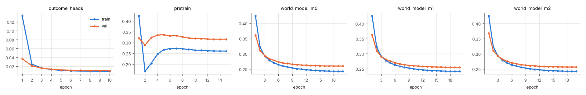
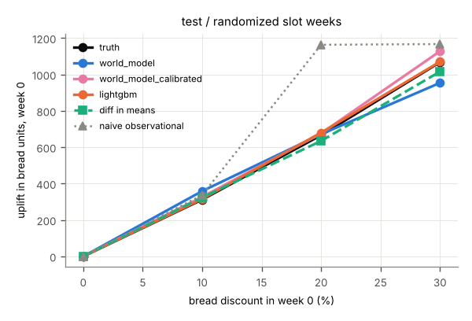
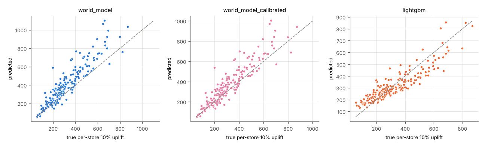
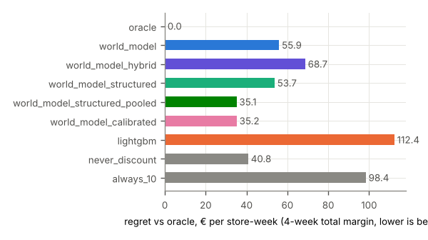
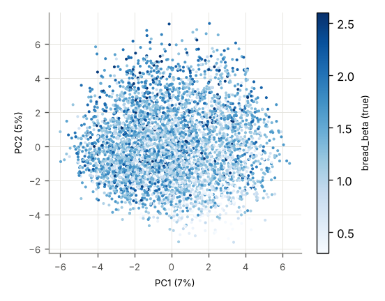

# Run report: poc_tiny_rich_s0

encoder `jepa` · world model `transformer` × 3 · target_drops_price True · censoring `tobit` · seed 0 · stores 200 · runtime 11,040 s

## Headline (test, all stores)

Lowest planning regret: **structured, pooled cross-category slope** (35.1 € per store-week). world model 55.9, hybrid (WM bread + experimental cross effects) 68.7, structured (hybrid + experimental pull-forward) 53.7, structured, pooled cross-category slope 35.1, calibrated (structured, pooled slope, bread effects calibrated) 35.2, LightGBM 112, never discount 40.8, always 10% 98.4.

| model | WAPE bread h1 | WAPE margin 4w | ATE bias 20% (randomized) | CATE Spearman | action sensitivity | planning regret € | oracle match |
|---|---|---|---|---|---|---|---|
| world_model | 0.105 | 0.075 | 5.168 | 0.918 | 0.941 | 55.939 | 0.533 |
| world_model_hybrid | 0.105 | 0.075 | 5.168 | 0.918 | 0.941 | 68.746 | 0.397 |
| world_model_structured | 0.105 | 0.075 | 5.168 | 0.918 | 0.941 | 53.735 | 0.481 |
| world_model_structured_pooled | 0.105 | 0.075 | 5.168 | 0.918 | 0.941 | 35.141 | 0.662 |
| world_model_calibrated | 0.105 | 0.075 | 9.646 | 0.918 | 1.113 | 35.214 | 0.668 |
| lightgbm | 0.082 | 0.078 | 13.587 | 0.894 | 0.951 | 112 | 0.531 |

## val

### val / all (4600 windows)

**Forecast** (WAPE of bread units per horizon step; 4-week total margin)

| model | h1 | h2 | h3 | h4 | margin WAPE | margin MAE € |
|---|---|---|---|---|---|---|
| world_model | 0.107 | 0.108 | 0.109 | 0.110 | 0.079 | 2,756 |
| world_model_hybrid | 0.107 | 0.108 | 0.109 | 0.110 | 0.079 | 2,756 |
| world_model_structured | 0.107 | 0.108 | 0.109 | 0.110 | 0.079 | 2,756 |
| world_model_structured_pooled | 0.107 | 0.108 | 0.109 | 0.110 | 0.079 | 2,756 |
| world_model_calibrated | 0.107 | 0.108 | 0.109 | 0.110 | 0.079 | 2,756 |
| lightgbm | 0.085 | 0.086 | 0.087 | 0.089 | 0.079 | 2,729 |
| world_model_heads_on_real_embeddings | 0.053 | 0.052 | 0.053 | 0.054 | – | – |

**Effect recovery** (bread units in week 0, action [d,0,0,0], vs ground-truth counterfactuals)

| level | true | world_model pred | world_model_hybrid pred | world_model_structured pred | world_model_structured_pooled pred | world_model_calibrated pred | lightgbm pred | world_model bias | world_model_hybrid bias | world_model_structured bias | world_model_structured_pooled bias | world_model_calibrated bias | lightgbm bias | world_model RMSE | world_model_hybrid RMSE | world_model_structured RMSE | world_model_structured_pooled RMSE | world_model_calibrated RMSE | lightgbm RMSE | diff in means | naive obs. | true Δ margin 4w | world_model Δ margin 4w | world_model_hybrid Δ margin 4w | world_model_structured Δ margin 4w | world_model_structured_pooled Δ margin 4w | world_model_calibrated Δ margin 4w | lightgbm Δ margin 4w |
|---|---|---|---|---|---|---|---|---|---|---|---|---|---|---|---|---|---|---|---|---|---|---|---|---|---|---|---|---|
| 10% | 315 | 388 | 388 | 388 | 388 | 354 | 318 | 72.952 | 72.952 | 72.952 | 72.952 | 38.386 | 3.283 | 161 | 161 | 161 | 161 | 134 | 114 | 232 | – | -58.776 | 224 | 198 | 55.718 | -56.615 | -76.095 | -1.827 |
| 20% | 675 | 712 | 712 | 712 | 712 | 717 | 681 | 37.465 | 37.465 | 37.465 | 37.465 | 42.216 | 5.704 | 239 | 239 | 239 | 239 | 241 | 225 | 696 | – | -218 | -145 | -243 | -309 | -266 | -288 | -77.896 |
| 30% | 1,083 | 1,019 | 1,019 | 1,019 | 1,019 | 1,204 | 1,041 | -64.119 | -64.119 | -64.119 | -64.119 | 122 | -41.467 | 356 | 356 | 356 | 356 | 413 | 330 | 989 | – | -501 | -646 | -539 | -525 | -578 | -599 | -210 |

**Margin effect split** (Δ 4-week margin vs 0 %, € per store-week: bread vs all other categories)

| level | model | bread pred | bread true | other pred | other true | total pred | total true |
|---|---|---|---|---|---|---|---|
| 10% | world_model | -43.581 | -224 | 268 | 165 | 224 | -58.776 |
| 10% | world_model_hybrid | -43.581 | -224 | 242 | 165 | 198 | -58.776 |
| 10% | world_model_structured | -186 | -224 | 242 | 165 | 55.718 | -58.776 |
| 10% | world_model_structured_pooled | -186 | -224 | 130 | 165 | -56.615 | -58.776 |
| 10% | world_model_calibrated | -206 | -224 | 130 | 165 | -76.095 | -58.776 |
| 20% | world_model | -459 | -556 | 314 | 338 | -145 | -218 |
| 20% | world_model_hybrid | -459 | -556 | 216 | 338 | -243 | -218 |
| 20% | world_model_structured | -526 | -556 | 216 | 338 | -309 | -218 |
| 20% | world_model_structured_pooled | -526 | -556 | 260 | 338 | -266 | -218 |
| 20% | world_model_calibrated | -547 | -556 | 260 | 338 | -288 | -218 |
| 30% | world_model | -982 | -1,021 | 337 | 520 | -646 | -501 |
| 30% | world_model_hybrid | -982 | -1,021 | 444 | 520 | -539 | -501 |
| 30% | world_model_structured | -968 | -1,021 | 444 | 520 | -525 | -501 |
| 30% | world_model_structured_pooled | -968 | -1,021 | 391 | 520 | -578 | -501 |
| 30% | world_model_calibrated | -989 | -1,021 | 391 | 520 | -599 | -501 |

**Heterogeneity and action sensitivity**

| model | Spearman vs true per-store uplift | Spearman vs bread_beta | sensitivity ratio | ignores action |
|---|---|---|---|---|
| world_model | 0.922 | 0.630 | 0.941 | no |
| world_model_hybrid | 0.922 | 0.630 | 0.941 | no |
| world_model_structured | 0.922 | 0.630 | 0.941 | no |
| world_model_structured_pooled | 0.922 | 0.630 | 0.941 | no |
| world_model_calibrated | 0.922 | 0.630 | 1.112 | no |
| lightgbm | 0.881 | 0.479 | 0.962 | no |
(true per-store uplift vs bread_beta: Spearman 0.720)

**Planning** (true 4-week total margin of the chosen level, € per store-week)

| policy | value € | regret € | oracle match | levels chosen |
|---|---|---|---|---|
| oracle | 34,862 | 0.000 | 1.000 |  |
| never discount | 34,825 | 37.030 | 0.677 |  |
| always 10% | 34,766 | 95.806 | 0.213 |  |
| world_model | 34,810 | 52.107 | 0.555 | 0% 63%, 10% 33%, 20% 3%, 30% 1% |
| world_model_hybrid | 34,797 | 64.364 | 0.406 | 0% 31%, 10% 69%, 20% 0%, 30% 0% |
| world_model_structured | 34,811 | 50.760 | 0.491 | 0% 42%, 10% 58%, 20% 0%, 30% 0% |
| world_model_structured_pooled | 34,829 | 33.045 | 0.666 | 0% 86%, 10% 14%, 20% 0%, 30% 0% |
| world_model_calibrated | 34,829 | 32.412 | 0.676 | 0% 89%, 10% 11%, 20% 0%, 30% 0% |
| lightgbm | 34,749 | 113 | 0.517 | 0% 69%, 10% 9%, 20% 12%, 30% 10% |
true best level shares: 0% 68%, 10% 21%, 20% 10%, 30% 1%

**Censoring** (WAPE bread h1)

| model | censored weeks | uncensored weeks | share censored |
|---|---|---|---|
| world_model | 0.105 | 0.108 | 0.188 |
| world_model_hybrid | 0.105 | 0.108 | 0.188 |
| world_model_structured | 0.105 | 0.108 | 0.188 |
| world_model_structured_pooled | 0.105 | 0.108 | 0.188 |
| world_model_calibrated | 0.105 | 0.108 | 0.188 |
| lightgbm | 0.084 | 0.085 | 0.188 |

### val / randomized (1421 windows)

**Forecast** (WAPE of bread units per horizon step; 4-week total margin)

| model | h1 | h2 | h3 | h4 | margin WAPE | margin MAE € |
|---|---|---|---|---|---|---|
| world_model | 0.103 | 0.108 | 0.101 | 0.108 | 0.081 | 2,788 |
| world_model_hybrid | 0.103 | 0.108 | 0.101 | 0.108 | 0.081 | 2,788 |
| world_model_structured | 0.103 | 0.108 | 0.101 | 0.108 | 0.081 | 2,788 |
| world_model_structured_pooled | 0.103 | 0.108 | 0.101 | 0.108 | 0.081 | 2,788 |
| world_model_calibrated | 0.103 | 0.108 | 0.101 | 0.108 | 0.081 | 2,788 |
| lightgbm | 0.086 | 0.090 | 0.083 | 0.089 | 0.079 | 2,717 |
| world_model_heads_on_real_embeddings | 0.053 | 0.052 | 0.050 | 0.054 | – | – |

**Effect recovery** (bread units in week 0, action [d,0,0,0], vs ground-truth counterfactuals)

| level | true | world_model pred | world_model_hybrid pred | world_model_structured pred | world_model_structured_pooled pred | world_model_calibrated pred | lightgbm pred | world_model bias | world_model_hybrid bias | world_model_structured bias | world_model_structured_pooled bias | world_model_calibrated bias | lightgbm bias | world_model RMSE | world_model_hybrid RMSE | world_model_structured RMSE | world_model_structured_pooled RMSE | world_model_calibrated RMSE | lightgbm RMSE | diff in means | naive obs. | true Δ margin 4w | world_model Δ margin 4w | world_model_hybrid Δ margin 4w | world_model_structured Δ margin 4w | world_model_structured_pooled Δ margin 4w | world_model_calibrated Δ margin 4w | lightgbm Δ margin 4w |
|---|---|---|---|---|---|---|---|---|---|---|---|---|---|---|---|---|---|---|---|---|---|---|---|---|---|---|---|---|
| 10% | 308 | 344 | 344 | 344 | 344 | 314 | 320 | 36.697 | 36.697 | 36.697 | 36.697 | 6.036 | 12.132 | 116 | 116 | 116 | 116 | 100 | 105 | 232 | – | -72.339 | 83.702 | 125 | 29.959 | -81.615 | -101 | -12.040 |
| 20% | 655 | 651 | 651 | 651 | 651 | 655 | 685 | -4.423 | -4.423 | -4.423 | -4.423 | -0.085 | 30.193 | 205 | 205 | 205 | 205 | 206 | 191 | 696 | – | -247 | -312 | -330 | -336 | -293 | -316 | -102 |
| 30% | 1,048 | 940 | 940 | 940 | 940 | 1,112 | 1,065 | -108 | -108 | -108 | -108 | 63.370 | 16.307 | 341 | 341 | 341 | 341 | 359 | 260 | 989 | – | -542 | -808 | -622 | -546 | -599 | -621 | -242 |

**Margin effect split** (Δ 4-week margin vs 0 %, € per store-week: bread vs all other categories)

| level | model | bread pred | bread true | other pred | other true | total pred | total true |
|---|---|---|---|---|---|---|---|
| 10% | world_model | -115 | -236 | 199 | 164 | 83.702 | -72.339 |
| 10% | world_model_hybrid | -115 | -236 | 240 | 164 | 125 | -72.339 |
| 10% | world_model_structured | -210 | -236 | 240 | 164 | 29.959 | -72.339 |
| 10% | world_model_structured_pooled | -210 | -236 | 129 | 164 | -81.615 | -72.339 |
| 10% | world_model_calibrated | -230 | -236 | 129 | 164 | -101 | -72.339 |
| 20% | world_model | -545 | -583 | 233 | 336 | -312 | -247 |
| 20% | world_model_hybrid | -545 | -583 | 215 | 336 | -330 | -247 |
| 20% | world_model_structured | -551 | -583 | 215 | 336 | -336 | -247 |
| 20% | world_model_structured_pooled | -551 | -583 | 258 | 336 | -293 | -247 |
| 20% | world_model_calibrated | -574 | -583 | 258 | 336 | -316 | -247 |
| 30% | world_model | -1,062 | -1,058 | 254 | 516 | -808 | -542 |
| 30% | world_model_hybrid | -1,062 | -1,058 | 441 | 516 | -622 | -542 |
| 30% | world_model_structured | -987 | -1,058 | 441 | 516 | -546 | -542 |
| 30% | world_model_structured_pooled | -987 | -1,058 | 388 | 516 | -599 | -542 |
| 30% | world_model_calibrated | -1,009 | -1,058 | 388 | 516 | -621 | -542 |

**Heterogeneity and action sensitivity**

| model | Spearman vs true per-store uplift | Spearman vs bread_beta | sensitivity ratio | ignores action |
|---|---|---|---|---|
| world_model | 0.903 | 0.614 | 0.897 | no |
| world_model_hybrid | 0.903 | 0.614 | 0.897 | no |
| world_model_structured | 0.903 | 0.614 | 0.897 | no |
| world_model_structured_pooled | 0.903 | 0.614 | 0.897 | no |
| world_model_calibrated | 0.903 | 0.614 | 1.060 | no |
| lightgbm | 0.883 | 0.478 | 1.016 | no |
(true per-store uplift vs bread_beta: Spearman 0.712)

**Planning** (true 4-week total margin of the chosen level, € per store-week)

| policy | value € | regret € | oracle match | levels chosen |
|---|---|---|---|---|
| oracle | 34,636 | 0.000 | 1.000 |  |
| never discount | 34,608 | 28.387 | 0.716 |  |
| always 10% | 34,536 | 101 | 0.208 |  |
| world_model | 34,593 | 43.068 | 0.616 | 0% 74%, 10% 25%, 20% 1%, 30% 0% |
| world_model_hybrid | 34,573 | 62.805 | 0.431 | 0% 36%, 10% 64%, 20% 0%, 30% 0% |
| world_model_structured | 34,588 | 47.911 | 0.536 | 0% 49%, 10% 51%, 20% 0%, 30% 0% |
| world_model_structured_pooled | 34,607 | 28.924 | 0.705 | 0% 93%, 10% 7%, 20% 0%, 30% 0% |
| world_model_calibrated | 34,608 | 28.418 | 0.714 | 0% 96%, 10% 4%, 20% 0%, 30% 0% |
| lightgbm | 34,532 | 104 | 0.538 | 0% 68%, 10% 17%, 20% 8%, 30% 8% |
true best level shares: 0% 72%, 10% 21%, 20% 7%, 30% 0%

**Censoring** (WAPE bread h1)

| model | censored weeks | uncensored weeks | share censored |
|---|---|---|---|
| world_model | 0.105 | 0.103 | 0.241 |
| world_model_hybrid | 0.105 | 0.103 | 0.241 |
| world_model_structured | 0.105 | 0.103 | 0.241 |
| world_model_structured_pooled | 0.105 | 0.103 | 0.241 |
| world_model_calibrated | 0.105 | 0.103 | 0.241 |
| lightgbm | 0.081 | 0.088 | 0.241 |

### val / cold_start_stores (690 windows)

**Forecast** (WAPE of bread units per horizon step; 4-week total margin)

| model | h1 | h2 | h3 | h4 | margin WAPE | margin MAE € |
|---|---|---|---|---|---|---|
| world_model | 0.110 | 0.107 | 0.114 | 0.113 | 0.087 | 2,950 |
| world_model_hybrid | 0.110 | 0.107 | 0.114 | 0.113 | 0.087 | 2,950 |
| world_model_structured | 0.110 | 0.107 | 0.114 | 0.113 | 0.087 | 2,950 |
| world_model_structured_pooled | 0.110 | 0.107 | 0.114 | 0.113 | 0.087 | 2,950 |
| world_model_calibrated | 0.110 | 0.107 | 0.114 | 0.113 | 0.087 | 2,950 |
| lightgbm | 0.085 | 0.085 | 0.087 | 0.093 | 0.085 | 2,876 |
| world_model_heads_on_real_embeddings | 0.051 | 0.054 | 0.052 | 0.055 | – | – |

**Effect recovery** (bread units in week 0, action [d,0,0,0], vs ground-truth counterfactuals)

| level | true | world_model pred | world_model_hybrid pred | world_model_structured pred | world_model_structured_pooled pred | world_model_calibrated pred | lightgbm pred | world_model bias | world_model_hybrid bias | world_model_structured bias | world_model_structured_pooled bias | world_model_calibrated bias | lightgbm bias | world_model RMSE | world_model_hybrid RMSE | world_model_structured RMSE | world_model_structured_pooled RMSE | world_model_calibrated RMSE | lightgbm RMSE | diff in means | naive obs. | true Δ margin 4w | world_model Δ margin 4w | world_model_hybrid Δ margin 4w | world_model_structured Δ margin 4w | world_model_structured_pooled Δ margin 4w | world_model_calibrated Δ margin 4w | lightgbm Δ margin 4w |
|---|---|---|---|---|---|---|---|---|---|---|---|---|---|---|---|---|---|---|---|---|---|---|---|---|---|---|---|---|
| 10% | 282 | 363 | 363 | 363 | 363 | 330 | 296 | 80.795 | 80.795 | 80.795 | 80.795 | 48.508 | 13.860 | 179 | 179 | 179 | 179 | 152 | 120 | 120 | – | -97.224 | 210 | 182 | 49.419 | -62.426 | -81.902 | 0.211 |
| 20% | 600 | 673 | 673 | 673 | 673 | 678 | 636 | 72.896 | 72.896 | 72.896 | 72.896 | 77.386 | 35.839 | 283 | 283 | 283 | 283 | 286 | 250 | 415 | – | -286 | -108 | -238 | -311 | -268 | -291 | -75.364 |
| 30% | 959 | 964 | 964 | 964 | 964 | 1,140 | 964 | 5.694 | 5.694 | 5.694 | 5.694 | 181 | 5.327 | 400 | 400 | 400 | 400 | 509 | 379 | 683 | – | -588 | -553 | -505 | -520 | -573 | -595 | -219 |

**Margin effect split** (Δ 4-week margin vs 0 %, € per store-week: bread vs all other categories)

| level | model | bread pred | bread true | other pred | other true | total pred | total true |
|---|---|---|---|---|---|---|---|
| 10% | world_model | -59.040 | -229 | 269 | 132 | 210 | -97.224 |
| 10% | world_model_hybrid | -59.040 | -229 | 241 | 132 | 182 | -97.224 |
| 10% | world_model_structured | -191 | -229 | 241 | 132 | 49.419 | -97.224 |
| 10% | world_model_structured_pooled | -191 | -229 | 129 | 132 | -62.426 | -97.224 |
| 10% | world_model_calibrated | -211 | -229 | 129 | 132 | -81.902 | -97.224 |
| 20% | world_model | -453 | -558 | 346 | 272 | -108 | -286 |
| 20% | world_model_hybrid | -453 | -558 | 216 | 272 | -238 | -286 |
| 20% | world_model_structured | -527 | -558 | 216 | 272 | -311 | -286 |
| 20% | world_model_structured_pooled | -527 | -558 | 259 | 272 | -268 | -286 |
| 20% | world_model_calibrated | -550 | -558 | 259 | 272 | -291 | -286 |
| 30% | world_model | -947 | -1,009 | 394 | 421 | -553 | -588 |
| 30% | world_model_hybrid | -947 | -1,009 | 442 | 421 | -505 | -588 |
| 30% | world_model_structured | -961 | -1,009 | 442 | 421 | -520 | -588 |
| 30% | world_model_structured_pooled | -961 | -1,009 | 389 | 421 | -573 | -588 |
| 30% | world_model_calibrated | -984 | -1,009 | 389 | 421 | -595 | -588 |

**Heterogeneity and action sensitivity**

| model | Spearman vs true per-store uplift | Spearman vs bread_beta | sensitivity ratio | ignores action |
|---|---|---|---|---|
| world_model | 0.840 | 0.634 | 1.006 | no |
| world_model_hybrid | 0.840 | 0.634 | 1.006 | no |
| world_model_structured | 0.840 | 0.634 | 1.006 | no |
| world_model_structured_pooled | 0.840 | 0.634 | 1.006 | no |
| world_model_calibrated | 0.840 | 0.634 | 1.189 | no |
| lightgbm | 0.776 | 0.502 | 1.006 | no |
(true per-store uplift vs bread_beta: Spearman 0.872)

**Planning** (true 4-week total margin of the chosen level, € per store-week)

| policy | value € | regret € | oracle match | levels chosen |
|---|---|---|---|---|
| oracle | 34,246 | 0.000 | 1.000 |  |
| never discount | 34,226 | 19.325 | 0.770 |  |
| always 10% | 34,129 | 117 | 0.170 |  |
| world_model | 34,191 | 54.915 | 0.617 | 0% 65%, 10% 32%, 20% 2%, 30% 0% |
| world_model_hybrid | 34,165 | 80.400 | 0.378 | 0% 30%, 10% 70%, 20% 0%, 30% 0% |
| world_model_structured | 34,183 | 62.809 | 0.487 | 0% 45%, 10% 55%, 20% 0%, 30% 0% |
| world_model_structured_pooled | 34,221 | 24.538 | 0.726 | 0% 87%, 10% 13%, 20% 0%, 30% 0% |
| world_model_calibrated | 34,225 | 20.369 | 0.752 | 0% 91%, 10% 9%, 20% 0%, 30% 0% |
| lightgbm | 34,116 | 130 | 0.562 | 0% 71%, 10% 9%, 20% 10%, 30% 10% |
true best level shares: 0% 77%, 10% 17%, 20% 6%, 30% 0%

**Censoring** (WAPE bread h1)

| model | censored weeks | uncensored weeks | share censored |
|---|---|---|---|
| world_model | 0.112 | 0.109 | 0.165 |
| world_model_hybrid | 0.112 | 0.109 | 0.165 |
| world_model_structured | 0.112 | 0.109 | 0.165 |
| world_model_structured_pooled | 0.112 | 0.109 | 0.165 |
| world_model_calibrated | 0.112 | 0.109 | 0.165 |
| lightgbm | 0.086 | 0.084 | 0.165 |

### val / representation

Ridge probes on frozen z(t), out-of-fold R², folds grouped by store

| target | z(t) | calendar + store one-hot | calendar + static features |
|---|---|---|---|
| bread_beta | 0.629 | -0.005 | 0.542 |
| size_sqm | 0.959 | -0.005 | 1.000 |
| holiday | 0.720 | 1.000 | 1.000 |
| traffic_shock | 0.610 | -0.007 | -0.033 |

kNN (k=10) next-week bread units, WAPE: neighbours in z-space 0.210, neighbours on static features 0.223

## test

### test / all (4600 windows)

**Forecast** (WAPE of bread units per horizon step; 4-week total margin)

| model | h1 | h2 | h3 | h4 | margin WAPE | margin MAE € |
|---|---|---|---|---|---|---|
| world_model | 0.105 | 0.104 | 0.103 | 0.114 | 0.075 | 2,786 |
| world_model_hybrid | 0.105 | 0.104 | 0.103 | 0.114 | 0.075 | 2,786 |
| world_model_structured | 0.105 | 0.104 | 0.103 | 0.114 | 0.075 | 2,786 |
| world_model_structured_pooled | 0.105 | 0.104 | 0.103 | 0.114 | 0.075 | 2,786 |
| world_model_calibrated | 0.105 | 0.104 | 0.103 | 0.114 | 0.075 | 2,786 |
| lightgbm | 0.082 | 0.086 | 0.088 | 0.091 | 0.078 | 2,899 |
| world_model_heads_on_real_embeddings | 0.048 | 0.047 | 0.051 | 0.053 | – | – |

**Effect recovery** (bread units in week 0, action [d,0,0,0], vs ground-truth counterfactuals)

| level | true | world_model pred | world_model_hybrid pred | world_model_structured pred | world_model_structured_pooled pred | world_model_calibrated pred | lightgbm pred | world_model bias | world_model_hybrid bias | world_model_structured bias | world_model_structured_pooled bias | world_model_calibrated bias | lightgbm bias | world_model RMSE | world_model_hybrid RMSE | world_model_structured RMSE | world_model_structured_pooled RMSE | world_model_calibrated RMSE | lightgbm RMSE | diff in means | naive obs. | true Δ margin 4w | world_model Δ margin 4w | world_model_hybrid Δ margin 4w | world_model_structured Δ margin 4w | world_model_structured_pooled Δ margin 4w | world_model_calibrated Δ margin 4w | lightgbm Δ margin 4w |
|---|---|---|---|---|---|---|---|---|---|---|---|---|---|---|---|---|---|---|---|---|---|---|---|---|---|---|---|---|
| 10% | 323 | 411 | 411 | 411 | 411 | 374 | 320 | 87.286 | 87.286 | 87.286 | 87.286 | 50.729 | -2.883 | 177 | 177 | 177 | 177 | 147 | 107 | 324 | 338 | -57.600 | 235 | 213 | 70.197 | -50.886 | -71.563 | -4.584 |
| 20% | 693 | 743 | 743 | 743 | 743 | 748 | 686 | 50.331 | 50.331 | 50.331 | 50.331 | 55.289 | -7.474 | 246 | 246 | 246 | 246 | 249 | 220 | 635 | 1,163 | -219 | -172 | -273 | -315 | -268 | -291 | -83.591 |
| 30% | 1,111 | 1,046 | 1,046 | 1,046 | 1,046 | 1,236 | 1,056 | -65.216 | -65.216 | -65.216 | -65.216 | 125 | -54.766 | 353 | 353 | 353 | 353 | 405 | 326 | 1,016 | 1,167 | -511 | -679 | -577 | -532 | -589 | -610 | -209 |

**Margin effect split** (Δ 4-week margin vs 0 %, € per store-week: bread vs all other categories)

| level | model | bread pred | bread true | other pred | other true | total pred | total true |
|---|---|---|---|---|---|---|---|
| 10% | world_model | -47.792 | -234 | 283 | 176 | 235 | -57.600 |
| 10% | world_model_hybrid | -47.792 | -234 | 261 | 176 | 213 | -57.600 |
| 10% | world_model_structured | -191 | -234 | 261 | 176 | 70.197 | -57.600 |
| 10% | world_model_structured_pooled | -191 | -234 | 140 | 176 | -50.886 | -57.600 |
| 10% | world_model_calibrated | -211 | -234 | 140 | 176 | -71.563 | -57.600 |
| 20% | world_model | -506 | -580 | 334 | 361 | -172 | -219 |
| 20% | world_model_hybrid | -506 | -580 | 233 | 361 | -273 | -219 |
| 20% | world_model_structured | -548 | -580 | 233 | 361 | -315 | -219 |
| 20% | world_model_structured_pooled | -548 | -580 | 280 | 361 | -268 | -219 |
| 20% | world_model_calibrated | -571 | -580 | 280 | 361 | -291 | -219 |
| 30% | world_model | -1,055 | -1,065 | 376 | 554 | -679 | -511 |
| 30% | world_model_hybrid | -1,055 | -1,065 | 478 | 554 | -577 | -511 |
| 30% | world_model_structured | -1,010 | -1,065 | 478 | 554 | -532 | -511 |
| 30% | world_model_structured_pooled | -1,010 | -1,065 | 421 | 554 | -589 | -511 |
| 30% | world_model_calibrated | -1,031 | -1,065 | 421 | 554 | -610 | -511 |

**Heterogeneity and action sensitivity**

| model | Spearman vs true per-store uplift | Spearman vs bread_beta | sensitivity ratio | ignores action |
|---|---|---|---|---|
| world_model | 0.918 | 0.608 | 0.941 | no |
| world_model_hybrid | 0.918 | 0.608 | 0.941 | no |
| world_model_structured | 0.918 | 0.608 | 0.941 | no |
| world_model_structured_pooled | 0.918 | 0.608 | 0.941 | no |
| world_model_calibrated | 0.918 | 0.608 | 1.113 | no |
| lightgbm | 0.894 | 0.521 | 0.951 | no |
(true per-store uplift vs bread_beta: Spearman 0.727)

**Planning** (true 4-week total margin of the chosen level, € per store-week)

| policy | value € | regret € | oracle match | levels chosen |
|---|---|---|---|---|
| oracle | 37,169 | 0.000 | 1.000 |  |
| never discount | 37,128 | 40.850 | 0.675 |  |
| always 10% | 37,071 | 98.449 | 0.211 |  |
| world_model | 37,113 | 55.939 | 0.533 | 0% 61%, 10% 36%, 20% 2%, 30% 1% |
| world_model_hybrid | 37,101 | 68.746 | 0.397 | 0% 29%, 10% 70%, 20% 0%, 30% 0% |
| world_model_structured | 37,116 | 53.735 | 0.481 | 0% 38%, 10% 62%, 20% 0%, 30% 0% |
| world_model_structured_pooled | 37,134 | 35.141 | 0.662 | 0% 84%, 10% 16%, 20% 0%, 30% 0% |
| world_model_calibrated | 37,134 | 35.214 | 0.668 | 0% 88%, 10% 12%, 20% 0%, 30% 0% |
| lightgbm | 37,057 | 112 | 0.531 | 0% 72%, 10% 7%, 20% 12%, 30% 9% |
true best level shares: 0% 68%, 10% 21%, 20% 10%, 30% 1%

**Censoring** (WAPE bread h1)

| model | censored weeks | uncensored weeks | share censored |
|---|---|---|---|
| world_model | 0.104 | 0.105 | 0.187 |
| world_model_hybrid | 0.104 | 0.105 | 0.187 |
| world_model_structured | 0.104 | 0.105 | 0.187 |
| world_model_structured_pooled | 0.104 | 0.105 | 0.187 |
| world_model_calibrated | 0.104 | 0.105 | 0.187 |
| lightgbm | 0.080 | 0.083 | 0.187 |

### test / randomized (1425 windows)

**Forecast** (WAPE of bread units per horizon step; 4-week total margin)

| model | h1 | h2 | h3 | h4 | margin WAPE | margin MAE € |
|---|---|---|---|---|---|---|
| world_model | 0.100 | 0.102 | 0.098 | 0.108 | 0.074 | 2,722 |
| world_model_hybrid | 0.100 | 0.102 | 0.098 | 0.108 | 0.074 | 2,722 |
| world_model_structured | 0.100 | 0.102 | 0.098 | 0.108 | 0.074 | 2,722 |
| world_model_structured_pooled | 0.100 | 0.102 | 0.098 | 0.108 | 0.074 | 2,722 |
| world_model_calibrated | 0.100 | 0.102 | 0.098 | 0.108 | 0.074 | 2,722 |
| lightgbm | 0.081 | 0.090 | 0.085 | 0.089 | 0.079 | 2,900 |
| world_model_heads_on_real_embeddings | 0.048 | 0.047 | 0.048 | 0.050 | – | – |

**Effect recovery** (bread units in week 0, action [d,0,0,0], vs ground-truth counterfactuals)

| level | true | world_model pred | world_model_hybrid pred | world_model_structured pred | world_model_structured_pooled pred | world_model_calibrated pred | lightgbm pred | world_model bias | world_model_hybrid bias | world_model_structured bias | world_model_structured_pooled bias | world_model_calibrated bias | lightgbm bias | world_model RMSE | world_model_hybrid RMSE | world_model_structured RMSE | world_model_structured_pooled RMSE | world_model_calibrated RMSE | lightgbm RMSE | diff in means | naive obs. | true Δ margin 4w | world_model Δ margin 4w | world_model_hybrid Δ margin 4w | world_model_structured Δ margin 4w | world_model_structured_pooled Δ margin 4w | world_model_calibrated Δ margin 4w | lightgbm Δ margin 4w |
|---|---|---|---|---|---|---|---|---|---|---|---|---|---|---|---|---|---|---|---|---|---|---|---|---|---|---|---|---|
| 10% | 312 | 359 | 359 | 359 | 359 | 327 | 316 | 46.643 | 46.643 | 46.643 | 46.643 | 14.682 | 3.487 | 123 | 123 | 123 | 123 | 104 | 88.970 | 324 | 338 | -72.474 | 63.801 | 124 | 40.751 | -79.587 | -100 | -10.409 |
| 20% | 666 | 672 | 672 | 672 | 672 | 676 | 680 | 5.168 | 5.168 | 5.168 | 5.168 | 9.646 | 13.587 | 206 | 206 | 206 | 206 | 207 | 174 | 635 | 1,163 | -251 | -375 | -377 | -344 | -298 | -322 | -104 |
| 30% | 1,068 | 954 | 954 | 954 | 954 | 1,128 | 1,070 | -114 | -114 | -114 | -114 | 60.154 | 2.428 | 337 | 337 | 337 | 337 | 347 | 246 | 1,016 | 1,167 | -556 | -878 | -678 | -554 | -611 | -634 | -243 |

**Margin effect split** (Δ 4-week margin vs 0 %, € per store-week: bread vs all other categories)

| level | model | bread pred | bread true | other pred | other true | total pred | total true |
|---|---|---|---|---|---|---|---|
| 10% | world_model | -135 | -247 | 199 | 174 | 63.801 | -72.474 |
| 10% | world_model_hybrid | -135 | -247 | 259 | 174 | 124 | -72.474 |
| 10% | world_model_structured | -218 | -247 | 259 | 174 | 40.751 | -72.474 |
| 10% | world_model_structured_pooled | -218 | -247 | 139 | 174 | -79.587 | -72.474 |
| 10% | world_model_calibrated | -239 | -247 | 139 | 174 | -100 | -72.474 |
| 20% | world_model | -609 | -607 | 234 | 356 | -375 | -251 |
| 20% | world_model_hybrid | -609 | -607 | 232 | 356 | -377 | -251 |
| 20% | world_model_structured | -576 | -607 | 232 | 356 | -344 | -251 |
| 20% | world_model_structured_pooled | -576 | -607 | 278 | 356 | -298 | -251 |
| 20% | world_model_calibrated | -601 | -607 | 278 | 356 | -322 | -251 |
| 30% | world_model | -1,153 | -1,102 | 275 | 546 | -878 | -556 |
| 30% | world_model_hybrid | -1,153 | -1,102 | 475 | 546 | -678 | -556 |
| 30% | world_model_structured | -1,029 | -1,102 | 475 | 546 | -554 | -556 |
| 30% | world_model_structured_pooled | -1,029 | -1,102 | 418 | 546 | -611 | -556 |
| 30% | world_model_calibrated | -1,052 | -1,102 | 418 | 546 | -634 | -556 |

**Heterogeneity and action sensitivity**

| model | Spearman vs true per-store uplift | Spearman vs bread_beta | sensitivity ratio | ignores action |
|---|---|---|---|---|
| world_model | 0.906 | 0.604 | 0.894 | no |
| world_model_hybrid | 0.906 | 0.604 | 0.894 | no |
| world_model_structured | 0.906 | 0.604 | 0.894 | no |
| world_model_structured_pooled | 0.906 | 0.604 | 0.894 | no |
| world_model_calibrated | 0.906 | 0.604 | 1.056 | no |
| lightgbm | 0.892 | 0.538 | 1.002 | no |
(true per-store uplift vs bread_beta: Spearman 0.710)

**Planning** (true 4-week total margin of the chosen level, € per store-week)

| policy | value € | regret € | oracle match | levels chosen |
|---|---|---|---|---|
| oracle | 36,909 | 0.000 | 1.000 |  |
| never discount | 36,879 | 30.620 | 0.724 |  |
| always 10% | 36,806 | 103 | 0.200 |  |
| world_model | 36,863 | 46.035 | 0.602 | 0% 72%, 10% 27%, 20% 1%, 30% 0% |
| world_model_hybrid | 36,843 | 66.490 | 0.425 | 0% 36%, 10% 64%, 20% 0%, 30% 0% |
| world_model_structured | 36,857 | 52.647 | 0.500 | 0% 44%, 10% 56%, 20% 0%, 30% 0% |
| world_model_structured_pooled | 36,879 | 30.714 | 0.718 | 0% 93%, 10% 7%, 20% 0%, 30% 0% |
| world_model_calibrated | 36,879 | 30.025 | 0.723 | 0% 96%, 10% 4%, 20% 0%, 30% 0% |
| lightgbm | 36,807 | 102 | 0.538 | 0% 66%, 10% 20%, 20% 8%, 30% 7% |
true best level shares: 0% 72%, 10% 20%, 20% 7%, 30% 0%

**Censoring** (WAPE bread h1)

| model | censored weeks | uncensored weeks | share censored |
|---|---|---|---|
| world_model | 0.100 | 0.100 | 0.254 |
| world_model_hybrid | 0.100 | 0.100 | 0.254 |
| world_model_structured | 0.100 | 0.100 | 0.254 |
| world_model_structured_pooled | 0.100 | 0.100 | 0.254 |
| world_model_calibrated | 0.100 | 0.100 | 0.254 |
| lightgbm | 0.073 | 0.084 | 0.254 |

### test / cold_start_stores (690 windows)

**Forecast** (WAPE of bread units per horizon step; 4-week total margin)

| model | h1 | h2 | h3 | h4 | margin WAPE | margin MAE € |
|---|---|---|---|---|---|---|
| world_model | 0.109 | 0.112 | 0.110 | 0.127 | 0.080 | 2,961 |
| world_model_hybrid | 0.109 | 0.112 | 0.110 | 0.127 | 0.080 | 2,961 |
| world_model_structured | 0.109 | 0.112 | 0.110 | 0.127 | 0.080 | 2,961 |
| world_model_structured_pooled | 0.109 | 0.112 | 0.110 | 0.127 | 0.080 | 2,961 |
| world_model_calibrated | 0.109 | 0.112 | 0.110 | 0.127 | 0.080 | 2,961 |
| lightgbm | 0.085 | 0.092 | 0.090 | 0.096 | 0.079 | 2,925 |
| world_model_heads_on_real_embeddings | 0.050 | 0.050 | 0.054 | 0.056 | – | – |

**Effect recovery** (bread units in week 0, action [d,0,0,0], vs ground-truth counterfactuals)

| level | true | world_model pred | world_model_hybrid pred | world_model_structured pred | world_model_structured_pooled pred | world_model_calibrated pred | lightgbm pred | world_model bias | world_model_hybrid bias | world_model_structured bias | world_model_structured_pooled bias | world_model_calibrated bias | lightgbm bias | world_model RMSE | world_model_hybrid RMSE | world_model_structured RMSE | world_model_structured_pooled RMSE | world_model_calibrated RMSE | lightgbm RMSE | diff in means | naive obs. | true Δ margin 4w | world_model Δ margin 4w | world_model_hybrid Δ margin 4w | world_model_structured Δ margin 4w | world_model_structured_pooled Δ margin 4w | world_model_calibrated Δ margin 4w | lightgbm Δ margin 4w |
|---|---|---|---|---|---|---|---|---|---|---|---|---|---|---|---|---|---|---|---|---|---|---|---|---|---|---|---|---|
| 10% | 289 | 385 | 385 | 385 | 385 | 351 | 300 | 96.119 | 96.119 | 96.119 | 96.119 | 61.828 | 11.063 | 184 | 184 | 184 | 184 | 154 | 115 | 300 | – | -93.871 | 246 | 209 | 65.382 | -55.604 | -76.020 | -5.311 |
| 20% | 617 | 704 | 704 | 704 | 704 | 709 | 650 | 87.207 | 87.207 | 87.207 | 87.207 | 91.903 | 33.309 | 278 | 278 | 278 | 278 | 281 | 253 | 558 | – | -285 | -124 | -260 | -317 | -270 | -294 | -75.939 |
| 30% | 984 | 994 | 994 | 994 | 994 | 1,175 | 978 | 9.758 | 9.758 | 9.758 | 9.758 | 191 | -6.738 | 385 | 385 | 385 | 385 | 486 | 386 | 1,032 | – | -597 | -600 | -546 | -529 | -586 | -609 | -221 |

**Margin effect split** (Δ 4-week margin vs 0 %, € per store-week: bread vs all other categories)

| level | model | bread pred | bread true | other pred | other true | total pred | total true |
|---|---|---|---|---|---|---|---|
| 10% | world_model | -51.791 | -237 | 298 | 143 | 246 | -93.871 |
| 10% | world_model_hybrid | -51.791 | -237 | 261 | 143 | 209 | -93.871 |
| 10% | world_model_structured | -195 | -237 | 261 | 143 | 65.382 | -93.871 |
| 10% | world_model_structured_pooled | -195 | -237 | 140 | 143 | -55.604 | -93.871 |
| 10% | world_model_calibrated | -216 | -237 | 140 | 143 | -76.020 | -93.871 |
| 20% | world_model | -493 | -580 | 368 | 295 | -124 | -285 |
| 20% | world_model_hybrid | -493 | -580 | 233 | 295 | -260 | -285 |
| 20% | world_model_structured | -550 | -580 | 233 | 295 | -317 | -285 |
| 20% | world_model_structured_pooled | -550 | -580 | 280 | 295 | -270 | -285 |
| 20% | world_model_calibrated | -574 | -580 | 280 | 295 | -294 | -285 |
| 30% | world_model | -1,024 | -1,054 | 424 | 456 | -600 | -597 |
| 30% | world_model_hybrid | -1,024 | -1,054 | 478 | 456 | -546 | -597 |
| 30% | world_model_structured | -1,007 | -1,054 | 478 | 456 | -529 | -597 |
| 30% | world_model_structured_pooled | -1,007 | -1,054 | 421 | 456 | -586 | -597 |
| 30% | world_model_calibrated | -1,030 | -1,054 | 421 | 456 | -609 | -597 |

**Heterogeneity and action sensitivity**

| model | Spearman vs true per-store uplift | Spearman vs bread_beta | sensitivity ratio | ignores action |
|---|---|---|---|---|
| world_model | 0.811 | 0.633 | 1.010 | no |
| world_model_hybrid | 0.811 | 0.633 | 1.010 | no |
| world_model_structured | 0.811 | 0.633 | 1.010 | no |
| world_model_structured_pooled | 0.811 | 0.633 | 1.010 | no |
| world_model_calibrated | 0.811 | 0.633 | 1.194 | no |
| lightgbm | 0.757 | 0.544 | 0.993 | no |
(true per-store uplift vs bread_beta: Spearman 0.900)

**Planning** (true 4-week total margin of the chosen level, € per store-week)

| policy | value € | regret € | oracle match | levels chosen |
|---|---|---|---|---|
| oracle | 37,140 | 0.000 | 1.000 |  |
| never discount | 37,114 | 25.747 | 0.735 |  |
| always 10% | 37,020 | 120 | 0.193 |  |
| world_model | 37,077 | 62.345 | 0.570 | 0% 60%, 10% 37%, 20% 2%, 30% 1% |
| world_model_hybrid | 37,056 | 84.124 | 0.399 | 0% 27%, 10% 73%, 20% 0%, 30% 0% |
| world_model_structured | 37,073 | 66.873 | 0.459 | 0% 39%, 10% 61%, 20% 0%, 30% 0% |
| world_model_structured_pooled | 37,113 | 26.640 | 0.710 | 0% 87%, 10% 13%, 20% 0%, 30% 0% |
| world_model_calibrated | 37,115 | 25.211 | 0.716 | 0% 89%, 10% 11%, 20% 0%, 30% 0% |
| lightgbm | 37,020 | 120 | 0.575 | 0% 72%, 10% 6%, 20% 12%, 30% 9% |
true best level shares: 0% 73%, 10% 19%, 20% 7%, 30% 0%

**Censoring** (WAPE bread h1)

| model | censored weeks | uncensored weeks | share censored |
|---|---|---|---|
| world_model | 0.103 | 0.110 | 0.180 |
| world_model_hybrid | 0.103 | 0.110 | 0.180 |
| world_model_structured | 0.103 | 0.110 | 0.180 |
| world_model_structured_pooled | 0.103 | 0.110 | 0.180 |
| world_model_calibrated | 0.103 | 0.110 | 0.180 |
| lightgbm | 0.075 | 0.087 | 0.180 |

### test / representation

Ridge probes on frozen z(t), out-of-fold R², folds grouped by store

| target | z(t) | calendar + store one-hot | calendar + static features |
|---|---|---|---|
| bread_beta | 0.642 | -0.005 | 0.542 |
| size_sqm | 0.965 | -0.005 | 1.000 |
| holiday | – | – | – |
| traffic_shock | 0.645 | -0.003 | -0.021 |

kNN (k=10) next-week bread units, WAPE: neighbours in z-space 0.181, neighbours on static features 0.206

## Plots

**Training curves**

**Uplift vs truth (test, randomized slot weeks)**

**Per-store 10% uplift, predicted vs true (test)**

**Planning regret (test, all)**

**Embedding PCA coloured by bread_beta (test)**

