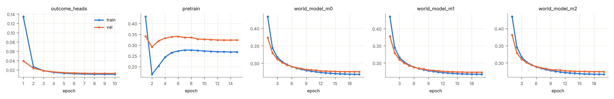
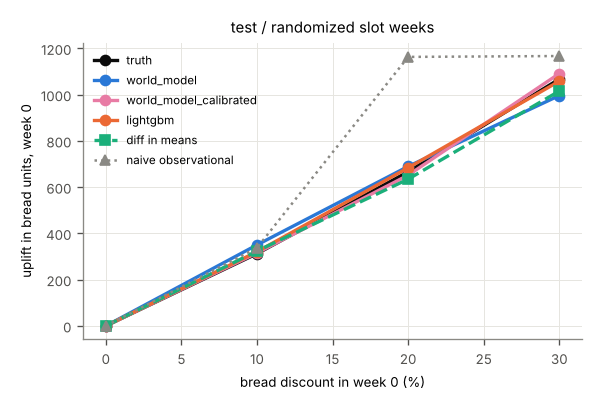
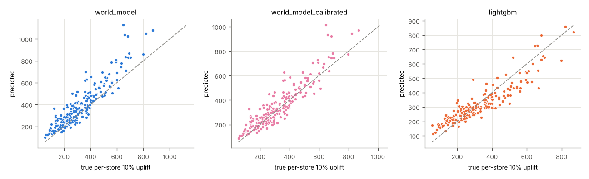
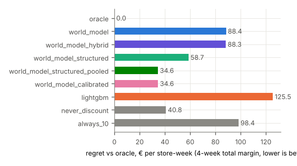
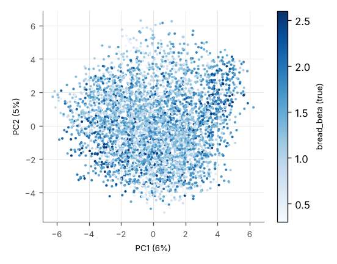

# Run report: poc_tiny_rich_s1

encoder `jepa` · world model `transformer` × 3 · target_drops_price True · censoring `tobit` · seed 1 · stores 200 · runtime 11,119 s

## Headline (test, all stores)

Lowest planning regret: **structured, pooled cross-category slope** (34.6 € per store-week). world model 88.4, hybrid (WM bread + experimental cross effects) 88.3, structured (hybrid + experimental pull-forward) 58.7, structured, pooled cross-category slope 34.6, calibrated (structured, pooled slope, bread effects calibrated) 34.6, LightGBM 126, never discount 40.8, always 10% 98.4.

| model | WAPE bread h1 | WAPE margin 4w | ATE bias 20% (randomized) | CATE Spearman | action sensitivity | planning regret € | oracle match |
|---|---|---|---|---|---|---|---|
| world_model | 0.100 | 0.080 | 23.264 | 0.893 | 0.976 | 88.397 | 0.426 |
| world_model_hybrid | 0.100 | 0.080 | 23.264 | 0.893 | 0.976 | 88.268 | 0.268 |
| world_model_structured | 0.100 | 0.080 | 23.264 | 0.893 | 0.976 | 58.742 | 0.455 |
| world_model_structured_pooled | 0.100 | 0.080 | 23.264 | 0.893 | 0.976 | 34.581 | 0.665 |
| world_model_calibrated | 0.100 | 0.080 | -14.613 | 0.893 | 1.069 | 34.627 | 0.671 |
| lightgbm | 0.082 | 0.078 | 17.322 | 0.905 | 0.934 | 126 | 0.503 |

## val

### val / all (4600 windows)

**Forecast** (WAPE of bread units per horizon step; 4-week total margin)

| model | h1 | h2 | h3 | h4 | margin WAPE | margin MAE € |
|---|---|---|---|---|---|---|
| world_model | 0.106 | 0.104 | 0.103 | 0.104 | 0.076 | 2,630 |
| world_model_hybrid | 0.106 | 0.104 | 0.103 | 0.104 | 0.076 | 2,630 |
| world_model_structured | 0.106 | 0.104 | 0.103 | 0.104 | 0.076 | 2,630 |
| world_model_structured_pooled | 0.106 | 0.104 | 0.103 | 0.104 | 0.076 | 2,630 |
| world_model_calibrated | 0.106 | 0.104 | 0.103 | 0.104 | 0.076 | 2,630 |
| lightgbm | 0.084 | 0.086 | 0.088 | 0.089 | 0.080 | 2,758 |
| world_model_heads_on_real_embeddings | 0.057 | 0.057 | 0.056 | 0.056 | – | – |

**Effect recovery** (bread units in week 0, action [d,0,0,0], vs ground-truth counterfactuals)

| level | true | world_model pred | world_model_hybrid pred | world_model_structured pred | world_model_structured_pooled pred | world_model_calibrated pred | lightgbm pred | world_model bias | world_model_hybrid bias | world_model_structured bias | world_model_structured_pooled bias | world_model_calibrated bias | lightgbm bias | world_model RMSE | world_model_hybrid RMSE | world_model_structured RMSE | world_model_structured_pooled RMSE | world_model_calibrated RMSE | lightgbm RMSE | diff in means | naive obs. | true Δ margin 4w | world_model Δ margin 4w | world_model_hybrid Δ margin 4w | world_model_structured Δ margin 4w | world_model_structured_pooled Δ margin 4w | world_model_calibrated Δ margin 4w | lightgbm Δ margin 4w |
|---|---|---|---|---|---|---|---|---|---|---|---|---|---|---|---|---|---|---|---|---|---|---|---|---|---|---|---|---|
| 10% | 315 | 389 | 389 | 389 | 389 | 350 | 312 | 73.998 | 73.998 | 73.998 | 73.998 | 35.105 | -3.681 | 154 | 154 | 154 | 154 | 126 | 111 | 232 | – | -58.776 | 289 | 252 | 58.312 | -53.710 | -78.382 | 0.275 |
| 20% | 675 | 753 | 753 | 753 | 753 | 711 | 676 | 77.617 | 77.617 | 77.617 | 77.617 | 36.285 | 0.856 | 232 | 232 | 232 | 232 | 214 | 219 | 696 | – | -218 | 103 | -134 | -297 | -254 | -286 | -45.905 |
| 30% | 1,083 | 1,072 | 1,072 | 1,072 | 1,072 | 1,175 | 1,043 | -10.493 | -10.493 | -10.493 | -10.493 | 91.915 | -39.659 | 317 | 317 | 317 | 317 | 336 | 327 | 989 | – | -501 | -212 | -423 | -517 | -570 | -592 | -197 |

**Margin effect split** (Δ 4-week margin vs 0 %, € per store-week: bread vs all other categories)

| level | model | bread pred | bread true | other pred | other true | total pred | total true |
|---|---|---|---|---|---|---|---|
| 10% | world_model | 10.611 | -224 | 279 | 165 | 289 | -58.776 |
| 10% | world_model_hybrid | 10.611 | -224 | 241 | 165 | 252 | -58.776 |
| 10% | world_model_structured | -183 | -224 | 241 | 165 | 58.312 | -58.776 |
| 10% | world_model_structured_pooled | -183 | -224 | 129 | 165 | -53.710 | -58.776 |
| 10% | world_model_calibrated | -208 | -224 | 129 | 165 | -78.382 | -58.776 |
| 20% | world_model | -350 | -556 | 453 | 338 | 103 | -218 |
| 20% | world_model_hybrid | -350 | -556 | 216 | 338 | -134 | -218 |
| 20% | world_model_structured | -513 | -556 | 216 | 338 | -297 | -218 |
| 20% | world_model_structured_pooled | -513 | -556 | 259 | 338 | -254 | -218 |
| 20% | world_model_calibrated | -545 | -556 | 259 | 338 | -286 | -218 |
| 30% | world_model | -866 | -1,021 | 653 | 520 | -212 | -501 |
| 30% | world_model_hybrid | -866 | -1,021 | 442 | 520 | -423 | -501 |
| 30% | world_model_structured | -960 | -1,021 | 442 | 520 | -517 | -501 |
| 30% | world_model_structured_pooled | -960 | -1,021 | 389 | 520 | -570 | -501 |
| 30% | world_model_calibrated | -981 | -1,021 | 389 | 520 | -592 | -501 |

**Heterogeneity and action sensitivity**

| model | Spearman vs true per-store uplift | Spearman vs bread_beta | sensitivity ratio | ignores action |
|---|---|---|---|---|
| world_model | 0.906 | 0.516 | 0.990 | no |
| world_model_hybrid | 0.906 | 0.516 | 0.990 | no |
| world_model_structured | 0.906 | 0.516 | 0.990 | no |
| world_model_structured_pooled | 0.906 | 0.516 | 0.990 | no |
| world_model_calibrated | 0.906 | 0.516 | 1.085 | no |
| lightgbm | 0.894 | 0.492 | 0.963 | no |
(true per-store uplift vs bread_beta: Spearman 0.720)

**Planning** (true 4-week total margin of the chosen level, € per store-week)

| policy | value € | regret € | oracle match | levels chosen |
|---|---|---|---|---|
| oracle | 34,862 | 0.000 | 1.000 |  |
| never discount | 34,825 | 37.030 | 0.677 |  |
| always 10% | 34,766 | 95.806 | 0.213 |  |
| world_model | 34,784 | 77.252 | 0.479 | 0% 50%, 10% 38%, 20% 9%, 30% 3% |
| world_model_hybrid | 34,784 | 77.576 | 0.320 | 0% 15%, 10% 84%, 20% 0%, 30% 0% |
| world_model_structured | 34,810 | 51.307 | 0.497 | 0% 42%, 10% 58%, 20% 0%, 30% 0% |
| world_model_structured_pooled | 34,829 | 32.361 | 0.675 | 0% 86%, 10% 14%, 20% 0%, 30% 0% |
| world_model_calibrated | 34,829 | 32.732 | 0.676 | 0% 90%, 10% 10%, 20% 0%, 30% 0% |
| lightgbm | 34,742 | 119 | 0.521 | 0% 69%, 10% 0%, 20% 19%, 30% 11% |
true best level shares: 0% 68%, 10% 21%, 20% 10%, 30% 1%

**Censoring** (WAPE bread h1)

| model | censored weeks | uncensored weeks | share censored |
|---|---|---|---|
| world_model | 0.108 | 0.106 | 0.188 |
| world_model_hybrid | 0.108 | 0.106 | 0.188 |
| world_model_structured | 0.108 | 0.106 | 0.188 |
| world_model_structured_pooled | 0.108 | 0.106 | 0.188 |
| world_model_calibrated | 0.108 | 0.106 | 0.188 |
| lightgbm | 0.083 | 0.085 | 0.188 |

### val / randomized (1421 windows)

**Forecast** (WAPE of bread units per horizon step; 4-week total margin)

| model | h1 | h2 | h3 | h4 | margin WAPE | margin MAE € |
|---|---|---|---|---|---|---|
| world_model | 0.103 | 0.105 | 0.097 | 0.101 | 0.075 | 2,570 |
| world_model_hybrid | 0.103 | 0.105 | 0.097 | 0.101 | 0.075 | 2,570 |
| world_model_structured | 0.103 | 0.105 | 0.097 | 0.101 | 0.075 | 2,570 |
| world_model_structured_pooled | 0.103 | 0.105 | 0.097 | 0.101 | 0.075 | 2,570 |
| world_model_calibrated | 0.103 | 0.105 | 0.097 | 0.101 | 0.075 | 2,570 |
| lightgbm | 0.085 | 0.089 | 0.082 | 0.088 | 0.080 | 2,761 |
| world_model_heads_on_real_embeddings | 0.058 | 0.056 | 0.054 | 0.058 | – | – |

**Effect recovery** (bread units in week 0, action [d,0,0,0], vs ground-truth counterfactuals)

| level | true | world_model pred | world_model_hybrid pred | world_model_structured pred | world_model_structured_pooled pred | world_model_calibrated pred | lightgbm pred | world_model bias | world_model_hybrid bias | world_model_structured bias | world_model_structured_pooled bias | world_model_calibrated bias | lightgbm bias | world_model RMSE | world_model_hybrid RMSE | world_model_structured RMSE | world_model_structured_pooled RMSE | world_model_calibrated RMSE | lightgbm RMSE | diff in means | naive obs. | true Δ margin 4w | world_model Δ margin 4w | world_model_hybrid Δ margin 4w | world_model_structured Δ margin 4w | world_model_structured_pooled Δ margin 4w | world_model_calibrated Δ margin 4w | lightgbm Δ margin 4w |
|---|---|---|---|---|---|---|---|---|---|---|---|---|---|---|---|---|---|---|---|---|---|---|---|---|---|---|---|---|
| 10% | 308 | 354 | 354 | 354 | 354 | 319 | 320 | 46.659 | 46.659 | 46.659 | 46.659 | 11.257 | 12.305 | 116 | 116 | 116 | 116 | 96.744 | 104 | 232 | – | -72.339 | 213 | 191 | 35.420 | -75.602 | -101 | 0.326 |
| 20% | 655 | 695 | 695 | 695 | 695 | 657 | 687 | 40.122 | 40.122 | 40.122 | 40.122 | 1.944 | 31.679 | 192 | 192 | 192 | 192 | 182 | 182 | 696 | – | -247 | 3.259 | -213 | -324 | -281 | -315 | -68.634 |
| 30% | 1,048 | 999 | 999 | 999 | 999 | 1,095 | 1,074 | -49.232 | -49.232 | -49.232 | -49.232 | 46.202 | 25.397 | 296 | 296 | 296 | 296 | 298 | 260 | 989 | – | -542 | -321 | -502 | -540 | -592 | -615 | -228 |

**Margin effect split** (Δ 4-week margin vs 0 %, € per store-week: bread vs all other categories)

| level | model | bread pred | bread true | other pred | other true | total pred | total true |
|---|---|---|---|---|---|---|---|
| 10% | world_model | -48.247 | -236 | 262 | 164 | 213 | -72.339 |
| 10% | world_model_hybrid | -48.247 | -236 | 239 | 164 | 191 | -72.339 |
| 10% | world_model_structured | -204 | -236 | 239 | 164 | 35.420 | -72.339 |
| 10% | world_model_structured_pooled | -204 | -236 | 128 | 164 | -75.602 | -72.339 |
| 10% | world_model_calibrated | -229 | -236 | 128 | 164 | -101 | -72.339 |
| 20% | world_model | -427 | -583 | 430 | 336 | 3.259 | -247 |
| 20% | world_model_hybrid | -427 | -583 | 214 | 336 | -213 | -247 |
| 20% | world_model_structured | -538 | -583 | 214 | 336 | -324 | -247 |
| 20% | world_model_structured_pooled | -538 | -583 | 257 | 336 | -281 | -247 |
| 20% | world_model_calibrated | -572 | -583 | 257 | 336 | -315 | -247 |
| 30% | world_model | -940 | -1,058 | 619 | 516 | -321 | -542 |
| 30% | world_model_hybrid | -940 | -1,058 | 438 | 516 | -502 | -542 |
| 30% | world_model_structured | -978 | -1,058 | 438 | 516 | -540 | -542 |
| 30% | world_model_structured_pooled | -978 | -1,058 | 386 | 516 | -592 | -542 |
| 30% | world_model_calibrated | -1,001 | -1,058 | 386 | 516 | -615 | -542 |

**Heterogeneity and action sensitivity**

| model | Spearman vs true per-store uplift | Spearman vs bread_beta | sensitivity ratio | ignores action |
|---|---|---|---|---|
| world_model | 0.889 | 0.493 | 0.953 | no |
| world_model_hybrid | 0.889 | 0.493 | 0.953 | no |
| world_model_structured | 0.889 | 0.493 | 0.953 | no |
| world_model_structured_pooled | 0.889 | 0.493 | 0.953 | no |
| world_model_calibrated | 0.889 | 0.493 | 1.044 | no |
| lightgbm | 0.903 | 0.514 | 1.024 | no |
(true per-store uplift vs bread_beta: Spearman 0.712)

**Planning** (true 4-week total margin of the chosen level, € per store-week)

| policy | value € | regret € | oracle match | levels chosen |
|---|---|---|---|---|
| oracle | 34,636 | 0.000 | 1.000 |  |
| never discount | 34,608 | 28.387 | 0.716 |  |
| always 10% | 34,536 | 101 | 0.208 |  |
| world_model | 34,564 | 71.944 | 0.534 | 0% 56%, 10% 35%, 20% 6%, 30% 3% |
| world_model_hybrid | 34,558 | 78.293 | 0.334 | 0% 18%, 10% 82%, 20% 0%, 30% 0% |
| world_model_structured | 34,588 | 47.947 | 0.536 | 0% 48%, 10% 52%, 20% 0%, 30% 0% |
| world_model_structured_pooled | 34,609 | 26.942 | 0.719 | 0% 93%, 10% 7%, 20% 0%, 30% 0% |
| world_model_calibrated | 34,608 | 27.805 | 0.718 | 0% 96%, 10% 4%, 20% 0%, 30% 0% |
| lightgbm | 34,529 | 107 | 0.586 | 0% 78%, 10% 0%, 20% 11%, 30% 11% |
true best level shares: 0% 72%, 10% 21%, 20% 7%, 30% 0%

**Censoring** (WAPE bread h1)

| model | censored weeks | uncensored weeks | share censored |
|---|---|---|---|
| world_model | 0.103 | 0.103 | 0.241 |
| world_model_hybrid | 0.103 | 0.103 | 0.241 |
| world_model_structured | 0.103 | 0.103 | 0.241 |
| world_model_structured_pooled | 0.103 | 0.103 | 0.241 |
| world_model_calibrated | 0.103 | 0.103 | 0.241 |
| lightgbm | 0.080 | 0.087 | 0.241 |

### val / cold_start_stores (690 windows)

**Forecast** (WAPE of bread units per horizon step; 4-week total margin)

| model | h1 | h2 | h3 | h4 | margin WAPE | margin MAE € |
|---|---|---|---|---|---|---|
| world_model | 0.110 | 0.110 | 0.111 | 0.111 | 0.082 | 2,788 |
| world_model_hybrid | 0.110 | 0.110 | 0.111 | 0.111 | 0.082 | 2,788 |
| world_model_structured | 0.110 | 0.110 | 0.111 | 0.111 | 0.082 | 2,788 |
| world_model_structured_pooled | 0.110 | 0.110 | 0.111 | 0.111 | 0.082 | 2,788 |
| world_model_calibrated | 0.110 | 0.110 | 0.111 | 0.111 | 0.082 | 2,788 |
| lightgbm | 0.083 | 0.087 | 0.089 | 0.093 | 0.086 | 2,916 |
| world_model_heads_on_real_embeddings | 0.062 | 0.062 | 0.061 | 0.062 | – | – |

**Effect recovery** (bread units in week 0, action [d,0,0,0], vs ground-truth counterfactuals)

| level | true | world_model pred | world_model_hybrid pred | world_model_structured pred | world_model_structured_pooled pred | world_model_calibrated pred | lightgbm pred | world_model bias | world_model_hybrid bias | world_model_structured bias | world_model_structured_pooled bias | world_model_calibrated bias | lightgbm bias | world_model RMSE | world_model_hybrid RMSE | world_model_structured RMSE | world_model_structured_pooled RMSE | world_model_calibrated RMSE | lightgbm RMSE | diff in means | naive obs. | true Δ margin 4w | world_model Δ margin 4w | world_model_hybrid Δ margin 4w | world_model_structured Δ margin 4w | world_model_structured_pooled Δ margin 4w | world_model_calibrated Δ margin 4w | lightgbm Δ margin 4w |
|---|---|---|---|---|---|---|---|---|---|---|---|---|---|---|---|---|---|---|---|---|---|---|---|---|---|---|---|---|
| 10% | 282 | 364 | 364 | 364 | 364 | 328 | 284 | 82.642 | 82.642 | 82.642 | 82.642 | 46.227 | 2.218 | 167 | 167 | 167 | 167 | 137 | 113 | 120 | – | -97.224 | 243 | 227 | 51.820 | -60.035 | -84.704 | 0.340 |
| 20% | 600 | 704 | 704 | 704 | 704 | 666 | 625 | 104 | 104 | 104 | 104 | 65.094 | 24.951 | 251 | 251 | 251 | 251 | 228 | 241 | 415 | – | -286 | 46.422 | -160 | -302 | -259 | -291 | -58.559 |
| 30% | 959 | 1,001 | 1,001 | 1,001 | 1,001 | 1,096 | 948 | 42.073 | 42.073 | 42.073 | 42.073 | 138 | -10.654 | 328 | 328 | 328 | 328 | 364 | 373 | 683 | – | -588 | -251 | -433 | -512 | -565 | -587 | -220 |

**Margin effect split** (Δ 4-week margin vs 0 %, € per store-week: bread vs all other categories)

| level | model | bread pred | bread true | other pred | other true | total pred | total true |
|---|---|---|---|---|---|---|---|
| 10% | world_model | -13.483 | -229 | 257 | 132 | 243 | -97.224 |
| 10% | world_model_hybrid | -13.483 | -229 | 241 | 132 | 227 | -97.224 |
| 10% | world_model_structured | -189 | -229 | 241 | 132 | 51.820 | -97.224 |
| 10% | world_model_structured_pooled | -189 | -229 | 129 | 132 | -60.035 | -97.224 |
| 10% | world_model_calibrated | -214 | -229 | 129 | 132 | -84.704 | -97.224 |
| 20% | world_model | -376 | -558 | 422 | 272 | 46.422 | -286 |
| 20% | world_model_hybrid | -376 | -558 | 216 | 272 | -160 | -286 |
| 20% | world_model_structured | -517 | -558 | 216 | 272 | -302 | -286 |
| 20% | world_model_structured_pooled | -517 | -558 | 259 | 272 | -259 | -286 |
| 20% | world_model_calibrated | -550 | -558 | 259 | 272 | -291 | -286 |
| 30% | world_model | -875 | -1,009 | 624 | 421 | -251 | -588 |
| 30% | world_model_hybrid | -875 | -1,009 | 442 | 421 | -433 | -588 |
| 30% | world_model_structured | -953 | -1,009 | 442 | 421 | -512 | -588 |
| 30% | world_model_structured_pooled | -953 | -1,009 | 389 | 421 | -565 | -588 |
| 30% | world_model_calibrated | -976 | -1,009 | 389 | 421 | -587 | -588 |

**Heterogeneity and action sensitivity**

| model | Spearman vs true per-store uplift | Spearman vs bread_beta | sensitivity ratio | ignores action |
|---|---|---|---|---|
| world_model | 0.834 | 0.573 | 1.044 | no |
| world_model_hybrid | 0.834 | 0.573 | 1.044 | no |
| world_model_structured | 0.834 | 0.573 | 1.044 | no |
| world_model_structured_pooled | 0.834 | 0.573 | 1.044 | no |
| world_model_calibrated | 0.834 | 0.573 | 1.144 | no |
| lightgbm | 0.769 | 0.483 | 0.989 | no |
(true per-store uplift vs bread_beta: Spearman 0.872)

**Planning** (true 4-week total margin of the chosen level, € per store-week)

| policy | value € | regret € | oracle match | levels chosen |
|---|---|---|---|---|
| oracle | 34,246 | 0.000 | 1.000 |  |
| never discount | 34,226 | 19.325 | 0.770 |  |
| always 10% | 34,129 | 117 | 0.170 |  |
| world_model | 34,166 | 79.843 | 0.506 | 0% 53%, 10% 37%, 20% 7%, 30% 3% |
| world_model_hybrid | 34,153 | 92.901 | 0.299 | 0% 21%, 10% 79%, 20% 0%, 30% 0% |
| world_model_structured | 34,188 | 57.937 | 0.506 | 0% 48%, 10% 52%, 20% 0%, 30% 0% |
| world_model_structured_pooled | 34,224 | 21.446 | 0.752 | 0% 88%, 10% 12%, 20% 0%, 30% 0% |
| world_model_calibrated | 34,225 | 20.789 | 0.761 | 0% 92%, 10% 8%, 20% 0%, 30% 0% |
| lightgbm | 34,102 | 143 | 0.552 | 0% 71%, 10% 0%, 20% 17%, 30% 12% |
true best level shares: 0% 77%, 10% 17%, 20% 6%, 30% 0%

**Censoring** (WAPE bread h1)

| model | censored weeks | uncensored weeks | share censored |
|---|---|---|---|
| world_model | 0.103 | 0.112 | 0.165 |
| world_model_hybrid | 0.103 | 0.112 | 0.165 |
| world_model_structured | 0.103 | 0.112 | 0.165 |
| world_model_structured_pooled | 0.103 | 0.112 | 0.165 |
| world_model_calibrated | 0.103 | 0.112 | 0.165 |
| lightgbm | 0.081 | 0.084 | 0.165 |

### val / representation

Ridge probes on frozen z(t), out-of-fold R², folds grouped by store

| target | z(t) | calendar + store one-hot | calendar + static features |
|---|---|---|---|
| bread_beta | 0.651 | -0.005 | 0.542 |
| size_sqm | 0.961 | -0.005 | 1.000 |
| holiday | 0.796 | 1.000 | 1.000 |
| traffic_shock | 0.569 | -0.007 | -0.033 |

kNN (k=10) next-week bread units, WAPE: neighbours in z-space 0.205, neighbours on static features 0.223

## test

### test / all (4600 windows)

**Forecast** (WAPE of bread units per horizon step; 4-week total margin)

| model | h1 | h2 | h3 | h4 | margin WAPE | margin MAE € |
|---|---|---|---|---|---|---|
| world_model | 0.100 | 0.101 | 0.100 | 0.110 | 0.080 | 2,947 |
| world_model_hybrid | 0.100 | 0.101 | 0.100 | 0.110 | 0.080 | 2,947 |
| world_model_structured | 0.100 | 0.101 | 0.100 | 0.110 | 0.080 | 2,947 |
| world_model_structured_pooled | 0.100 | 0.101 | 0.100 | 0.110 | 0.080 | 2,947 |
| world_model_calibrated | 0.100 | 0.101 | 0.100 | 0.110 | 0.080 | 2,947 |
| lightgbm | 0.082 | 0.086 | 0.087 | 0.091 | 0.078 | 2,871 |
| world_model_heads_on_real_embeddings | 0.051 | 0.052 | 0.054 | 0.055 | – | – |

**Effect recovery** (bread units in week 0, action [d,0,0,0], vs ground-truth counterfactuals)

| level | true | world_model pred | world_model_hybrid pred | world_model_structured pred | world_model_structured_pooled pred | world_model_calibrated pred | lightgbm pred | world_model bias | world_model_hybrid bias | world_model_structured bias | world_model_structured_pooled bias | world_model_calibrated bias | lightgbm bias | world_model RMSE | world_model_hybrid RMSE | world_model_structured RMSE | world_model_structured_pooled RMSE | world_model_calibrated RMSE | lightgbm RMSE | diff in means | naive obs. | true Δ margin 4w | world_model Δ margin 4w | world_model_hybrid Δ margin 4w | world_model_structured Δ margin 4w | world_model_structured_pooled Δ margin 4w | world_model_calibrated Δ margin 4w | lightgbm Δ margin 4w |
|---|---|---|---|---|---|---|---|---|---|---|---|---|---|---|---|---|---|---|---|---|---|---|---|---|---|---|---|---|
| 10% | 323 | 394 | 394 | 394 | 394 | 355 | 318 | 70.713 | 70.713 | 70.713 | 70.713 | 31.347 | -5.215 | 161 | 161 | 161 | 161 | 133 | 103 | 324 | 338 | -57.600 | 376 | 296 | 78.037 | -44.594 | -68.440 | 0.600 |
| 20% | 693 | 760 | 760 | 760 | 760 | 718 | 680 | 66.422 | 66.422 | 66.422 | 66.422 | 24.707 | -13.027 | 237 | 237 | 237 | 237 | 220 | 217 | 635 | 1,163 | -219 | 190 | -114 | -291 | -243 | -275 | -41.069 |
| 30% | 1,111 | 1,084 | 1,084 | 1,084 | 1,084 | 1,188 | 1,038 | -26.716 | -26.716 | -26.716 | -26.716 | 76.856 | -73.375 | 323 | 323 | 323 | 323 | 340 | 330 | 1,016 | 1,167 | -511 | -107 | -404 | -505 | -562 | -583 | -168 |

**Margin effect split** (Δ 4-week margin vs 0 %, € per store-week: bread vs all other categories)

| level | model | bread pred | bread true | other pred | other true | total pred | total true |
|---|---|---|---|---|---|---|---|
| 10% | world_model | 32.108 | -234 | 344 | 176 | 376 | -57.600 |
| 10% | world_model_hybrid | 32.108 | -234 | 264 | 176 | 296 | -57.600 |
| 10% | world_model_structured | -186 | -234 | 264 | 176 | 78.037 | -57.600 |
| 10% | world_model_structured_pooled | -186 | -234 | 141 | 176 | -44.594 | -57.600 |
| 10% | world_model_calibrated | -210 | -234 | 141 | 176 | -68.440 | -57.600 |
| 20% | world_model | -351 | -580 | 541 | 361 | 190 | -219 |
| 20% | world_model_hybrid | -351 | -580 | 236 | 361 | -114 | -219 |
| 20% | world_model_structured | -527 | -580 | 236 | 361 | -291 | -219 |
| 20% | world_model_structured_pooled | -527 | -580 | 284 | 361 | -243 | -219 |
| 20% | world_model_calibrated | -558 | -580 | 284 | 361 | -275 | -219 |
| 30% | world_model | -888 | -1,065 | 781 | 554 | -107 | -511 |
| 30% | world_model_hybrid | -888 | -1,065 | 484 | 554 | -404 | -511 |
| 30% | world_model_structured | -989 | -1,065 | 484 | 554 | -505 | -511 |
| 30% | world_model_structured_pooled | -989 | -1,065 | 426 | 554 | -562 | -511 |
| 30% | world_model_calibrated | -1,010 | -1,065 | 426 | 554 | -583 | -511 |

**Heterogeneity and action sensitivity**

| model | Spearman vs true per-store uplift | Spearman vs bread_beta | sensitivity ratio | ignores action |
|---|---|---|---|---|
| world_model | 0.893 | 0.511 | 0.976 | no |
| world_model_hybrid | 0.893 | 0.511 | 0.976 | no |
| world_model_structured | 0.893 | 0.511 | 0.976 | no |
| world_model_structured_pooled | 0.893 | 0.511 | 0.976 | no |
| world_model_calibrated | 0.893 | 0.511 | 1.069 | no |
| lightgbm | 0.905 | 0.541 | 0.934 | no |
(true per-store uplift vs bread_beta: Spearman 0.727)

**Planning** (true 4-week total margin of the chosen level, € per store-week)

| policy | value € | regret € | oracle match | levels chosen |
|---|---|---|---|---|
| oracle | 37,169 | 0.000 | 1.000 |  |
| never discount | 37,128 | 40.850 | 0.675 |  |
| always 10% | 37,071 | 98.449 | 0.211 |  |
| world_model | 37,081 | 88.397 | 0.426 | 0% 42%, 10% 46%, 20% 10%, 30% 3% |
| world_model_hybrid | 37,081 | 88.268 | 0.268 | 0% 8%, 10% 92%, 20% 0%, 30% 0% |
| world_model_structured | 37,111 | 58.742 | 0.455 | 0% 33%, 10% 67%, 20% 0%, 30% 0% |
| world_model_structured_pooled | 37,135 | 34.581 | 0.665 | 0% 84%, 10% 16%, 20% 0%, 30% 0% |
| world_model_calibrated | 37,135 | 34.627 | 0.671 | 0% 89%, 10% 11%, 20% 0%, 30% 0% |
| lightgbm | 37,044 | 126 | 0.503 | 0% 65%, 10% 0%, 20% 23%, 30% 11% |
true best level shares: 0% 68%, 10% 21%, 20% 10%, 30% 1%

**Censoring** (WAPE bread h1)

| model | censored weeks | uncensored weeks | share censored |
|---|---|---|---|
| world_model | 0.104 | 0.099 | 0.187 |
| world_model_hybrid | 0.104 | 0.099 | 0.187 |
| world_model_structured | 0.104 | 0.099 | 0.187 |
| world_model_structured_pooled | 0.104 | 0.099 | 0.187 |
| world_model_calibrated | 0.104 | 0.099 | 0.187 |
| lightgbm | 0.080 | 0.082 | 0.187 |

### test / randomized (1425 windows)

**Forecast** (WAPE of bread units per horizon step; 4-week total margin)

| model | h1 | h2 | h3 | h4 | margin WAPE | margin MAE € |
|---|---|---|---|---|---|---|
| world_model | 0.095 | 0.102 | 0.096 | 0.104 | 0.080 | 2,929 |
| world_model_hybrid | 0.095 | 0.102 | 0.096 | 0.104 | 0.080 | 2,929 |
| world_model_structured | 0.095 | 0.102 | 0.096 | 0.104 | 0.080 | 2,929 |
| world_model_structured_pooled | 0.095 | 0.102 | 0.096 | 0.104 | 0.080 | 2,929 |
| world_model_calibrated | 0.095 | 0.102 | 0.096 | 0.104 | 0.080 | 2,929 |
| lightgbm | 0.081 | 0.090 | 0.085 | 0.088 | 0.078 | 2,867 |
| world_model_heads_on_real_embeddings | 0.053 | 0.052 | 0.053 | 0.057 | – | – |

**Effect recovery** (bread units in week 0, action [d,0,0,0], vs ground-truth counterfactuals)

| level | true | world_model pred | world_model_hybrid pred | world_model_structured pred | world_model_structured_pooled pred | world_model_calibrated pred | lightgbm pred | world_model bias | world_model_hybrid bias | world_model_structured bias | world_model_structured_pooled bias | world_model_calibrated bias | lightgbm bias | world_model RMSE | world_model_hybrid RMSE | world_model_structured RMSE | world_model_structured_pooled RMSE | world_model_calibrated RMSE | lightgbm RMSE | diff in means | naive obs. | true Δ margin 4w | world_model Δ margin 4w | world_model_hybrid Δ margin 4w | world_model_structured Δ margin 4w | world_model_structured_pooled Δ margin 4w | world_model_calibrated Δ margin 4w | lightgbm Δ margin 4w |
|---|---|---|---|---|---|---|---|---|---|---|---|---|---|---|---|---|---|---|---|---|---|---|---|---|---|---|---|---|
| 10% | 312 | 350 | 350 | 350 | 350 | 315 | 321 | 38.034 | 38.034 | 38.034 | 38.034 | 3.029 | 8.540 | 108 | 108 | 108 | 108 | 91.442 | 89.561 | 324 | 338 | -72.474 | 276 | 219 | 52.081 | -69.555 | -93.710 | 0.792 |
| 20% | 666 | 690 | 690 | 690 | 690 | 652 | 684 | 23.264 | 23.264 | 23.264 | 23.264 | -14.613 | 17.322 | 184 | 184 | 184 | 184 | 179 | 169 | 635 | 1,163 | -251 | 62.288 | -209 | -318 | -271 | -304 | -63.373 |
| 30% | 1,068 | 996 | 996 | 996 | 996 | 1,091 | 1,058 | -71.340 | -71.340 | -71.340 | -71.340 | 23.814 | -9.286 | 299 | 299 | 299 | 299 | 293 | 247 | 1,016 | 1,167 | -556 | -236 | -495 | -523 | -581 | -603 | -201 |

**Margin effect split** (Δ 4-week margin vs 0 %, € per store-week: bread vs all other categories)

| level | model | bread pred | bread true | other pred | other true | total pred | total true |
|---|---|---|---|---|---|---|---|
| 10% | world_model | -42.978 | -247 | 319 | 174 | 276 | -72.474 |
| 10% | world_model_hybrid | -42.978 | -247 | 262 | 174 | 219 | -72.474 |
| 10% | world_model_structured | -210 | -247 | 262 | 174 | 52.081 | -72.474 |
| 10% | world_model_structured_pooled | -210 | -247 | 140 | 174 | -69.555 | -72.474 |
| 10% | world_model_calibrated | -234 | -247 | 140 | 174 | -93.710 | -72.474 |
| 20% | world_model | -444 | -607 | 506 | 356 | 62.288 | -251 |
| 20% | world_model_hybrid | -444 | -607 | 234 | 356 | -209 | -251 |
| 20% | world_model_structured | -552 | -607 | 234 | 356 | -318 | -251 |
| 20% | world_model_structured_pooled | -552 | -607 | 281 | 356 | -271 | -251 |
| 20% | world_model_calibrated | -585 | -607 | 281 | 356 | -304 | -251 |
| 30% | world_model | -975 | -1,102 | 739 | 546 | -236 | -556 |
| 30% | world_model_hybrid | -975 | -1,102 | 480 | 546 | -495 | -556 |
| 30% | world_model_structured | -1,004 | -1,102 | 480 | 546 | -523 | -556 |
| 30% | world_model_structured_pooled | -1,004 | -1,102 | 423 | 546 | -581 | -556 |
| 30% | world_model_calibrated | -1,026 | -1,102 | 423 | 546 | -603 | -556 |

**Heterogeneity and action sensitivity**

| model | Spearman vs true per-store uplift | Spearman vs bread_beta | sensitivity ratio | ignores action |
|---|---|---|---|---|
| world_model | 0.878 | 0.496 | 0.933 | no |
| world_model_hybrid | 0.878 | 0.496 | 0.933 | no |
| world_model_structured | 0.878 | 0.496 | 0.933 | no |
| world_model_structured_pooled | 0.878 | 0.496 | 0.933 | no |
| world_model_calibrated | 0.878 | 0.496 | 1.022 | no |
| lightgbm | 0.907 | 0.562 | 0.991 | no |
(true per-store uplift vs bread_beta: Spearman 0.710)

**Planning** (true 4-week total margin of the chosen level, € per store-week)

| policy | value € | regret € | oracle match | levels chosen |
|---|---|---|---|---|
| oracle | 36,909 | 0.000 | 1.000 |  |
| never discount | 36,879 | 30.620 | 0.724 |  |
| always 10% | 36,806 | 103 | 0.200 |  |
| world_model | 36,825 | 84.766 | 0.474 | 0% 49%, 10% 42%, 20% 7%, 30% 3% |
| world_model_hybrid | 36,819 | 89.905 | 0.272 | 0% 9%, 10% 91%, 20% 0%, 30% 0% |
| world_model_structured | 36,854 | 54.959 | 0.496 | 0% 39%, 10% 61%, 20% 0%, 30% 0% |
| world_model_structured_pooled | 36,881 | 28.718 | 0.722 | 0% 92%, 10% 8%, 20% 0%, 30% 0% |
| world_model_calibrated | 36,880 | 29.352 | 0.725 | 0% 96%, 10% 4%, 20% 0%, 30% 0% |
| lightgbm | 36,806 | 103 | 0.571 | 0% 76%, 10% 0%, 20% 15%, 30% 9% |
true best level shares: 0% 72%, 10% 20%, 20% 7%, 30% 0%

**Censoring** (WAPE bread h1)

| model | censored weeks | uncensored weeks | share censored |
|---|---|---|---|
| world_model | 0.099 | 0.093 | 0.254 |
| world_model_hybrid | 0.099 | 0.093 | 0.254 |
| world_model_structured | 0.099 | 0.093 | 0.254 |
| world_model_structured_pooled | 0.099 | 0.093 | 0.254 |
| world_model_calibrated | 0.099 | 0.093 | 0.254 |
| lightgbm | 0.074 | 0.084 | 0.254 |

### test / cold_start_stores (690 windows)

**Forecast** (WAPE of bread units per horizon step; 4-week total margin)

| model | h1 | h2 | h3 | h4 | margin WAPE | margin MAE € |
|---|---|---|---|---|---|---|
| world_model | 0.110 | 0.111 | 0.108 | 0.125 | 0.085 | 3,118 |
| world_model_hybrid | 0.110 | 0.111 | 0.108 | 0.125 | 0.085 | 3,118 |
| world_model_structured | 0.110 | 0.111 | 0.108 | 0.125 | 0.085 | 3,118 |
| world_model_structured_pooled | 0.110 | 0.111 | 0.108 | 0.125 | 0.085 | 3,118 |
| world_model_calibrated | 0.110 | 0.111 | 0.108 | 0.125 | 0.085 | 3,118 |
| lightgbm | 0.086 | 0.091 | 0.091 | 0.095 | 0.079 | 2,900 |
| world_model_heads_on_real_embeddings | 0.058 | 0.059 | 0.059 | 0.059 | – | – |

**Effect recovery** (bread units in week 0, action [d,0,0,0], vs ground-truth counterfactuals)

| level | true | world_model pred | world_model_hybrid pred | world_model_structured pred | world_model_structured_pooled pred | world_model_calibrated pred | lightgbm pred | world_model bias | world_model_hybrid bias | world_model_structured bias | world_model_structured_pooled bias | world_model_calibrated bias | lightgbm bias | world_model RMSE | world_model_hybrid RMSE | world_model_structured RMSE | world_model_structured_pooled RMSE | world_model_calibrated RMSE | lightgbm RMSE | diff in means | naive obs. | true Δ margin 4w | world_model Δ margin 4w | world_model_hybrid Δ margin 4w | world_model_structured Δ margin 4w | world_model_structured_pooled Δ margin 4w | world_model_calibrated Δ margin 4w | lightgbm Δ margin 4w |
|---|---|---|---|---|---|---|---|---|---|---|---|---|---|---|---|---|---|---|---|---|---|---|---|---|---|---|---|---|
| 10% | 289 | 366 | 366 | 366 | 366 | 329 | 292 | 76.684 | 76.684 | 76.684 | 76.684 | 40.146 | 3.452 | 167 | 167 | 167 | 167 | 137 | 103 | 300 | – | -93.871 | 337 | 276 | 75.774 | -46.262 | -69.437 | 1.346 |
| 20% | 617 | 700 | 700 | 700 | 700 | 662 | 636 | 83.337 | 83.337 | 83.337 | 83.337 | 44.873 | 19.270 | 244 | 244 | 244 | 244 | 223 | 238 | 558 | – | -285 | 151 | -136 | -287 | -240 | -271 | -50.982 |
| 30% | 984 | 990 | 990 | 990 | 990 | 1,085 | 948 | 6.002 | 6.002 | 6.002 | 6.002 | 101 | -36.437 | 323 | 323 | 323 | 323 | 347 | 379 | 1,032 | – | -597 | -113 | -412 | -487 | -544 | -566 | -188 |

**Margin effect split** (Δ 4-week margin vs 0 %, € per store-week: bread vs all other categories)

| level | model | bread pred | bread true | other pred | other true | total pred | total true |
|---|---|---|---|---|---|---|---|
| 10% | world_model | 13.199 | -237 | 324 | 143 | 337 | -93.871 |
| 10% | world_model_hybrid | 13.199 | -237 | 263 | 143 | 276 | -93.871 |
| 10% | world_model_structured | -187 | -237 | 263 | 143 | 75.774 | -93.871 |
| 10% | world_model_structured_pooled | -187 | -237 | 141 | 143 | -46.262 | -93.871 |
| 10% | world_model_calibrated | -210 | -237 | 141 | 143 | -69.437 | -93.871 |
| 20% | world_model | -371 | -580 | 522 | 295 | 151 | -285 |
| 20% | world_model_hybrid | -371 | -580 | 235 | 295 | -136 | -285 |
| 20% | world_model_structured | -522 | -580 | 235 | 295 | -287 | -285 |
| 20% | world_model_structured_pooled | -522 | -580 | 282 | 295 | -240 | -285 |
| 20% | world_model_calibrated | -553 | -580 | 282 | 295 | -271 | -285 |
| 30% | world_model | -893 | -1,054 | 780 | 456 | -113 | -597 |
| 30% | world_model_hybrid | -893 | -1,054 | 482 | 456 | -412 | -597 |
| 30% | world_model_structured | -968 | -1,054 | 482 | 456 | -487 | -597 |
| 30% | world_model_structured_pooled | -968 | -1,054 | 424 | 456 | -544 | -597 |
| 30% | world_model_calibrated | -990 | -1,054 | 424 | 456 | -566 | -597 |

**Heterogeneity and action sensitivity**

| model | Spearman vs true per-store uplift | Spearman vs bread_beta | sensitivity ratio | ignores action |
|---|---|---|---|---|
| world_model | 0.861 | 0.692 | 1.006 | no |
| world_model_hybrid | 0.861 | 0.692 | 1.006 | no |
| world_model_structured | 0.861 | 0.692 | 1.006 | no |
| world_model_structured_pooled | 0.861 | 0.692 | 1.006 | no |
| world_model_calibrated | 0.861 | 0.692 | 1.102 | no |
| lightgbm | 0.803 | 0.613 | 0.963 | no |
(true per-store uplift vs bread_beta: Spearman 0.900)

**Planning** (true 4-week total margin of the chosen level, € per store-week)

| policy | value € | regret € | oracle match | levels chosen |
|---|---|---|---|---|
| oracle | 37,140 | 0.000 | 1.000 |  |
| never discount | 37,114 | 25.747 | 0.735 |  |
| always 10% | 37,020 | 120 | 0.193 |  |
| world_model | 37,052 | 87.864 | 0.513 | 0% 49%, 10% 39%, 20% 9%, 30% 3% |
| world_model_hybrid | 37,034 | 106 | 0.267 | 0% 10%, 10% 90%, 20% 0%, 30% 0% |
| world_model_structured | 37,069 | 70.615 | 0.458 | 0% 37%, 10% 63%, 20% 0%, 30% 0% |
| world_model_structured_pooled | 37,115 | 24.744 | 0.732 | 0% 87%, 10% 13%, 20% 0%, 30% 0% |
| world_model_calibrated | 37,117 | 23.022 | 0.736 | 0% 90%, 10% 9%, 20% 0%, 30% 0% |
| lightgbm | 36,991 | 148 | 0.525 | 0% 68%, 10% 1%, 20% 21%, 30% 10% |
true best level shares: 0% 73%, 10% 19%, 20% 7%, 30% 0%

**Censoring** (WAPE bread h1)

| model | censored weeks | uncensored weeks | share censored |
|---|---|---|---|
| world_model | 0.112 | 0.109 | 0.180 |
| world_model_hybrid | 0.112 | 0.109 | 0.180 |
| world_model_structured | 0.112 | 0.109 | 0.180 |
| world_model_structured_pooled | 0.112 | 0.109 | 0.180 |
| world_model_calibrated | 0.112 | 0.109 | 0.180 |
| lightgbm | 0.079 | 0.088 | 0.180 |

### test / representation

Ridge probes on frozen z(t), out-of-fold R², folds grouped by store

| target | z(t) | calendar + store one-hot | calendar + static features |
|---|---|---|---|
| bread_beta | 0.628 | -0.005 | 0.542 |
| size_sqm | 0.966 | -0.005 | 1.000 |
| holiday | – | – | – |
| traffic_shock | 0.598 | -0.003 | -0.021 |

kNN (k=10) next-week bread units, WAPE: neighbours in z-space 0.180, neighbours on static features 0.206

## Plots

**Training curves**

**Uplift vs truth (test, randomized slot weeks)**

**Per-store 10% uplift, predicted vs true (test)**

**Planning regret (test, all)**

**Embedding PCA coloured by bread_beta (test)**

