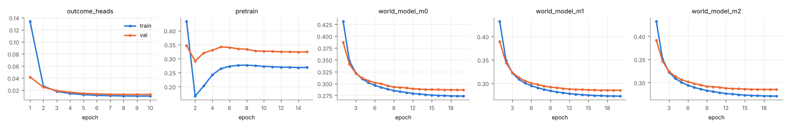
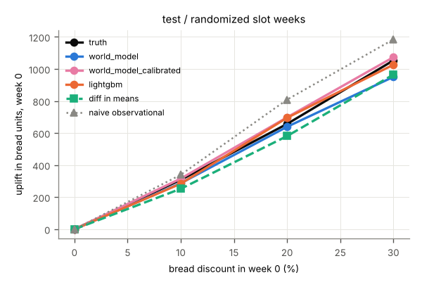
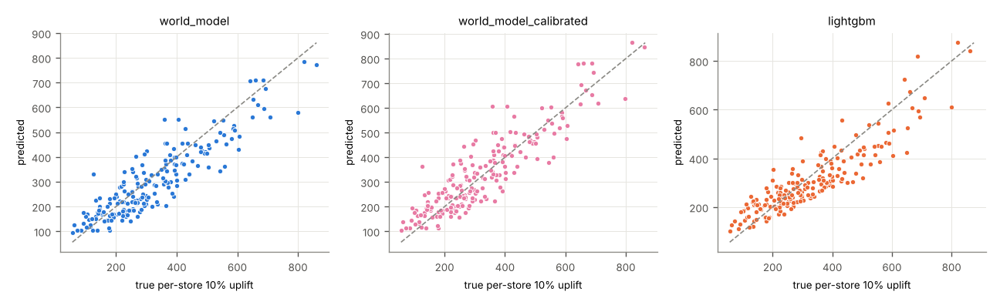
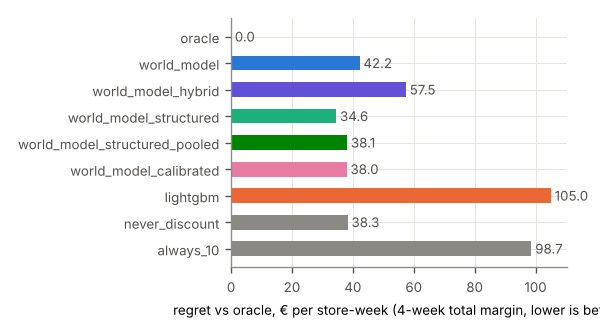
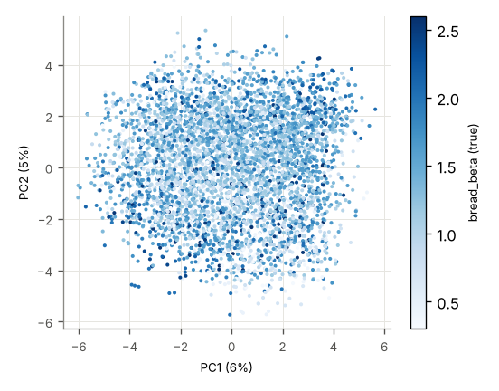

# Run report: poc_tiny_s1

encoder `jepa` · world model `transformer` × 3 · target_drops_price True · censoring `tobit` · seed 1 · stores 200 · runtime 10,938 s

## Headline (test, all stores)

Lowest planning regret: **structured (hybrid + experimental pull-forward)** (34.6 € per store-week). world model 42.2, hybrid (WM bread + experimental cross effects) 57.5, structured (hybrid + experimental pull-forward) 34.6, structured, pooled cross-category slope 38.1, calibrated (structured, pooled slope, bread effects calibrated) 38.0, LightGBM 105, never discount 38.3, always 10% 98.7.

| model | WAPE bread h1 | WAPE margin 4w | ATE bias 20% (randomized) | CATE Spearman | action sensitivity | planning regret € | oracle match |
|---|---|---|---|---|---|---|---|
| world_model | 0.098 | 0.079 | -17.754 | 0.875 | 0.915 | 42.215 | 0.643 |
| world_model_hybrid | 0.098 | 0.079 | -17.754 | 0.875 | 0.915 | 57.451 | 0.467 |
| world_model_structured | 0.098 | 0.079 | -17.754 | 0.875 | 0.915 | 34.552 | 0.658 |
| world_model_structured_pooled | 0.098 | 0.079 | -17.754 | 0.875 | 0.915 | 38.132 | 0.678 |
| world_model_calibrated | 0.098 | 0.079 | 41.435 | 0.875 | 1.033 | 37.983 | 0.679 |
| lightgbm | 0.080 | 0.077 | 38.495 | 0.889 | 0.938 | 105 | 0.517 |

## val

### val / all (4600 windows)

**Forecast** (WAPE of bread units per horizon step; 4-week total margin)

| model | h1 | h2 | h3 | h4 | margin WAPE | margin MAE € |
|---|---|---|---|---|---|---|
| world_model | 0.109 | 0.104 | 0.104 | 0.106 | 0.077 | 2,685 |
| world_model_hybrid | 0.109 | 0.104 | 0.104 | 0.106 | 0.077 | 2,685 |
| world_model_structured | 0.109 | 0.104 | 0.104 | 0.106 | 0.077 | 2,685 |
| world_model_structured_pooled | 0.109 | 0.104 | 0.104 | 0.106 | 0.077 | 2,685 |
| world_model_calibrated | 0.109 | 0.104 | 0.104 | 0.106 | 0.077 | 2,685 |
| lightgbm | 0.086 | 0.088 | 0.091 | 0.092 | 0.079 | 2,734 |
| world_model_heads_on_real_embeddings | 0.059 | 0.058 | 0.058 | 0.057 | – | – |

**Effect recovery** (bread units in week 0, action [d,0,0,0], vs ground-truth counterfactuals)

| level | true | world_model pred | world_model_hybrid pred | world_model_structured pred | world_model_structured_pooled pred | world_model_calibrated pred | lightgbm pred | world_model bias | world_model_hybrid bias | world_model_structured bias | world_model_structured_pooled bias | world_model_calibrated bias | lightgbm bias | world_model RMSE | world_model_hybrid RMSE | world_model_structured RMSE | world_model_structured_pooled RMSE | world_model_calibrated RMSE | lightgbm RMSE | diff in means | naive obs. | true Δ margin 4w | world_model Δ margin 4w | world_model_hybrid Δ margin 4w | world_model_structured Δ margin 4w | world_model_structured_pooled Δ margin 4w | world_model_calibrated Δ margin 4w | lightgbm Δ margin 4w |
|---|---|---|---|---|---|---|---|---|---|---|---|---|---|---|---|---|---|---|---|---|---|---|---|---|---|---|---|---|
| 10% | 316 | 296 | 296 | 296 | 296 | 326 | 312 | -19.557 | -19.557 | -19.557 | -19.557 | 10.115 | -3.552 | 102 | 102 | 102 | 102 | 104 | 125 | 135 | – | -57.903 | -229 | 57.842 | -50.556 | -171 | -169 | -96.088 |
| 20% | 676 | 675 | 675 | 675 | 675 | 738 | 713 | -1.476 | -1.476 | -1.476 | -1.476 | 61.037 | 36.235 | 210 | 210 | 210 | 210 | 222 | 228 | 645 | – | -215 | -657 | -204 | -233 | -418 | -448 | -91.671 |
| 30% | 1,085 | 1,038 | 1,038 | 1,038 | 1,038 | 1,172 | 1,006 | -46.454 | -46.454 | -46.454 | -46.454 | 87.482 | -79.188 | 342 | 342 | 342 | 342 | 347 | 339 | 926 | – | -498 | -994 | -822 | -792 | -769 | -823 | -198 |

**Margin effect split** (Δ 4-week margin vs 0 %, € per store-week: bread vs all other categories)

| level | model | bread pred | bread true | other pred | other true | total pred | total true |
|---|---|---|---|---|---|---|---|
| 10% | world_model | -137 | -223 | -92.743 | 165 | -229 | -57.903 |
| 10% | world_model_hybrid | -137 | -223 | 195 | 165 | 57.842 | -57.903 |
| 10% | world_model_structured | -245 | -223 | 195 | 165 | -50.556 | -57.903 |
| 10% | world_model_structured_pooled | -245 | -223 | 74.220 | 165 | -171 | -57.903 |
| 10% | world_model_calibrated | -243 | -223 | 74.220 | 165 | -169 | -57.903 |
| 20% | world_model | -537 | -553 | -120 | 338 | -657 | -215 |
| 20% | world_model_hybrid | -537 | -553 | 334 | 338 | -204 | -215 |
| 20% | world_model_structured | -567 | -553 | 334 | 338 | -233 | -215 |
| 20% | world_model_structured_pooled | -567 | -553 | 149 | 338 | -418 | -215 |
| 20% | world_model_calibrated | -596 | -553 | 149 | 338 | -448 | -215 |
| 30% | world_model | -1,021 | -1,017 | 27.171 | 519 | -994 | -498 |
| 30% | world_model_hybrid | -1,021 | -1,017 | 199 | 519 | -822 | -498 |
| 30% | world_model_structured | -992 | -1,017 | 199 | 519 | -792 | -498 |
| 30% | world_model_structured_pooled | -992 | -1,017 | 223 | 519 | -769 | -498 |
| 30% | world_model_calibrated | -1,046 | -1,017 | 223 | 519 | -823 | -498 |

**Heterogeneity and action sensitivity**

| model | Spearman vs true per-store uplift | Spearman vs bread_beta | sensitivity ratio | ignores action |
|---|---|---|---|---|
| world_model | 0.883 | 0.482 | 0.957 | no |
| world_model_hybrid | 0.883 | 0.482 | 0.957 | no |
| world_model_structured | 0.883 | 0.482 | 0.957 | no |
| world_model_structured_pooled | 0.883 | 0.482 | 0.957 | no |
| world_model_calibrated | 0.883 | 0.482 | 1.081 | no |
| lightgbm | 0.884 | 0.426 | 0.927 | no |
(true per-store uplift vs bread_beta: Spearman 0.722)

**Planning** (true 4-week total margin of the chosen level, € per store-week)

| policy | value € | regret € | oracle match | levels chosen |
|---|---|---|---|---|
| oracle | 34,848 | 0.000 | 1.000 |  |
| never discount | 34,810 | 37.661 | 0.668 |  |
| always 10% | 34,752 | 95.564 | 0.217 |  |
| world_model | 34,809 | 39.225 | 0.666 | 0% 97%, 10% 3%, 20% 0%, 30% 0% |
| world_model_hybrid | 34,797 | 51.251 | 0.537 | 0% 56%, 10% 41%, 20% 3%, 30% 0% |
| world_model_structured | 34,817 | 31.333 | 0.678 | 0% 87%, 10% 13%, 20% 0%, 30% 0% |
| world_model_structured_pooled | 34,810 | 37.527 | 0.668 | 0% 100%, 10% 0%, 20% 0%, 30% 0% |
| world_model_calibrated | 34,810 | 37.441 | 0.669 | 0% 100%, 10% 0%, 20% 0%, 30% 0% |
| lightgbm | 34,773 | 74.831 | 0.547 | 0% 76%, 10% 15%, 20% 4%, 30% 5% |
true best level shares: 0% 67%, 10% 22%, 20% 11%, 30% 1%

**Censoring** (WAPE bread h1)

| model | censored weeks | uncensored weeks | share censored |
|---|---|---|---|
| world_model | 0.115 | 0.108 | 0.189 |
| world_model_hybrid | 0.115 | 0.108 | 0.189 |
| world_model_structured | 0.115 | 0.108 | 0.189 |
| world_model_structured_pooled | 0.115 | 0.108 | 0.189 |
| world_model_calibrated | 0.115 | 0.108 | 0.189 |
| lightgbm | 0.086 | 0.086 | 0.189 |

### val / randomized (578 windows)

**Forecast** (WAPE of bread units per horizon step; 4-week total margin)

| model | h1 | h2 | h3 | h4 | margin WAPE | margin MAE € |
|---|---|---|---|---|---|---|
| world_model | 0.104 | 0.103 | 0.094 | 0.103 | 0.073 | 2,533 |
| world_model_hybrid | 0.104 | 0.103 | 0.094 | 0.103 | 0.073 | 2,533 |
| world_model_structured | 0.104 | 0.103 | 0.094 | 0.103 | 0.073 | 2,533 |
| world_model_structured_pooled | 0.104 | 0.103 | 0.094 | 0.103 | 0.073 | 2,533 |
| world_model_calibrated | 0.104 | 0.103 | 0.094 | 0.103 | 0.073 | 2,533 |
| lightgbm | 0.089 | 0.095 | 0.087 | 0.097 | 0.080 | 2,776 |
| world_model_heads_on_real_embeddings | 0.059 | 0.055 | 0.053 | 0.056 | – | – |

**Effect recovery** (bread units in week 0, action [d,0,0,0], vs ground-truth counterfactuals)

| level | true | world_model pred | world_model_hybrid pred | world_model_structured pred | world_model_structured_pooled pred | world_model_calibrated pred | lightgbm pred | world_model bias | world_model_hybrid bias | world_model_structured bias | world_model_structured_pooled bias | world_model_calibrated bias | lightgbm bias | world_model RMSE | world_model_hybrid RMSE | world_model_structured RMSE | world_model_structured_pooled RMSE | world_model_calibrated RMSE | lightgbm RMSE | diff in means | naive obs. | true Δ margin 4w | world_model Δ margin 4w | world_model_hybrid Δ margin 4w | world_model_structured Δ margin 4w | world_model_structured_pooled Δ margin 4w | world_model_calibrated Δ margin 4w | lightgbm Δ margin 4w |
|---|---|---|---|---|---|---|---|---|---|---|---|---|---|---|---|---|---|---|---|---|---|---|---|---|---|---|---|---|
| 10% | 303 | 279 | 279 | 279 | 279 | 307 | 282 | -23.347 | -23.347 | -23.347 | -23.347 | 4.650 | -20.618 | 93.394 | 93.394 | 93.394 | 93.394 | 91.910 | 93.277 | 135 | – | -73.699 | -278 | 19.783 | -60.212 | -180 | -179 | -109 |
| 20% | 649 | 642 | 642 | 642 | 642 | 702 | 683 | -6.434 | -6.434 | -6.434 | -6.434 | 53.053 | 33.998 | 192 | 192 | 192 | 192 | 199 | 174 | 645 | – | -243 | -745 | -266 | -249 | -433 | -465 | -98.215 |
| 30% | 1,039 | 989 | 989 | 989 | 989 | 1,117 | 977 | -50.109 | -50.109 | -50.109 | -50.109 | 77.471 | -62.322 | 323 | 323 | 323 | 323 | 320 | 273 | 926 | – | -532 | -1,098 | -883 | -805 | -781 | -837 | -196 |

**Margin effect split** (Δ 4-week margin vs 0 %, € per store-week: bread vs all other categories)

| level | model | bread pred | bread true | other pred | other true | total pred | total true |
|---|---|---|---|---|---|---|---|
| 10% | world_model | -173 | -231 | -104 | 158 | -278 | -73.699 |
| 10% | world_model_hybrid | -173 | -231 | 193 | 158 | 19.783 | -73.699 |
| 10% | world_model_structured | -253 | -231 | 193 | 158 | -60.212 | -73.699 |
| 10% | world_model_structured_pooled | -253 | -231 | 73.738 | 158 | -180 | -73.699 |
| 10% | world_model_calibrated | -252 | -231 | 73.738 | 158 | -179 | -73.699 |
| 20% | world_model | -597 | -566 | -148 | 323 | -745 | -243 |
| 20% | world_model_hybrid | -597 | -566 | 331 | 323 | -266 | -243 |
| 20% | world_model_structured | -580 | -566 | 331 | 323 | -249 | -243 |
| 20% | world_model_structured_pooled | -580 | -566 | 148 | 323 | -433 | -243 |
| 20% | world_model_calibrated | -612 | -566 | 148 | 323 | -465 | -243 |
| 30% | world_model | -1,081 | -1,029 | -17.077 | 497 | -1,098 | -532 |
| 30% | world_model_hybrid | -1,081 | -1,029 | 198 | 497 | -883 | -532 |
| 30% | world_model_structured | -1,003 | -1,029 | 198 | 497 | -805 | -532 |
| 30% | world_model_structured_pooled | -1,003 | -1,029 | 222 | 497 | -781 | -532 |
| 30% | world_model_calibrated | -1,059 | -1,029 | 222 | 497 | -837 | -532 |

**Heterogeneity and action sensitivity**

| model | Spearman vs true per-store uplift | Spearman vs bread_beta | sensitivity ratio | ignores action |
|---|---|---|---|---|
| world_model | 0.869 | 0.506 | 0.952 | no |
| world_model_hybrid | 0.869 | 0.506 | 0.952 | no |
| world_model_structured | 0.869 | 0.506 | 0.952 | no |
| world_model_structured_pooled | 0.869 | 0.506 | 0.952 | no |
| world_model_calibrated | 0.869 | 0.506 | 1.075 | no |
| lightgbm | 0.887 | 0.512 | 0.940 | no |
(true per-store uplift vs bread_beta: Spearman 0.739)

**Planning** (true 4-week total margin of the chosen level, € per store-week)

| policy | value € | regret € | oracle match | levels chosen |
|---|---|---|---|---|
| oracle | 34,856 | 0.000 | 1.000 |  |
| never discount | 34,828 | 27.554 | 0.758 |  |
| always 10% | 34,754 | 101 | 0.149 |  |
| world_model | 34,827 | 28.230 | 0.761 | 0% 99%, 10% 1%, 20% 0%, 30% 0% |
| world_model_hybrid | 34,817 | 38.749 | 0.626 | 0% 65%, 10% 35%, 20% 0%, 30% 0% |
| world_model_structured | 34,831 | 24.883 | 0.749 | 0% 86%, 10% 14%, 20% 0%, 30% 0% |
| world_model_structured_pooled | 34,828 | 27.554 | 0.758 | 0% 100%, 10% 0%, 20% 0%, 30% 0% |
| world_model_calibrated | 34,828 | 27.554 | 0.758 | 0% 100%, 10% 0%, 20% 0%, 30% 0% |
| lightgbm | 34,783 | 72.327 | 0.621 | 0% 77%, 10% 12%, 20% 5%, 30% 5% |
true best level shares: 0% 76%, 10% 15%, 20% 9%, 30% 0%

**Censoring** (WAPE bread h1)

| model | censored weeks | uncensored weeks | share censored |
|---|---|---|---|
| world_model | 0.123 | 0.097 | 0.227 |
| world_model_hybrid | 0.123 | 0.097 | 0.227 |
| world_model_structured | 0.123 | 0.097 | 0.227 |
| world_model_structured_pooled | 0.123 | 0.097 | 0.227 |
| world_model_calibrated | 0.123 | 0.097 | 0.227 |
| lightgbm | 0.098 | 0.086 | 0.227 |

### val / cold_start_stores (690 windows)

**Forecast** (WAPE of bread units per horizon step; 4-week total margin)

| model | h1 | h2 | h3 | h4 | margin WAPE | margin MAE € |
|---|---|---|---|---|---|---|
| world_model | 0.117 | 0.110 | 0.116 | 0.116 | 0.082 | 2,791 |
| world_model_hybrid | 0.117 | 0.110 | 0.116 | 0.116 | 0.082 | 2,791 |
| world_model_structured | 0.117 | 0.110 | 0.116 | 0.116 | 0.082 | 2,791 |
| world_model_structured_pooled | 0.117 | 0.110 | 0.116 | 0.116 | 0.082 | 2,791 |
| world_model_calibrated | 0.117 | 0.110 | 0.116 | 0.116 | 0.082 | 2,791 |
| lightgbm | 0.091 | 0.095 | 0.099 | 0.098 | 0.084 | 2,838 |
| world_model_heads_on_real_embeddings | 0.066 | 0.063 | 0.061 | 0.062 | – | – |

**Effect recovery** (bread units in week 0, action [d,0,0,0], vs ground-truth counterfactuals)

| level | true | world_model pred | world_model_hybrid pred | world_model_structured pred | world_model_structured_pooled pred | world_model_calibrated pred | lightgbm pred | world_model bias | world_model_hybrid bias | world_model_structured bias | world_model_structured_pooled bias | world_model_calibrated bias | lightgbm bias | world_model RMSE | world_model_hybrid RMSE | world_model_structured RMSE | world_model_structured_pooled RMSE | world_model_calibrated RMSE | lightgbm RMSE | diff in means | naive obs. | true Δ margin 4w | world_model Δ margin 4w | world_model_hybrid Δ margin 4w | world_model_structured Δ margin 4w | world_model_structured_pooled Δ margin 4w | world_model_calibrated Δ margin 4w | lightgbm Δ margin 4w |
|---|---|---|---|---|---|---|---|---|---|---|---|---|---|---|---|---|---|---|---|---|---|---|---|---|---|---|---|---|
| 10% | 282 | 281 | 281 | 281 | 281 | 309 | 294 | -1.099 | -1.099 | -1.099 | -1.099 | 27.057 | 11.871 | 97.528 | 97.528 | 97.528 | 97.528 | 105 | 128 | 122 | – | -94.959 | -268 | 51.120 | -44.671 | -166 | -164 | -85.755 |
| 20% | 603 | 640 | 640 | 640 | 640 | 699 | 669 | 36.588 | 36.588 | 36.588 | 36.588 | 95.847 | 65.962 | 216 | 216 | 216 | 216 | 238 | 255 | 510 | – | -279 | -714 | -202 | -219 | -405 | -435 | -82.999 |
| 30% | 966 | 977 | 977 | 977 | 977 | 1,103 | 935 | 10.821 | 10.821 | 10.821 | 10.821 | 137 | -31.274 | 347 | 347 | 347 | 347 | 372 | 377 | 809 | – | -575 | -1,037 | -799 | -765 | -741 | -793 | -192 |

**Margin effect split** (Δ 4-week margin vs 0 %, € per store-week: bread vs all other categories)

| level | model | bread pred | bread true | other pred | other true | total pred | total true |
|---|---|---|---|---|---|---|---|
| 10% | world_model | -145 | -226 | -123 | 131 | -268 | -94.959 |
| 10% | world_model_hybrid | -145 | -226 | 196 | 131 | 51.120 | -94.959 |
| 10% | world_model_structured | -241 | -226 | 196 | 131 | -44.671 | -94.959 |
| 10% | world_model_structured_pooled | -241 | -226 | 74.814 | 131 | -166 | -94.959 |
| 10% | world_model_calibrated | -239 | -226 | 74.814 | 131 | -164 | -94.959 |
| 20% | world_model | -538 | -550 | -176 | 271 | -714 | -279 |
| 20% | world_model_hybrid | -538 | -550 | 336 | 271 | -202 | -279 |
| 20% | world_model_structured | -555 | -550 | 336 | 271 | -219 | -279 |
| 20% | world_model_structured_pooled | -555 | -550 | 150 | 271 | -405 | -279 |
| 20% | world_model_calibrated | -585 | -550 | 150 | 271 | -435 | -279 |
| 30% | world_model | -1,000 | -994 | -36.643 | 419 | -1,037 | -575 |
| 30% | world_model_hybrid | -1,000 | -994 | 201 | 419 | -799 | -575 |
| 30% | world_model_structured | -966 | -994 | 201 | 419 | -765 | -575 |
| 30% | world_model_structured_pooled | -966 | -994 | 225 | 419 | -741 | -575 |
| 30% | world_model_calibrated | -1,018 | -994 | 225 | 419 | -793 | -575 |

**Heterogeneity and action sensitivity**

| model | Spearman vs true per-store uplift | Spearman vs bread_beta | sensitivity ratio | ignores action |
|---|---|---|---|---|
| world_model | 0.844 | 0.625 | 1.011 | no |
| world_model_hybrid | 0.844 | 0.625 | 1.011 | no |
| world_model_structured | 0.844 | 0.625 | 1.011 | no |
| world_model_structured_pooled | 0.844 | 0.625 | 1.011 | no |
| world_model_calibrated | 0.844 | 0.625 | 1.142 | no |
| lightgbm | 0.783 | 0.514 | 0.968 | no |
(true per-store uplift vs bread_beta: Spearman 0.875)

**Planning** (true 4-week total margin of the chosen level, € per store-week)

| policy | value € | regret € | oracle match | levels chosen |
|---|---|---|---|---|
| oracle | 34,205 | 0.000 | 1.000 |  |
| never discount | 34,184 | 20.474 | 0.745 |  |
| always 10% | 34,089 | 115 | 0.188 |  |
| world_model | 34,182 | 22.320 | 0.738 | 0% 98%, 10% 1%, 20% 0%, 30% 0% |
| world_model_hybrid | 34,152 | 53.153 | 0.543 | 0% 58%, 10% 39%, 20% 3%, 30% 0% |
| world_model_structured | 34,184 | 21.044 | 0.730 | 0% 87%, 10% 13%, 20% 0%, 30% 0% |
| world_model_structured_pooled | 34,184 | 20.474 | 0.745 | 0% 100%, 10% 0%, 20% 0%, 30% 0% |
| world_model_calibrated | 34,184 | 20.477 | 0.743 | 0% 100%, 10% 0%, 20% 0%, 30% 0% |
| lightgbm | 34,136 | 68.844 | 0.591 | 0% 77%, 10% 16%, 20% 3%, 30% 4% |
true best level shares: 0% 74%, 10% 19%, 20% 6%, 30% 0%

**Censoring** (WAPE bread h1)

| model | censored weeks | uncensored weeks | share censored |
|---|---|---|---|
| world_model | 0.120 | 0.116 | 0.174 |
| world_model_hybrid | 0.120 | 0.116 | 0.174 |
| world_model_structured | 0.120 | 0.116 | 0.174 |
| world_model_structured_pooled | 0.120 | 0.116 | 0.174 |
| world_model_calibrated | 0.120 | 0.116 | 0.174 |
| lightgbm | 0.087 | 0.092 | 0.174 |

### val / representation

Ridge probes on frozen z(t), out-of-fold R², folds grouped by store

| target | z(t) | calendar + store one-hot | calendar + static features |
|---|---|---|---|
| bread_beta | 0.611 | -0.005 | 0.542 |
| size_sqm | 0.958 | -0.005 | 1.000 |
| holiday | 0.786 | 1.000 | 1.000 |
| traffic_shock | 0.576 | -0.007 | -0.033 |

kNN (k=10) next-week bread units, WAPE: neighbours in z-space 0.211, neighbours on static features 0.224

## test

### test / all (4600 windows)

**Forecast** (WAPE of bread units per horizon step; 4-week total margin)

| model | h1 | h2 | h3 | h4 | margin WAPE | margin MAE € |
|---|---|---|---|---|---|---|
| world_model | 0.098 | 0.099 | 0.098 | 0.103 | 0.079 | 2,944 |
| world_model_hybrid | 0.098 | 0.099 | 0.098 | 0.103 | 0.079 | 2,944 |
| world_model_structured | 0.098 | 0.099 | 0.098 | 0.103 | 0.079 | 2,944 |
| world_model_structured_pooled | 0.098 | 0.099 | 0.098 | 0.103 | 0.079 | 2,944 |
| world_model_calibrated | 0.098 | 0.099 | 0.098 | 0.103 | 0.079 | 2,944 |
| lightgbm | 0.080 | 0.084 | 0.088 | 0.087 | 0.077 | 2,871 |
| world_model_heads_on_real_embeddings | 0.050 | 0.052 | 0.053 | 0.054 | – | – |

**Effect recovery** (bread units in week 0, action [d,0,0,0], vs ground-truth counterfactuals)

| level | true | world_model pred | world_model_hybrid pred | world_model_structured pred | world_model_structured_pooled pred | world_model_calibrated pred | lightgbm pred | world_model bias | world_model_hybrid bias | world_model_structured bias | world_model_structured_pooled bias | world_model_calibrated bias | lightgbm bias | world_model RMSE | world_model_hybrid RMSE | world_model_structured RMSE | world_model_structured_pooled RMSE | world_model_calibrated RMSE | lightgbm RMSE | diff in means | naive obs. | true Δ margin 4w | world_model Δ margin 4w | world_model_hybrid Δ margin 4w | world_model_structured Δ margin 4w | world_model_structured_pooled Δ margin 4w | world_model_calibrated Δ margin 4w | lightgbm Δ margin 4w |
|---|---|---|---|---|---|---|---|---|---|---|---|---|---|---|---|---|---|---|---|---|---|---|---|---|---|---|---|---|
| 10% | 322 | 302 | 302 | 302 | 302 | 332 | 306 | -20.408 | -20.408 | -20.408 | -20.408 | 9.869 | -16.466 | 99.436 | 99.436 | 99.436 | 99.436 | 102 | 103 | 252 | 340 | -60.351 | -72.606 | 83.012 | -32.575 | -165 | -162 | -74.221 |
| 20% | 690 | 675 | 675 | 675 | 675 | 738 | 716 | -14.876 | -14.876 | -14.876 | -14.876 | 47.650 | 25.708 | 202 | 202 | 202 | 202 | 212 | 194 | 581 | 809 | -227 | -465 | -199 | -218 | -422 | -450 | -87.573 |
| 30% | 1,105 | 1,012 | 1,012 | 1,012 | 1,012 | 1,142 | 1,037 | -93.680 | -93.680 | -93.680 | -93.680 | 36.818 | -68.765 | 337 | 337 | 337 | 337 | 323 | 311 | 965 | 1,184 | -523 | -808 | -878 | -816 | -790 | -843 | -163 |

**Margin effect split** (Δ 4-week margin vs 0 %, € per store-week: bread vs all other categories)

| level | model | bread pred | bread true | other pred | other true | total pred | total true |
|---|---|---|---|---|---|---|---|
| 10% | world_model | -132 | -237 | 58.937 | 177 | -72.606 | -60.351 |
| 10% | world_model_hybrid | -132 | -237 | 215 | 177 | 83.012 | -60.351 |
| 10% | world_model_structured | -247 | -237 | 215 | 177 | -32.575 | -60.351 |
| 10% | world_model_structured_pooled | -247 | -237 | 81.856 | 177 | -165 | -60.351 |
| 10% | world_model_calibrated | -244 | -237 | 81.856 | 177 | -162 | -60.351 |
| 20% | world_model | -567 | -588 | 102 | 361 | -465 | -227 |
| 20% | world_model_hybrid | -567 | -588 | 368 | 361 | -199 | -227 |
| 20% | world_model_structured | -586 | -588 | 368 | 361 | -218 | -227 |
| 20% | world_model_structured_pooled | -586 | -588 | 164 | 361 | -422 | -227 |
| 20% | world_model_calibrated | -613 | -588 | 164 | 361 | -450 | -227 |
| 30% | world_model | -1,098 | -1,078 | 290 | 555 | -808 | -523 |
| 30% | world_model_hybrid | -1,098 | -1,078 | 220 | 555 | -878 | -523 |
| 30% | world_model_structured | -1,036 | -1,078 | 220 | 555 | -816 | -523 |
| 30% | world_model_structured_pooled | -1,036 | -1,078 | 246 | 555 | -790 | -523 |
| 30% | world_model_calibrated | -1,089 | -1,078 | 246 | 555 | -843 | -523 |

**Heterogeneity and action sensitivity**

| model | Spearman vs true per-store uplift | Spearman vs bread_beta | sensitivity ratio | ignores action |
|---|---|---|---|---|
| world_model | 0.875 | 0.489 | 0.915 | no |
| world_model_hybrid | 0.875 | 0.489 | 0.915 | no |
| world_model_structured | 0.875 | 0.489 | 0.915 | no |
| world_model_structured_pooled | 0.875 | 0.489 | 0.915 | no |
| world_model_calibrated | 0.875 | 0.489 | 1.033 | no |
| lightgbm | 0.889 | 0.452 | 0.938 | no |
(true per-store uplift vs bread_beta: Spearman 0.723)

**Planning** (true 4-week total margin of the chosen level, € per store-week)

| policy | value € | regret € | oracle match | levels chosen |
|---|---|---|---|---|
| oracle | 37,245 | 0.000 | 1.000 |  |
| never discount | 37,207 | 38.324 | 0.678 |  |
| always 10% | 37,146 | 98.674 | 0.217 |  |
| world_model | 37,203 | 42.215 | 0.643 | 0% 88%, 10% 10%, 20% 1%, 30% 0% |
| world_model_hybrid | 37,188 | 57.451 | 0.467 | 0% 46%, 10% 53%, 20% 1%, 30% 0% |
| world_model_structured | 37,210 | 34.552 | 0.658 | 0% 80%, 10% 20%, 20% 0%, 30% 0% |
| world_model_structured_pooled | 37,207 | 38.132 | 0.678 | 0% 100%, 10% 0%, 20% 0%, 30% 0% |
| world_model_calibrated | 37,207 | 37.983 | 0.679 | 0% 100%, 10% 0%, 20% 0%, 30% 0% |
| lightgbm | 37,140 | 105 | 0.517 | 0% 66%, 10% 20%, 20% 1%, 30% 13% |
true best level shares: 0% 68%, 10% 22%, 20% 10%, 30% 1%

**Censoring** (WAPE bread h1)

| model | censored weeks | uncensored weeks | share censored |
|---|---|---|---|
| world_model | 0.101 | 0.098 | 0.193 |
| world_model_hybrid | 0.101 | 0.098 | 0.193 |
| world_model_structured | 0.101 | 0.098 | 0.193 |
| world_model_structured_pooled | 0.101 | 0.098 | 0.193 |
| world_model_calibrated | 0.101 | 0.098 | 0.193 |
| lightgbm | 0.078 | 0.081 | 0.193 |

### test / randomized (717 windows)

**Forecast** (WAPE of bread units per horizon step; 4-week total margin)

| model | h1 | h2 | h3 | h4 | margin WAPE | margin MAE € |
|---|---|---|---|---|---|---|
| world_model | 0.094 | 0.102 | 0.093 | 0.096 | 0.079 | 2,853 |
| world_model_hybrid | 0.094 | 0.102 | 0.093 | 0.096 | 0.079 | 2,853 |
| world_model_structured | 0.094 | 0.102 | 0.093 | 0.096 | 0.079 | 2,853 |
| world_model_structured_pooled | 0.094 | 0.102 | 0.093 | 0.096 | 0.079 | 2,853 |
| world_model_calibrated | 0.094 | 0.102 | 0.093 | 0.096 | 0.079 | 2,853 |
| lightgbm | 0.080 | 0.090 | 0.082 | 0.087 | 0.075 | 2,718 |
| world_model_heads_on_real_embeddings | 0.054 | 0.052 | 0.047 | 0.057 | – | – |

**Effect recovery** (bread units in week 0, action [d,0,0,0], vs ground-truth counterfactuals)

| level | true | world_model pred | world_model_hybrid pred | world_model_structured pred | world_model_structured_pooled pred | world_model_calibrated pred | lightgbm pred | world_model bias | world_model_hybrid bias | world_model_structured bias | world_model_structured_pooled bias | world_model_calibrated bias | lightgbm bias | world_model RMSE | world_model_hybrid RMSE | world_model_structured RMSE | world_model_structured_pooled RMSE | world_model_calibrated RMSE | lightgbm RMSE | diff in means | naive obs. | true Δ margin 4w | world_model Δ margin 4w | world_model_hybrid Δ margin 4w | world_model_structured Δ margin 4w | world_model_structured_pooled Δ margin 4w | world_model_calibrated Δ margin 4w | lightgbm Δ margin 4w |
|---|---|---|---|---|---|---|---|---|---|---|---|---|---|---|---|---|---|---|---|---|---|---|---|---|---|---|---|---|
| 10% | 308 | 287 | 287 | 287 | 287 | 316 | 284 | -21.049 | -21.049 | -21.049 | -21.049 | 7.729 | -23.921 | 84.619 | 84.619 | 84.619 | 84.619 | 86.291 | 91.502 | 252 | 340 | -79.780 | -80.972 | 56.051 | -40.694 | -171 | -168 | -91.675 |
| 20% | 657 | 639 | 639 | 639 | 639 | 698 | 695 | -17.754 | -17.754 | -17.754 | -17.754 | 41.435 | 38.495 | 169 | 169 | 169 | 169 | 176 | 163 | 581 | 809 | -264 | -473 | -238 | -233 | -434 | -463 | -106 |
| 30% | 1,053 | 951 | 951 | 951 | 951 | 1,073 | 1,026 | -102 | -102 | -102 | -102 | 20.164 | -26.685 | 295 | 295 | 295 | 295 | 268 | 244 | 965 | 1,184 | -569 | -801 | -901 | -823 | -797 | -851 | -171 |

**Margin effect split** (Δ 4-week margin vs 0 %, € per store-week: bread vs all other categories)

| level | model | bread pred | bread true | other pred | other true | total pred | total true |
|---|---|---|---|---|---|---|---|
| 10% | world_model | -155 | -245 | 73.603 | 165 | -80.972 | -79.780 |
| 10% | world_model_hybrid | -155 | -245 | 211 | 165 | 56.051 | -79.780 |
| 10% | world_model_structured | -251 | -245 | 211 | 165 | -40.694 | -79.780 |
| 10% | world_model_structured_pooled | -251 | -245 | 80.358 | 165 | -171 | -79.780 |
| 10% | world_model_calibrated | -249 | -245 | 80.358 | 165 | -168 | -79.780 |
| 20% | world_model | -600 | -602 | 126 | 339 | -473 | -264 |
| 20% | world_model_hybrid | -600 | -602 | 361 | 339 | -238 | -264 |
| 20% | world_model_structured | -595 | -602 | 361 | 339 | -233 | -264 |
| 20% | world_model_structured_pooled | -595 | -602 | 161 | 339 | -434 | -264 |
| 20% | world_model_calibrated | -623 | -602 | 161 | 339 | -463 | -264 |
| 30% | world_model | -1,117 | -1,090 | 317 | 521 | -801 | -569 |
| 30% | world_model_hybrid | -1,117 | -1,090 | 216 | 521 | -901 | -569 |
| 30% | world_model_structured | -1,038 | -1,090 | 216 | 521 | -823 | -569 |
| 30% | world_model_structured_pooled | -1,038 | -1,090 | 242 | 521 | -797 | -569 |
| 30% | world_model_calibrated | -1,093 | -1,090 | 242 | 521 | -851 | -569 |

**Heterogeneity and action sensitivity**

| model | Spearman vs true per-store uplift | Spearman vs bread_beta | sensitivity ratio | ignores action |
|---|---|---|---|---|
| world_model | 0.890 | 0.566 | 0.903 | no |
| world_model_hybrid | 0.890 | 0.566 | 0.903 | no |
| world_model_structured | 0.890 | 0.566 | 0.903 | no |
| world_model_structured_pooled | 0.890 | 0.566 | 0.903 | no |
| world_model_calibrated | 0.890 | 0.566 | 1.019 | no |
| lightgbm | 0.890 | 0.493 | 0.975 | no |
(true per-store uplift vs bread_beta: Spearman 0.735)

**Planning** (true 4-week total margin of the chosen level, € per store-week)

| policy | value € | regret € | oracle match | levels chosen |
|---|---|---|---|---|
| oracle | 36,287 | 0.000 | 1.000 |  |
| never discount | 36,257 | 29.338 | 0.764 |  |
| always 10% | 36,178 | 109 | 0.165 |  |
| world_model | 36,254 | 32.535 | 0.727 | 0% 91%, 10% 8%, 20% 0%, 30% 1% |
| world_model_hybrid | 36,235 | 51.155 | 0.533 | 0% 52%, 10% 48%, 20% 0%, 30% 0% |
| world_model_structured | 36,260 | 26.418 | 0.732 | 0% 81%, 10% 19%, 20% 0%, 30% 0% |
| world_model_structured_pooled | 36,257 | 29.321 | 0.763 | 0% 100%, 10% 0%, 20% 0%, 30% 0% |
| world_model_calibrated | 36,257 | 29.383 | 0.764 | 0% 99%, 10% 1%, 20% 0%, 30% 0% |
| lightgbm | 36,180 | 106 | 0.573 | 0% 68%, 10% 16%, 20% 1%, 30% 15% |
true best level shares: 0% 76%, 10% 16%, 20% 6%, 30% 1%

**Censoring** (WAPE bread h1)

| model | censored weeks | uncensored weeks | share censored |
|---|---|---|---|
| world_model | 0.098 | 0.092 | 0.252 |
| world_model_hybrid | 0.098 | 0.092 | 0.252 |
| world_model_structured | 0.098 | 0.092 | 0.252 |
| world_model_structured_pooled | 0.098 | 0.092 | 0.252 |
| world_model_calibrated | 0.098 | 0.092 | 0.252 |
| lightgbm | 0.076 | 0.082 | 0.252 |

### test / cold_start_stores (690 windows)

**Forecast** (WAPE of bread units per horizon step; 4-week total margin)

| model | h1 | h2 | h3 | h4 | margin WAPE | margin MAE € |
|---|---|---|---|---|---|---|
| world_model | 0.105 | 0.109 | 0.108 | 0.115 | 0.079 | 2,923 |
| world_model_hybrid | 0.105 | 0.109 | 0.108 | 0.115 | 0.079 | 2,923 |
| world_model_structured | 0.105 | 0.109 | 0.108 | 0.115 | 0.079 | 2,923 |
| world_model_structured_pooled | 0.105 | 0.109 | 0.108 | 0.115 | 0.079 | 2,923 |
| world_model_calibrated | 0.105 | 0.109 | 0.108 | 0.115 | 0.079 | 2,923 |
| lightgbm | 0.082 | 0.087 | 0.089 | 0.092 | 0.080 | 2,978 |
| world_model_heads_on_real_embeddings | 0.054 | 0.054 | 0.055 | 0.057 | – | – |

**Effect recovery** (bread units in week 0, action [d,0,0,0], vs ground-truth counterfactuals)

| level | true | world_model pred | world_model_hybrid pred | world_model_structured pred | world_model_structured_pooled pred | world_model_calibrated pred | lightgbm pred | world_model bias | world_model_hybrid bias | world_model_structured bias | world_model_structured_pooled bias | world_model_calibrated bias | lightgbm bias | world_model RMSE | world_model_hybrid RMSE | world_model_structured RMSE | world_model_structured_pooled RMSE | world_model_calibrated RMSE | lightgbm RMSE | diff in means | naive obs. | true Δ margin 4w | world_model Δ margin 4w | world_model_hybrid Δ margin 4w | world_model_structured Δ margin 4w | world_model_structured_pooled Δ margin 4w | world_model_calibrated Δ margin 4w | lightgbm Δ margin 4w |
|---|---|---|---|---|---|---|---|---|---|---|---|---|---|---|---|---|---|---|---|---|---|---|---|---|---|---|---|---|
| 10% | 288 | 277 | 277 | 277 | 277 | 304 | 290 | -11.381 | -11.381 | -11.381 | -11.381 | 16.362 | 2.147 | 95.105 | 95.105 | 95.105 | 95.105 | 99.422 | 104 | 115 | – | -96.661 | -144 | 58.858 | -31.635 | -164 | -162 | -68.350 |
| 20% | 614 | 617 | 617 | 617 | 617 | 674 | 672 | 3.131 | 3.131 | 3.131 | 3.131 | 60.253 | 58.495 | 199 | 199 | 199 | 199 | 211 | 229 | 309 | – | -294 | -575 | -219 | -210 | -415 | -443 | -82.143 |
| 30% | 979 | 919 | 919 | 919 | 919 | 1,038 | 961 | -59.599 | -59.599 | -59.599 | -59.599 | 58.991 | -18.063 | 338 | 338 | 338 | 338 | 332 | 351 | 774 | – | -610 | -913 | -867 | -787 | -761 | -813 | -162 |

**Margin effect split** (Δ 4-week margin vs 0 %, € per store-week: bread vs all other categories)

| level | model | bread pred | bread true | other pred | other true | total pred | total true |
|---|---|---|---|---|---|---|---|
| 10% | world_model | -156 | -240 | 12.084 | 144 | -144 | -96.661 |
| 10% | world_model_hybrid | -156 | -240 | 215 | 144 | 58.858 | -96.661 |
| 10% | world_model_structured | -246 | -240 | 215 | 144 | -31.635 | -96.661 |
| 10% | world_model_structured_pooled | -246 | -240 | 81.955 | 144 | -164 | -96.661 |
| 10% | world_model_calibrated | -244 | -240 | 81.955 | 144 | -162 | -96.661 |
| 20% | world_model | -587 | -589 | 12.696 | 296 | -575 | -294 |
| 20% | world_model_hybrid | -587 | -589 | 368 | 296 | -219 | -294 |
| 20% | world_model_structured | -579 | -589 | 368 | 296 | -210 | -294 |
| 20% | world_model_structured_pooled | -579 | -589 | 164 | 296 | -415 | -294 |
| 20% | world_model_calibrated | -607 | -589 | 164 | 296 | -443 | -294 |
| 30% | world_model | -1,088 | -1,067 | 175 | 457 | -913 | -610 |
| 30% | world_model_hybrid | -1,088 | -1,067 | 220 | 457 | -867 | -610 |
| 30% | world_model_structured | -1,008 | -1,067 | 220 | 457 | -787 | -610 |
| 30% | world_model_structured_pooled | -1,008 | -1,067 | 246 | 457 | -761 | -610 |
| 30% | world_model_calibrated | -1,059 | -1,067 | 246 | 457 | -813 | -610 |

**Heterogeneity and action sensitivity**

| model | Spearman vs true per-store uplift | Spearman vs bread_beta | sensitivity ratio | ignores action |
|---|---|---|---|---|
| world_model | 0.815 | 0.637 | 0.939 | no |
| world_model_hybrid | 0.815 | 0.637 | 0.939 | no |
| world_model_structured | 0.815 | 0.637 | 0.939 | no |
| world_model_structured_pooled | 0.815 | 0.637 | 0.939 | no |
| world_model_calibrated | 0.815 | 0.637 | 1.060 | no |
| lightgbm | 0.795 | 0.574 | 0.982 | no |
(true per-store uplift vs bread_beta: Spearman 0.900)

**Planning** (true 4-week total margin of the chosen level, € per store-week)

| policy | value € | regret € | oracle match | levels chosen |
|---|---|---|---|---|
| oracle | 37,239 | 0.000 | 1.000 |  |
| never discount | 37,215 | 24.664 | 0.749 |  |
| always 10% | 37,118 | 121 | 0.190 |  |
| world_model | 37,211 | 28.624 | 0.729 | 0% 94%, 10% 6%, 20% 1%, 30% 0% |
| world_model_hybrid | 37,185 | 54.035 | 0.522 | 0% 58%, 10% 41%, 20% 1%, 30% 0% |
| world_model_structured | 37,211 | 28.534 | 0.688 | 0% 79%, 10% 21%, 20% 0%, 30% 0% |
| world_model_structured_pooled | 37,215 | 24.755 | 0.746 | 0% 100%, 10% 0%, 20% 0%, 30% 0% |
| world_model_calibrated | 37,215 | 24.755 | 0.746 | 0% 100%, 10% 0%, 20% 0%, 30% 0% |
| lightgbm | 37,148 | 91.746 | 0.574 | 0% 68%, 10% 22%, 20% 1%, 30% 9% |
true best level shares: 0% 75%, 10% 19%, 20% 6%, 30% 0%

**Censoring** (WAPE bread h1)

| model | censored weeks | uncensored weeks | share censored |
|---|---|---|---|
| world_model | 0.107 | 0.104 | 0.186 |
| world_model_hybrid | 0.107 | 0.104 | 0.186 |
| world_model_structured | 0.107 | 0.104 | 0.186 |
| world_model_structured_pooled | 0.107 | 0.104 | 0.186 |
| world_model_calibrated | 0.107 | 0.104 | 0.186 |
| lightgbm | 0.079 | 0.083 | 0.186 |

### test / representation

Ridge probes on frozen z(t), out-of-fold R², folds grouped by store

| target | z(t) | calendar + store one-hot | calendar + static features |
|---|---|---|---|
| bread_beta | 0.584 | -0.005 | 0.542 |
| size_sqm | 0.966 | -0.005 | 1.000 |
| holiday | – | – | – |
| traffic_shock | 0.603 | -0.003 | -0.021 |

kNN (k=10) next-week bread units, WAPE: neighbours in z-space 0.167, neighbours on static features 0.187

## Plots

**Training curves**

**Uplift vs truth (test, randomized slot weeks)**

**Per-store 10% uplift, predicted vs true (test)**

**Planning regret (test, all)**

**Embedding PCA coloured by bread_beta (test)**

