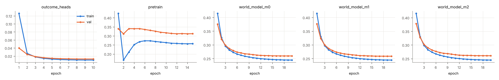
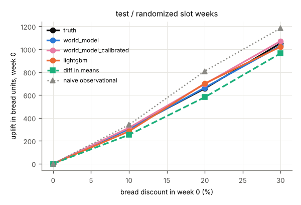
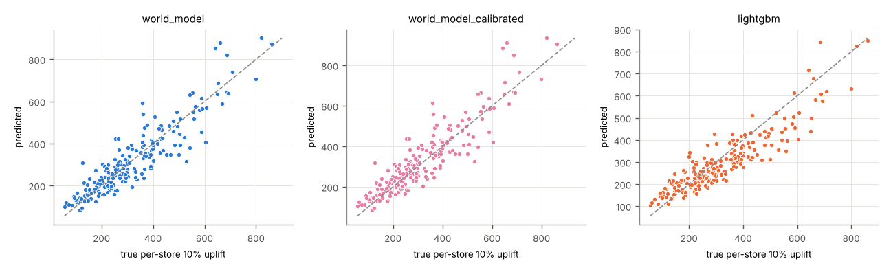
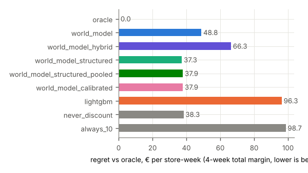
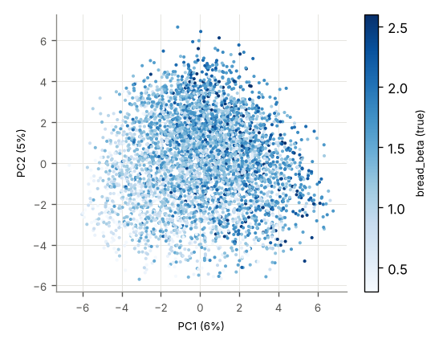

# Run report: poc_tiny_s2

encoder `jepa` · world model `transformer` × 3 · target_drops_price True · censoring `tobit` · seed 2 · stores 200 · runtime 10,843 s

## Headline (test, all stores)

Lowest planning regret: **structured (hybrid + experimental pull-forward)** (37.3 € per store-week). world model 48.8, hybrid (WM bread + experimental cross effects) 66.3, structured (hybrid + experimental pull-forward) 37.3, structured, pooled cross-category slope 37.9, calibrated (structured, pooled slope, bread effects calibrated) 37.9, LightGBM 96.3, never discount 38.3, always 10% 98.7.

| model | WAPE bread h1 | WAPE margin 4w | ATE bias 20% (randomized) | CATE Spearman | action sensitivity | planning regret € | oracle match |
|---|---|---|---|---|---|---|---|
| world_model | 0.098 | 0.077 | 7.170 | 0.897 | 1.016 | 48.848 | 0.646 |
| world_model_hybrid | 0.098 | 0.077 | 7.170 | 0.897 | 1.016 | 66.340 | 0.422 |
| world_model_structured | 0.098 | 0.077 | 7.170 | 0.897 | 1.016 | 37.339 | 0.640 |
| world_model_structured_pooled | 0.098 | 0.077 | 7.170 | 0.897 | 1.016 | 37.917 | 0.678 |
| world_model_calibrated | 0.098 | 0.077 | 39.174 | 0.897 | 1.055 | 37.916 | 0.679 |
| lightgbm | 0.080 | 0.078 | 44.074 | 0.890 | 0.940 | 96.318 | 0.528 |

## val

### val / all (4600 windows)

**Forecast** (WAPE of bread units per horizon step; 4-week total margin)

| model | h1 | h2 | h3 | h4 | margin WAPE | margin MAE € |
|---|---|---|---|---|---|---|
| world_model | 0.114 | 0.112 | 0.111 | 0.112 | 0.080 | 2,785 |
| world_model_hybrid | 0.114 | 0.112 | 0.111 | 0.112 | 0.080 | 2,785 |
| world_model_structured | 0.114 | 0.112 | 0.111 | 0.112 | 0.080 | 2,785 |
| world_model_structured_pooled | 0.114 | 0.112 | 0.111 | 0.112 | 0.080 | 2,785 |
| world_model_calibrated | 0.114 | 0.112 | 0.111 | 0.112 | 0.080 | 2,785 |
| lightgbm | 0.086 | 0.087 | 0.090 | 0.091 | 0.080 | 2,763 |
| world_model_heads_on_real_embeddings | 0.065 | 0.061 | 0.062 | 0.061 | – | – |

**Effect recovery** (bread units in week 0, action [d,0,0,0], vs ground-truth counterfactuals)

| level | true | world_model pred | world_model_hybrid pred | world_model_structured pred | world_model_structured_pooled pred | world_model_calibrated pred | lightgbm pred | world_model bias | world_model_hybrid bias | world_model_structured bias | world_model_structured_pooled bias | world_model_calibrated bias | lightgbm bias | world_model RMSE | world_model_hybrid RMSE | world_model_structured RMSE | world_model_structured_pooled RMSE | world_model_calibrated RMSE | lightgbm RMSE | diff in means | naive obs. | true Δ margin 4w | world_model Δ margin 4w | world_model_hybrid Δ margin 4w | world_model_structured Δ margin 4w | world_model_structured_pooled Δ margin 4w | world_model_calibrated Δ margin 4w | lightgbm Δ margin 4w |
|---|---|---|---|---|---|---|---|---|---|---|---|---|---|---|---|---|---|---|---|---|---|---|---|---|---|---|---|---|
| 10% | 316 | 329 | 329 | 329 | 329 | 342 | 303 | 13.689 | 13.689 | 13.689 | 13.689 | 26.023 | -12.117 | 106 | 106 | 106 | 106 | 111 | 120 | 135 | – | -57.903 | -81.845 | 160 | -40.036 | -162 | -174 | -75.650 |
| 20% | 676 | 747 | 747 | 747 | 747 | 783 | 733 | 70.741 | 70.741 | 70.741 | 70.741 | 107 | 56.573 | 230 | 230 | 230 | 230 | 252 | 248 | 645 | – | -215 | -403 | -63.879 | -249 | -436 | -469 | -73.786 |
| 30% | 1,085 | 1,195 | 1,195 | 1,195 | 1,195 | 1,242 | 1,015 | 110 | 110 | 110 | 110 | 157 | -69.638 | 368 | 368 | 368 | 368 | 395 | 341 | 926 | – | -498 | -757 | -759 | -867 | -843 | -871 | -155 |

**Margin effect split** (Δ 4-week margin vs 0 %, € per store-week: bread vs all other categories)

| level | model | bread pred | bread true | other pred | other true | total pred | total true |
|---|---|---|---|---|---|---|---|
| 10% | world_model | -36.640 | -223 | -45.205 | 165 | -81.845 | -57.903 |
| 10% | world_model_hybrid | -36.640 | -223 | 197 | 165 | 160 | -57.903 |
| 10% | world_model_structured | -237 | -223 | 197 | 165 | -40.036 | -57.903 |
| 10% | world_model_structured_pooled | -237 | -223 | 75.038 | 165 | -162 | -57.903 |
| 10% | world_model_calibrated | -249 | -223 | 75.038 | 165 | -174 | -57.903 |
| 20% | world_model | -401 | -553 | -1.896 | 338 | -403 | -215 |
| 20% | world_model_hybrid | -401 | -553 | 337 | 338 | -63.879 | -215 |
| 20% | world_model_structured | -586 | -553 | 337 | 338 | -249 | -215 |
| 20% | world_model_structured_pooled | -586 | -553 | 150 | 338 | -436 | -215 |
| 20% | world_model_calibrated | -619 | -553 | 150 | 338 | -469 | -215 |
| 30% | world_model | -961 | -1,017 | 204 | 519 | -757 | -498 |
| 30% | world_model_hybrid | -961 | -1,017 | 202 | 519 | -759 | -498 |
| 30% | world_model_structured | -1,069 | -1,017 | 202 | 519 | -867 | -498 |
| 30% | world_model_structured_pooled | -1,069 | -1,017 | 226 | 519 | -843 | -498 |
| 30% | world_model_calibrated | -1,097 | -1,017 | 226 | 519 | -871 | -498 |

**Heterogeneity and action sensitivity**

| model | Spearman vs true per-store uplift | Spearman vs bread_beta | sensitivity ratio | ignores action |
|---|---|---|---|---|
| world_model | 0.903 | 0.573 | 1.102 | no |
| world_model_hybrid | 0.903 | 0.573 | 1.102 | no |
| world_model_structured | 0.903 | 0.573 | 1.102 | no |
| world_model_structured_pooled | 0.903 | 0.573 | 1.102 | no |
| world_model_calibrated | 0.903 | 0.573 | 1.145 | no |
| lightgbm | 0.895 | 0.473 | 0.936 | no |
(true per-store uplift vs bread_beta: Spearman 0.722)

**Planning** (true 4-week total margin of the chosen level, € per store-week)

| policy | value € | regret € | oracle match | levels chosen |
|---|---|---|---|---|
| oracle | 34,848 | 0.000 | 1.000 |  |
| never discount | 34,810 | 37.661 | 0.668 |  |
| always 10% | 34,752 | 95.564 | 0.217 |  |
| world_model | 34,801 | 46.484 | 0.631 | 0% 87%, 10% 10%, 20% 2%, 30% 1% |
| world_model_hybrid | 34,777 | 70.430 | 0.410 | 0% 32%, 10% 62%, 20% 6%, 30% 0% |
| world_model_structured | 34,814 | 34.062 | 0.662 | 0% 83%, 10% 17%, 20% 0%, 30% 0% |
| world_model_structured_pooled | 34,811 | 36.610 | 0.669 | 0% 99%, 10% 1%, 20% 0%, 30% 0% |
| world_model_calibrated | 34,811 | 36.552 | 0.670 | 0% 99%, 10% 1%, 20% 0%, 30% 0% |
| lightgbm | 34,760 | 87.732 | 0.538 | 0% 74%, 10% 12%, 20% 9%, 30% 5% |
true best level shares: 0% 67%, 10% 22%, 20% 11%, 30% 1%

**Censoring** (WAPE bread h1)

| model | censored weeks | uncensored weeks | share censored |
|---|---|---|---|
| world_model | 0.102 | 0.117 | 0.189 |
| world_model_hybrid | 0.102 | 0.117 | 0.189 |
| world_model_structured | 0.102 | 0.117 | 0.189 |
| world_model_structured_pooled | 0.102 | 0.117 | 0.189 |
| world_model_calibrated | 0.102 | 0.117 | 0.189 |
| lightgbm | 0.087 | 0.086 | 0.189 |

### val / randomized (578 windows)

**Forecast** (WAPE of bread units per horizon step; 4-week total margin)

| model | h1 | h2 | h3 | h4 | margin WAPE | margin MAE € |
|---|---|---|---|---|---|---|
| world_model | 0.097 | 0.111 | 0.099 | 0.110 | 0.077 | 2,653 |
| world_model_hybrid | 0.097 | 0.111 | 0.099 | 0.110 | 0.077 | 2,653 |
| world_model_structured | 0.097 | 0.111 | 0.099 | 0.110 | 0.077 | 2,653 |
| world_model_structured_pooled | 0.097 | 0.111 | 0.099 | 0.110 | 0.077 | 2,653 |
| world_model_calibrated | 0.097 | 0.111 | 0.099 | 0.110 | 0.077 | 2,653 |
| lightgbm | 0.089 | 0.094 | 0.086 | 0.095 | 0.081 | 2,801 |
| world_model_heads_on_real_embeddings | 0.064 | 0.060 | 0.060 | 0.064 | – | – |

**Effect recovery** (bread units in week 0, action [d,0,0,0], vs ground-truth counterfactuals)

| level | true | world_model pred | world_model_hybrid pred | world_model_structured pred | world_model_structured_pooled pred | world_model_calibrated pred | lightgbm pred | world_model bias | world_model_hybrid bias | world_model_structured bias | world_model_structured_pooled bias | world_model_calibrated bias | lightgbm bias | world_model RMSE | world_model_hybrid RMSE | world_model_structured RMSE | world_model_structured_pooled RMSE | world_model_calibrated RMSE | lightgbm RMSE | diff in means | naive obs. | true Δ margin 4w | world_model Δ margin 4w | world_model_hybrid Δ margin 4w | world_model_structured Δ margin 4w | world_model_structured_pooled Δ margin 4w | world_model_calibrated Δ margin 4w | lightgbm Δ margin 4w |
|---|---|---|---|---|---|---|---|---|---|---|---|---|---|---|---|---|---|---|---|---|---|---|---|---|---|---|---|---|
| 10% | 303 | 307 | 307 | 307 | 307 | 318 | 279 | 4.165 | 4.165 | 4.165 | 4.165 | 15.659 | -23.183 | 93.916 | 93.916 | 93.916 | 93.916 | 98.055 | 92.825 | 135 | – | -73.699 | -154 | 108 | -48.497 | -168 | -182 | -73.227 |
| 20% | 649 | 685 | 685 | 685 | 685 | 718 | 692 | 36.153 | 36.153 | 36.153 | 36.153 | 69.164 | 42.777 | 186 | 186 | 186 | 186 | 202 | 173 | 645 | – | -243 | -515 | -139 | -259 | -443 | -477 | -67.640 |
| 30% | 1,039 | 1,082 | 1,082 | 1,082 | 1,082 | 1,124 | 983 | 42.389 | 42.389 | 42.389 | 42.389 | 84.526 | -56.276 | 283 | 283 | 283 | 283 | 300 | 271 | 926 | – | -532 | -857 | -804 | -856 | -832 | -860 | -161 |

**Margin effect split** (Δ 4-week margin vs 0 %, € per store-week: bread vs all other categories)

| level | model | bread pred | bread true | other pred | other true | total pred | total true |
|---|---|---|---|---|---|---|---|
| 10% | world_model | -85.927 | -231 | -67.581 | 158 | -154 | -73.699 |
| 10% | world_model_hybrid | -85.927 | -231 | 194 | 158 | 108 | -73.699 |
| 10% | world_model_structured | -242 | -231 | 194 | 158 | -48.497 | -73.699 |
| 10% | world_model_structured_pooled | -242 | -231 | 73.897 | 158 | -168 | -73.699 |
| 10% | world_model_calibrated | -256 | -231 | 73.897 | 158 | -182 | -73.699 |
| 20% | world_model | -471 | -566 | -43.141 | 323 | -515 | -243 |
| 20% | world_model_hybrid | -471 | -566 | 332 | 323 | -139 | -243 |
| 20% | world_model_structured | -591 | -566 | 332 | 323 | -259 | -243 |
| 20% | world_model_structured_pooled | -591 | -566 | 148 | 323 | -443 | -243 |
| 20% | world_model_calibrated | -625 | -566 | 148 | 323 | -477 | -243 |
| 30% | world_model | -1,003 | -1,029 | 146 | 497 | -857 | -532 |
| 30% | world_model_hybrid | -1,003 | -1,029 | 199 | 497 | -804 | -532 |
| 30% | world_model_structured | -1,054 | -1,029 | 199 | 497 | -856 | -532 |
| 30% | world_model_structured_pooled | -1,054 | -1,029 | 222 | 497 | -832 | -532 |
| 30% | world_model_calibrated | -1,082 | -1,029 | 222 | 497 | -860 | -532 |

**Heterogeneity and action sensitivity**

| model | Spearman vs true per-store uplift | Spearman vs bread_beta | sensitivity ratio | ignores action |
|---|---|---|---|---|
| world_model | 0.882 | 0.613 | 1.041 | no |
| world_model_hybrid | 0.882 | 0.613 | 1.041 | no |
| world_model_structured | 0.882 | 0.613 | 1.041 | no |
| world_model_structured_pooled | 0.882 | 0.613 | 1.041 | no |
| world_model_calibrated | 0.882 | 0.613 | 1.081 | no |
| lightgbm | 0.888 | 0.558 | 0.946 | no |
(true per-store uplift vs bread_beta: Spearman 0.739)

**Planning** (true 4-week total margin of the chosen level, € per store-week)

| policy | value € | regret € | oracle match | levels chosen |
|---|---|---|---|---|
| oracle | 34,856 | 0.000 | 1.000 |  |
| never discount | 34,828 | 27.554 | 0.758 |  |
| always 10% | 34,754 | 101 | 0.149 |  |
| world_model | 34,815 | 40.256 | 0.713 | 0% 92%, 10% 7%, 20% 0%, 30% 1% |
| world_model_hybrid | 34,799 | 57.053 | 0.455 | 0% 39%, 10% 60%, 20% 1%, 30% 0% |
| world_model_structured | 34,830 | 26.014 | 0.735 | 0% 86%, 10% 14%, 20% 0%, 30% 0% |
| world_model_structured_pooled | 34,828 | 27.554 | 0.758 | 0% 100%, 10% 0%, 20% 0%, 30% 0% |
| world_model_calibrated | 34,828 | 27.554 | 0.758 | 0% 100%, 10% 0%, 20% 0%, 30% 0% |
| lightgbm | 34,774 | 81.837 | 0.580 | 0% 74%, 10% 13%, 20% 10%, 30% 3% |
true best level shares: 0% 76%, 10% 15%, 20% 9%, 30% 0%

**Censoring** (WAPE bread h1)

| model | censored weeks | uncensored weeks | share censored |
|---|---|---|---|
| world_model | 0.101 | 0.096 | 0.227 |
| world_model_hybrid | 0.101 | 0.096 | 0.227 |
| world_model_structured | 0.101 | 0.096 | 0.227 |
| world_model_structured_pooled | 0.101 | 0.096 | 0.227 |
| world_model_calibrated | 0.101 | 0.096 | 0.227 |
| lightgbm | 0.098 | 0.085 | 0.227 |

### val / cold_start_stores (690 windows)

**Forecast** (WAPE of bread units per horizon step; 4-week total margin)

| model | h1 | h2 | h3 | h4 | margin WAPE | margin MAE € |
|---|---|---|---|---|---|---|
| world_model | 0.129 | 0.119 | 0.118 | 0.121 | 0.090 | 3,057 |
| world_model_hybrid | 0.129 | 0.119 | 0.118 | 0.121 | 0.090 | 3,057 |
| world_model_structured | 0.129 | 0.119 | 0.118 | 0.121 | 0.090 | 3,057 |
| world_model_structured_pooled | 0.129 | 0.119 | 0.118 | 0.121 | 0.090 | 3,057 |
| world_model_calibrated | 0.129 | 0.119 | 0.118 | 0.121 | 0.090 | 3,057 |
| lightgbm | 0.089 | 0.094 | 0.097 | 0.100 | 0.086 | 2,916 |
| world_model_heads_on_real_embeddings | 0.073 | 0.065 | 0.065 | 0.068 | – | – |

**Effect recovery** (bread units in week 0, action [d,0,0,0], vs ground-truth counterfactuals)

| level | true | world_model pred | world_model_hybrid pred | world_model_structured pred | world_model_structured_pooled pred | world_model_calibrated pred | lightgbm pred | world_model bias | world_model_hybrid bias | world_model_structured bias | world_model_structured_pooled bias | world_model_calibrated bias | lightgbm bias | world_model RMSE | world_model_hybrid RMSE | world_model_structured RMSE | world_model_structured_pooled RMSE | world_model_calibrated RMSE | lightgbm RMSE | diff in means | naive obs. | true Δ margin 4w | world_model Δ margin 4w | world_model_hybrid Δ margin 4w | world_model_structured Δ margin 4w | world_model_structured_pooled Δ margin 4w | world_model_calibrated Δ margin 4w | lightgbm Δ margin 4w |
|---|---|---|---|---|---|---|---|---|---|---|---|---|---|---|---|---|---|---|---|---|---|---|---|---|---|---|---|---|
| 10% | 282 | 307 | 307 | 307 | 307 | 319 | 288 | 25.064 | 25.064 | 25.064 | 25.064 | 36.566 | 5.591 | 107 | 107 | 107 | 107 | 115 | 125 | 122 | – | -94.959 | -84.589 | 155 | -37.401 | -158 | -171 | -68.048 |
| 20% | 603 | 692 | 692 | 692 | 692 | 725 | 693 | 88.429 | 88.429 | 88.429 | 88.429 | 122 | 89.276 | 234 | 234 | 234 | 234 | 261 | 276 | 510 | – | -279 | -390 | -49.709 | -239 | -425 | -458 | -59.771 |
| 30% | 966 | 1,088 | 1,088 | 1,088 | 1,088 | 1,131 | 948 | 122 | 122 | 122 | 122 | 165 | -18.030 | 367 | 367 | 367 | 367 | 398 | 382 | 809 | – | -575 | -677 | -704 | -837 | -813 | -841 | -139 |

**Margin effect split** (Δ 4-week margin vs 0 %, € per store-week: bread vs all other categories)

| level | model | bread pred | bread true | other pred | other true | total pred | total true |
|---|---|---|---|---|---|---|---|
| 10% | world_model | -40.124 | -226 | -44.465 | 131 | -84.589 | -94.959 |
| 10% | world_model_hybrid | -40.124 | -226 | 196 | 131 | 155 | -94.959 |
| 10% | world_model_structured | -233 | -226 | 196 | 131 | -37.401 | -94.959 |
| 10% | world_model_structured_pooled | -233 | -226 | 74.621 | 131 | -158 | -94.959 |
| 10% | world_model_calibrated | -246 | -226 | 74.621 | 131 | -171 | -94.959 |
| 20% | world_model | -385 | -550 | -4.411 | 271 | -390 | -279 |
| 20% | world_model_hybrid | -385 | -550 | 335 | 271 | -49.709 | -279 |
| 20% | world_model_structured | -575 | -550 | 335 | 271 | -239 | -279 |
| 20% | world_model_structured_pooled | -575 | -550 | 149 | 271 | -425 | -279 |
| 20% | world_model_calibrated | -608 | -550 | 149 | 271 | -458 | -279 |
| 30% | world_model | -904 | -994 | 227 | 419 | -677 | -575 |
| 30% | world_model_hybrid | -904 | -994 | 201 | 419 | -704 | -575 |
| 30% | world_model_structured | -1,038 | -994 | 201 | 419 | -837 | -575 |
| 30% | world_model_structured_pooled | -1,038 | -994 | 224 | 419 | -813 | -575 |
| 30% | world_model_calibrated | -1,065 | -994 | 224 | 419 | -841 | -575 |

**Heterogeneity and action sensitivity**

| model | Spearman vs true per-store uplift | Spearman vs bread_beta | sensitivity ratio | ignores action |
|---|---|---|---|---|
| world_model | 0.886 | 0.738 | 1.126 | no |
| world_model_hybrid | 0.886 | 0.738 | 1.126 | no |
| world_model_structured | 0.886 | 0.738 | 1.126 | no |
| world_model_structured_pooled | 0.886 | 0.738 | 1.126 | no |
| world_model_calibrated | 0.886 | 0.738 | 1.170 | no |
| lightgbm | 0.788 | 0.531 | 0.981 | no |
(true per-store uplift vs bread_beta: Spearman 0.875)

**Planning** (true 4-week total margin of the chosen level, € per store-week)

| policy | value € | regret € | oracle match | levels chosen |
|---|---|---|---|---|
| oracle | 34,205 | 0.000 | 1.000 |  |
| never discount | 34,184 | 20.474 | 0.745 |  |
| always 10% | 34,089 | 115 | 0.188 |  |
| world_model | 34,162 | 42.646 | 0.697 | 0% 87%, 10% 9%, 20% 2%, 30% 2% |
| world_model_hybrid | 34,129 | 76.053 | 0.439 | 0% 36%, 10% 58%, 20% 6%, 30% 0% |
| world_model_structured | 34,179 | 25.510 | 0.719 | 0% 79%, 10% 20%, 20% 0%, 30% 0% |
| world_model_structured_pooled | 34,185 | 19.205 | 0.749 | 0% 98%, 10% 2%, 20% 0%, 30% 0% |
| world_model_calibrated | 34,186 | 19.147 | 0.751 | 0% 98%, 10% 2%, 20% 0%, 30% 0% |
| lightgbm | 34,107 | 97.368 | 0.567 | 0% 71%, 10% 11%, 20% 14%, 30% 4% |
true best level shares: 0% 74%, 10% 19%, 20% 6%, 30% 0%

**Censoring** (WAPE bread h1)

| model | censored weeks | uncensored weeks | share censored |
|---|---|---|---|
| world_model | 0.109 | 0.134 | 0.174 |
| world_model_hybrid | 0.109 | 0.134 | 0.174 |
| world_model_structured | 0.109 | 0.134 | 0.174 |
| world_model_structured_pooled | 0.109 | 0.134 | 0.174 |
| world_model_calibrated | 0.109 | 0.134 | 0.174 |
| lightgbm | 0.087 | 0.090 | 0.174 |

### val / representation

Ridge probes on frozen z(t), out-of-fold R², folds grouped by store

| target | z(t) | calendar + store one-hot | calendar + static features |
|---|---|---|---|
| bread_beta | 0.636 | -0.005 | 0.542 |
| size_sqm | 0.936 | -0.005 | 1.000 |
| holiday | 0.785 | 1.000 | 1.000 |
| traffic_shock | 0.595 | -0.007 | -0.033 |

kNN (k=10) next-week bread units, WAPE: neighbours in z-space 0.215, neighbours on static features 0.224

## test

### test / all (4600 windows)

**Forecast** (WAPE of bread units per horizon step; 4-week total margin)

| model | h1 | h2 | h3 | h4 | margin WAPE | margin MAE € |
|---|---|---|---|---|---|---|
| world_model | 0.098 | 0.098 | 0.098 | 0.106 | 0.077 | 2,860 |
| world_model_hybrid | 0.098 | 0.098 | 0.098 | 0.106 | 0.077 | 2,860 |
| world_model_structured | 0.098 | 0.098 | 0.098 | 0.106 | 0.077 | 2,860 |
| world_model_structured_pooled | 0.098 | 0.098 | 0.098 | 0.106 | 0.077 | 2,860 |
| world_model_calibrated | 0.098 | 0.098 | 0.098 | 0.106 | 0.077 | 2,860 |
| lightgbm | 0.080 | 0.084 | 0.088 | 0.087 | 0.078 | 2,878 |
| world_model_heads_on_real_embeddings | 0.055 | 0.053 | 0.057 | 0.058 | – | – |

**Effect recovery** (bread units in week 0, action [d,0,0,0], vs ground-truth counterfactuals)

| level | true | world_model pred | world_model_hybrid pred | world_model_structured pred | world_model_structured_pooled pred | world_model_calibrated pred | lightgbm pred | world_model bias | world_model_hybrid bias | world_model_structured bias | world_model_structured_pooled bias | world_model_calibrated bias | lightgbm bias | world_model RMSE | world_model_hybrid RMSE | world_model_structured RMSE | world_model_structured_pooled RMSE | world_model_calibrated RMSE | lightgbm RMSE | diff in means | naive obs. | true Δ margin 4w | world_model Δ margin 4w | world_model_hybrid Δ margin 4w | world_model_structured Δ margin 4w | world_model_structured_pooled Δ margin 4w | world_model_calibrated Δ margin 4w | lightgbm Δ margin 4w |
|---|---|---|---|---|---|---|---|---|---|---|---|---|---|---|---|---|---|---|---|---|---|---|---|---|---|---|---|---|
| 10% | 322 | 325 | 325 | 325 | 325 | 337 | 302 | 2.097 | 2.097 | 2.097 | 2.097 | 14.256 | -20.487 | 98.064 | 98.064 | 98.064 | 98.064 | 102 | 101 | 252 | 340 | -60.351 | -138 | 150 | -24.650 | -157 | -167 | -83.743 |
| 20% | 690 | 717 | 717 | 717 | 717 | 751 | 727 | 26.804 | 26.804 | 26.804 | 26.804 | 61.353 | 36.964 | 208 | 208 | 208 | 208 | 222 | 205 | 581 | 809 | -227 | -489 | -122 | -231 | -434 | -464 | -88.980 |
| 30% | 1,105 | 1,123 | 1,123 | 1,123 | 1,123 | 1,166 | 1,039 | 17.268 | 17.268 | 17.268 | 17.268 | 61.004 | -66.131 | 334 | 334 | 334 | 334 | 348 | 315 | 965 | 1,184 | -523 | -778 | -872 | -869 | -843 | -870 | -158 |

**Margin effect split** (Δ 4-week margin vs 0 %, € per store-week: bread vs all other categories)

| level | model | bread pred | bread true | other pred | other true | total pred | total true |
|---|---|---|---|---|---|---|---|
| 10% | world_model | -63.929 | -237 | -73.722 | 177 | -138 | -60.351 |
| 10% | world_model_hybrid | -63.929 | -237 | 214 | 177 | 150 | -60.351 |
| 10% | world_model_structured | -238 | -237 | 214 | 177 | -24.650 | -60.351 |
| 10% | world_model_structured_pooled | -238 | -237 | 81.489 | 177 | -157 | -60.351 |
| 10% | world_model_calibrated | -249 | -237 | 81.489 | 177 | -167 | -60.351 |
| 20% | world_model | -488 | -588 | -0.604 | 361 | -489 | -227 |
| 20% | world_model_hybrid | -488 | -588 | 366 | 361 | -122 | -227 |
| 20% | world_model_structured | -598 | -588 | 366 | 361 | -231 | -227 |
| 20% | world_model_structured_pooled | -598 | -588 | 163 | 361 | -434 | -227 |
| 20% | world_model_calibrated | -628 | -588 | 163 | 361 | -464 | -227 |
| 30% | world_model | -1,091 | -1,078 | 313 | 555 | -778 | -523 |
| 30% | world_model_hybrid | -1,091 | -1,078 | 219 | 555 | -872 | -523 |
| 30% | world_model_structured | -1,088 | -1,078 | 219 | 555 | -869 | -523 |
| 30% | world_model_structured_pooled | -1,088 | -1,078 | 245 | 555 | -843 | -523 |
| 30% | world_model_calibrated | -1,115 | -1,078 | 245 | 555 | -870 | -523 |

**Heterogeneity and action sensitivity**

| model | Spearman vs true per-store uplift | Spearman vs bread_beta | sensitivity ratio | ignores action |
|---|---|---|---|---|
| world_model | 0.897 | 0.568 | 1.016 | no |
| world_model_hybrid | 0.897 | 0.568 | 1.016 | no |
| world_model_structured | 0.897 | 0.568 | 1.016 | no |
| world_model_structured_pooled | 0.897 | 0.568 | 1.016 | no |
| world_model_calibrated | 0.897 | 0.568 | 1.055 | no |
| lightgbm | 0.890 | 0.470 | 0.940 | no |
(true per-store uplift vs bread_beta: Spearman 0.723)

**Planning** (true 4-week total margin of the chosen level, € per store-week)

| policy | value € | regret € | oracle match | levels chosen |
|---|---|---|---|---|
| oracle | 37,245 | 0.000 | 1.000 |  |
| never discount | 37,207 | 38.324 | 0.678 |  |
| always 10% | 37,146 | 98.674 | 0.217 |  |
| world_model | 37,196 | 48.848 | 0.646 | 0% 89%, 10% 7%, 20% 2%, 30% 2% |
| world_model_hybrid | 37,179 | 66.340 | 0.422 | 0% 34%, 10% 63%, 20% 2%, 30% 0% |
| world_model_structured | 37,208 | 37.339 | 0.640 | 0% 79%, 10% 21%, 20% 0%, 30% 0% |
| world_model_structured_pooled | 37,207 | 37.917 | 0.678 | 0% 99%, 10% 1%, 20% 0%, 30% 0% |
| world_model_calibrated | 37,207 | 37.916 | 0.679 | 0% 99%, 10% 1%, 20% 0%, 30% 0% |
| lightgbm | 37,149 | 96.318 | 0.528 | 0% 71%, 10% 13%, 20% 7%, 30% 9% |
true best level shares: 0% 68%, 10% 22%, 20% 10%, 30% 1%

**Censoring** (WAPE bread h1)

| model | censored weeks | uncensored weeks | share censored |
|---|---|---|---|
| world_model | 0.092 | 0.100 | 0.193 |
| world_model_hybrid | 0.092 | 0.100 | 0.193 |
| world_model_structured | 0.092 | 0.100 | 0.193 |
| world_model_structured_pooled | 0.092 | 0.100 | 0.193 |
| world_model_calibrated | 0.092 | 0.100 | 0.193 |
| lightgbm | 0.079 | 0.081 | 0.193 |

### test / randomized (717 windows)

**Forecast** (WAPE of bread units per horizon step; 4-week total margin)

| model | h1 | h2 | h3 | h4 | margin WAPE | margin MAE € |
|---|---|---|---|---|---|---|
| world_model | 0.093 | 0.109 | 0.092 | 0.100 | 0.077 | 2,794 |
| world_model_hybrid | 0.093 | 0.109 | 0.092 | 0.100 | 0.077 | 2,794 |
| world_model_structured | 0.093 | 0.109 | 0.092 | 0.100 | 0.077 | 2,794 |
| world_model_structured_pooled | 0.093 | 0.109 | 0.092 | 0.100 | 0.077 | 2,794 |
| world_model_calibrated | 0.093 | 0.109 | 0.092 | 0.100 | 0.077 | 2,794 |
| lightgbm | 0.082 | 0.090 | 0.082 | 0.087 | 0.077 | 2,773 |
| world_model_heads_on_real_embeddings | 0.056 | 0.049 | 0.049 | 0.060 | – | – |

**Effect recovery** (bread units in week 0, action [d,0,0,0], vs ground-truth counterfactuals)

| level | true | world_model pred | world_model_hybrid pred | world_model_structured pred | world_model_structured_pooled pred | world_model_calibrated pred | lightgbm pred | world_model bias | world_model_hybrid bias | world_model_structured bias | world_model_structured_pooled bias | world_model_calibrated bias | lightgbm bias | world_model RMSE | world_model_hybrid RMSE | world_model_structured RMSE | world_model_structured_pooled RMSE | world_model_calibrated RMSE | lightgbm RMSE | diff in means | naive obs. | true Δ margin 4w | world_model Δ margin 4w | world_model_hybrid Δ margin 4w | world_model_structured Δ margin 4w | world_model_structured_pooled Δ margin 4w | world_model_calibrated Δ margin 4w | lightgbm Δ margin 4w |
|---|---|---|---|---|---|---|---|---|---|---|---|---|---|---|---|---|---|---|---|---|---|---|---|---|---|---|---|---|
| 10% | 308 | 303 | 303 | 303 | 303 | 314 | 283 | -5.310 | -5.310 | -5.310 | -5.310 | 6.034 | -24.742 | 83.536 | 83.536 | 83.536 | 83.536 | 85.668 | 89.123 | 252 | 340 | -79.780 | -176 | 113 | -35.564 | -164 | -176 | -88.406 |
| 20% | 657 | 664 | 664 | 664 | 664 | 696 | 701 | 7.170 | 7.170 | 7.170 | 7.170 | 39.174 | 44.074 | 175 | 175 | 175 | 175 | 185 | 170 | 581 | 809 | -264 | -548 | -177 | -249 | -447 | -479 | -98.773 |
| 30% | 1,053 | 1,031 | 1,031 | 1,031 | 1,031 | 1,071 | 1,022 | -21.756 | -21.756 | -21.756 | -21.756 | 18.422 | -30.482 | 272 | 272 | 272 | 272 | 279 | 250 | 965 | 1,184 | -569 | -832 | -910 | -872 | -847 | -874 | -174 |

**Margin effect split** (Δ 4-week margin vs 0 %, € per store-week: bread vs all other categories)

| level | model | bread pred | bread true | other pred | other true | total pred | total true |
|---|---|---|---|---|---|---|---|
| 10% | world_model | -94.705 | -245 | -81.586 | 165 | -176 | -79.780 |
| 10% | world_model_hybrid | -94.705 | -245 | 208 | 165 | 113 | -79.780 |
| 10% | world_model_structured | -244 | -245 | 208 | 165 | -35.564 | -79.780 |
| 10% | world_model_structured_pooled | -244 | -245 | 79.415 | 165 | -164 | -79.780 |
| 10% | world_model_calibrated | -255 | -245 | 79.415 | 165 | -176 | -79.780 |
| 20% | world_model | -534 | -602 | -13.111 | 339 | -548 | -264 |
| 20% | world_model_hybrid | -534 | -602 | 357 | 339 | -177 | -264 |
| 20% | world_model_structured | -606 | -602 | 357 | 339 | -249 | -264 |
| 20% | world_model_structured_pooled | -606 | -602 | 159 | 339 | -447 | -264 |
| 20% | world_model_calibrated | -638 | -602 | 159 | 339 | -479 | -264 |
| 30% | world_model | -1,124 | -1,090 | 292 | 521 | -832 | -569 |
| 30% | world_model_hybrid | -1,124 | -1,090 | 213 | 521 | -910 | -569 |
| 30% | world_model_structured | -1,085 | -1,090 | 213 | 521 | -872 | -569 |
| 30% | world_model_structured_pooled | -1,085 | -1,090 | 239 | 521 | -847 | -569 |
| 30% | world_model_calibrated | -1,113 | -1,090 | 239 | 521 | -874 | -569 |

**Heterogeneity and action sensitivity**

| model | Spearman vs true per-store uplift | Spearman vs bread_beta | sensitivity ratio | ignores action |
|---|---|---|---|---|
| world_model | 0.902 | 0.621 | 0.979 | no |
| world_model_hybrid | 0.902 | 0.621 | 0.979 | no |
| world_model_structured | 0.902 | 0.621 | 0.979 | no |
| world_model_structured_pooled | 0.902 | 0.621 | 0.979 | no |
| world_model_calibrated | 0.902 | 0.621 | 1.017 | no |
| lightgbm | 0.907 | 0.557 | 0.971 | no |
(true per-store uplift vs bread_beta: Spearman 0.735)

**Planning** (true 4-week total margin of the chosen level, € per store-week)

| policy | value € | regret € | oracle match | levels chosen |
|---|---|---|---|---|
| oracle | 36,287 | 0.000 | 1.000 |  |
| never discount | 36,257 | 29.338 | 0.764 |  |
| always 10% | 36,178 | 109 | 0.165 |  |
| world_model | 36,253 | 34.040 | 0.745 | 0% 93%, 10% 5%, 20% 0%, 30% 1% |
| world_model_hybrid | 36,224 | 62.155 | 0.452 | 0% 38%, 10% 62%, 20% 0%, 30% 0% |
| world_model_structured | 36,258 | 28.865 | 0.728 | 0% 83%, 10% 17%, 20% 0%, 30% 0% |
| world_model_structured_pooled | 36,257 | 29.338 | 0.764 | 0% 100%, 10% 0%, 20% 0%, 30% 0% |
| world_model_calibrated | 36,257 | 29.338 | 0.764 | 0% 100%, 10% 0%, 20% 0%, 30% 0% |
| lightgbm | 36,201 | 85.636 | 0.615 | 0% 75%, 10% 11%, 20% 5%, 30% 9% |
true best level shares: 0% 76%, 10% 16%, 20% 6%, 30% 1%

**Censoring** (WAPE bread h1)

| model | censored weeks | uncensored weeks | share censored |
|---|---|---|---|
| world_model | 0.087 | 0.096 | 0.252 |
| world_model_hybrid | 0.087 | 0.096 | 0.252 |
| world_model_structured | 0.087 | 0.096 | 0.252 |
| world_model_structured_pooled | 0.087 | 0.096 | 0.252 |
| world_model_calibrated | 0.087 | 0.096 | 0.252 |
| lightgbm | 0.076 | 0.085 | 0.252 |

### test / cold_start_stores (690 windows)

**Forecast** (WAPE of bread units per horizon step; 4-week total margin)

| model | h1 | h2 | h3 | h4 | margin WAPE | margin MAE € |
|---|---|---|---|---|---|---|
| world_model | 0.103 | 0.102 | 0.105 | 0.118 | 0.079 | 2,941 |
| world_model_hybrid | 0.103 | 0.102 | 0.105 | 0.118 | 0.079 | 2,941 |
| world_model_structured | 0.103 | 0.102 | 0.105 | 0.118 | 0.079 | 2,941 |
| world_model_structured_pooled | 0.103 | 0.102 | 0.105 | 0.118 | 0.079 | 2,941 |
| world_model_calibrated | 0.103 | 0.102 | 0.105 | 0.118 | 0.079 | 2,941 |
| lightgbm | 0.082 | 0.087 | 0.089 | 0.093 | 0.079 | 2,913 |
| world_model_heads_on_real_embeddings | 0.061 | 0.056 | 0.063 | 0.065 | – | – |

**Effect recovery** (bread units in week 0, action [d,0,0,0], vs ground-truth counterfactuals)

| level | true | world_model pred | world_model_hybrid pred | world_model_structured pred | world_model_structured_pooled pred | world_model_calibrated pred | lightgbm pred | world_model bias | world_model_hybrid bias | world_model_structured bias | world_model_structured_pooled bias | world_model_calibrated bias | lightgbm bias | world_model RMSE | world_model_hybrid RMSE | world_model_structured RMSE | world_model_structured_pooled RMSE | world_model_calibrated RMSE | lightgbm RMSE | diff in means | naive obs. | true Δ margin 4w | world_model Δ margin 4w | world_model_hybrid Δ margin 4w | world_model_structured Δ margin 4w | world_model_structured_pooled Δ margin 4w | world_model_calibrated Δ margin 4w | lightgbm Δ margin 4w |
|---|---|---|---|---|---|---|---|---|---|---|---|---|---|---|---|---|---|---|---|---|---|---|---|---|---|---|---|---|
| 10% | 288 | 300 | 300 | 300 | 300 | 312 | 283 | 12.302 | 12.302 | 12.302 | 12.302 | 23.557 | -5.083 | 93.901 | 93.901 | 93.901 | 93.901 | 99.374 | 105 | 115 | – | -96.661 | -145 | 143 | -18.994 | -151 | -162 | -78.418 |
| 20% | 614 | 662 | 662 | 662 | 662 | 694 | 682 | 48.639 | 48.639 | 48.639 | 48.639 | 80.560 | 67.821 | 202 | 202 | 202 | 202 | 222 | 234 | 309 | – | -294 | -484 | -108 | -215 | -418 | -448 | -82.453 |
| 30% | 979 | 1,031 | 1,031 | 1,031 | 1,031 | 1,071 | 964 | 52.077 | 52.077 | 52.077 | 52.077 | 92.245 | -14.985 | 328 | 328 | 328 | 328 | 350 | 354 | 774 | – | -610 | -687 | -803 | -829 | -803 | -829 | -151 |

**Margin effect split** (Δ 4-week margin vs 0 %, € per store-week: bread vs all other categories)

| level | model | bread pred | bread true | other pred | other true | total pred | total true |
|---|---|---|---|---|---|---|---|
| 10% | world_model | -70.922 | -240 | -74.525 | 144 | -145 | -96.661 |
| 10% | world_model_hybrid | -70.922 | -240 | 214 | 144 | 143 | -96.661 |
| 10% | world_model_structured | -233 | -240 | 214 | 144 | -18.994 | -96.661 |
| 10% | world_model_structured_pooled | -233 | -240 | 81.475 | 144 | -151 | -96.661 |
| 10% | world_model_calibrated | -243 | -240 | 81.475 | 144 | -162 | -96.661 |
| 20% | world_model | -474 | -589 | -9.900 | 296 | -484 | -294 |
| 20% | world_model_hybrid | -474 | -589 | 366 | 296 | -108 | -294 |
| 20% | world_model_structured | -581 | -589 | 366 | 296 | -215 | -294 |
| 20% | world_model_structured_pooled | -581 | -589 | 163 | 296 | -418 | -294 |
| 20% | world_model_calibrated | -611 | -589 | 163 | 296 | -448 | -294 |
| 30% | world_model | -1,022 | -1,067 | 335 | 457 | -687 | -610 |
| 30% | world_model_hybrid | -1,022 | -1,067 | 219 | 457 | -803 | -610 |
| 30% | world_model_structured | -1,048 | -1,067 | 219 | 457 | -829 | -610 |
| 30% | world_model_structured_pooled | -1,048 | -1,067 | 245 | 457 | -803 | -610 |
| 30% | world_model_calibrated | -1,074 | -1,067 | 245 | 457 | -829 | -610 |

**Heterogeneity and action sensitivity**

| model | Spearman vs true per-store uplift | Spearman vs bread_beta | sensitivity ratio | ignores action |
|---|---|---|---|---|
| world_model | 0.882 | 0.729 | 1.053 | no |
| world_model_hybrid | 0.882 | 0.729 | 1.053 | no |
| world_model_structured | 0.882 | 0.729 | 1.053 | no |
| world_model_structured_pooled | 0.882 | 0.729 | 1.053 | no |
| world_model_calibrated | 0.882 | 0.729 | 1.094 | no |
| lightgbm | 0.802 | 0.592 | 0.985 | no |
(true per-store uplift vs bread_beta: Spearman 0.900)

**Planning** (true 4-week total margin of the chosen level, € per store-week)

| policy | value € | regret € | oracle match | levels chosen |
|---|---|---|---|---|
| oracle | 37,239 | 0.000 | 1.000 |  |
| never discount | 37,215 | 24.664 | 0.749 |  |
| always 10% | 37,118 | 121 | 0.190 |  |
| world_model | 37,187 | 52.788 | 0.684 | 0% 87%, 10% 8%, 20% 1%, 30% 4% |
| world_model_hybrid | 37,166 | 73.216 | 0.439 | 0% 38%, 10% 60%, 20% 2%, 30% 0% |
| world_model_structured | 37,207 | 32.754 | 0.659 | 0% 74%, 10% 25%, 20% 0%, 30% 0% |
| world_model_structured_pooled | 37,216 | 23.540 | 0.748 | 0% 99%, 10% 1%, 20% 0%, 30% 0% |
| world_model_calibrated | 37,216 | 23.540 | 0.748 | 0% 99%, 10% 1%, 20% 0%, 30% 0% |
| lightgbm | 37,142 | 97.427 | 0.562 | 0% 70%, 10% 14%, 20% 9%, 30% 7% |
true best level shares: 0% 75%, 10% 19%, 20% 6%, 30% 0%

**Censoring** (WAPE bread h1)

| model | censored weeks | uncensored weeks | share censored |
|---|---|---|---|
| world_model | 0.102 | 0.103 | 0.186 |
| world_model_hybrid | 0.102 | 0.103 | 0.186 |
| world_model_structured | 0.102 | 0.103 | 0.186 |
| world_model_structured_pooled | 0.102 | 0.103 | 0.186 |
| world_model_calibrated | 0.102 | 0.103 | 0.186 |
| lightgbm | 0.081 | 0.082 | 0.186 |

### test / representation

Ridge probes on frozen z(t), out-of-fold R², folds grouped by store

| target | z(t) | calendar + store one-hot | calendar + static features |
|---|---|---|---|
| bread_beta | 0.596 | -0.005 | 0.542 |
| size_sqm | 0.942 | -0.005 | 1.000 |
| holiday | – | – | – |
| traffic_shock | 0.649 | -0.003 | -0.021 |

kNN (k=10) next-week bread units, WAPE: neighbours in z-space 0.168, neighbours on static features 0.187

## Plots

**Training curves**

**Uplift vs truth (test, randomized slot weeks)**

**Per-store 10% uplift, predicted vs true (test)**

**Planning regret (test, all)**

**Embedding PCA coloured by bread_beta (test)**

